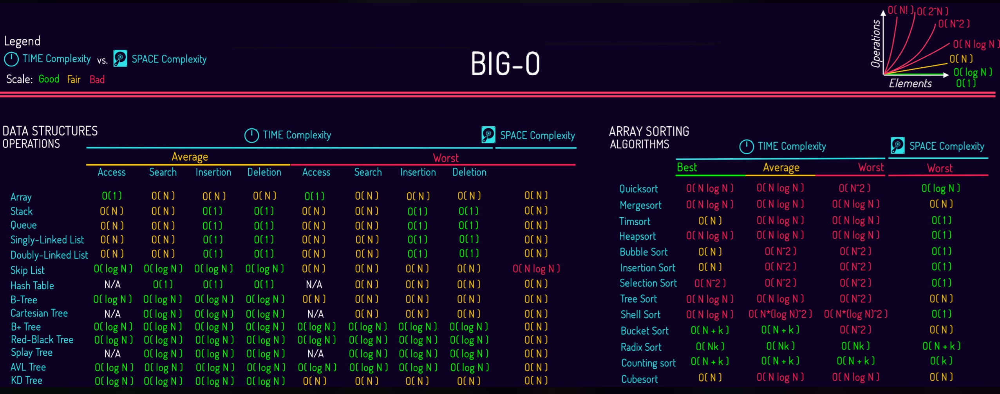
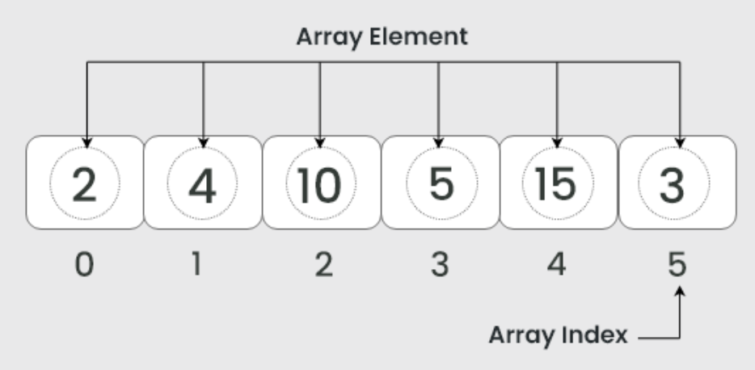
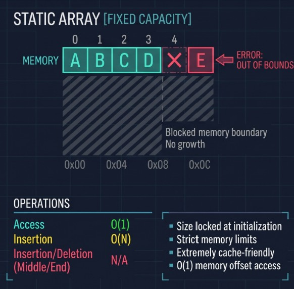
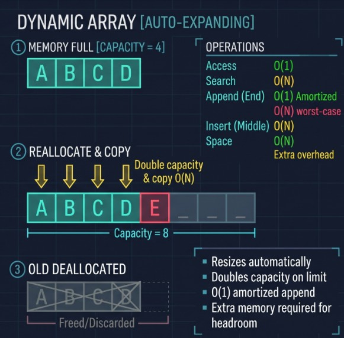
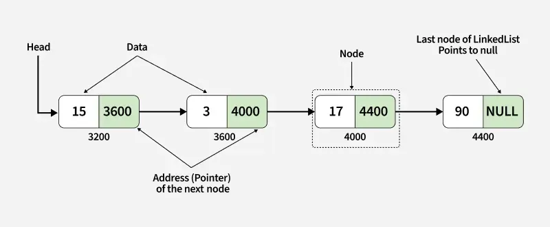
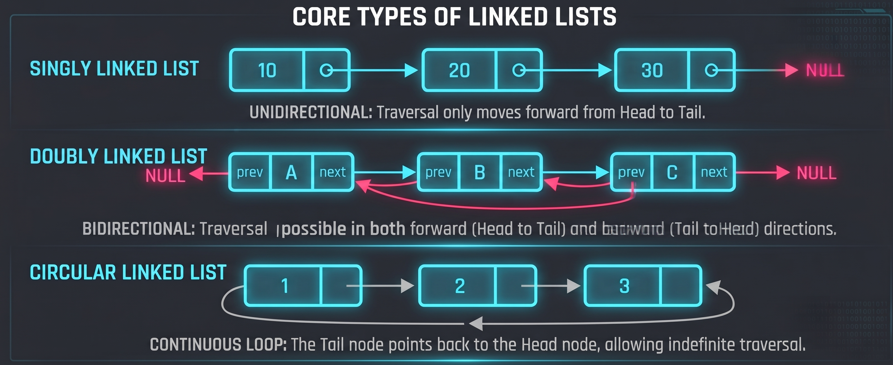
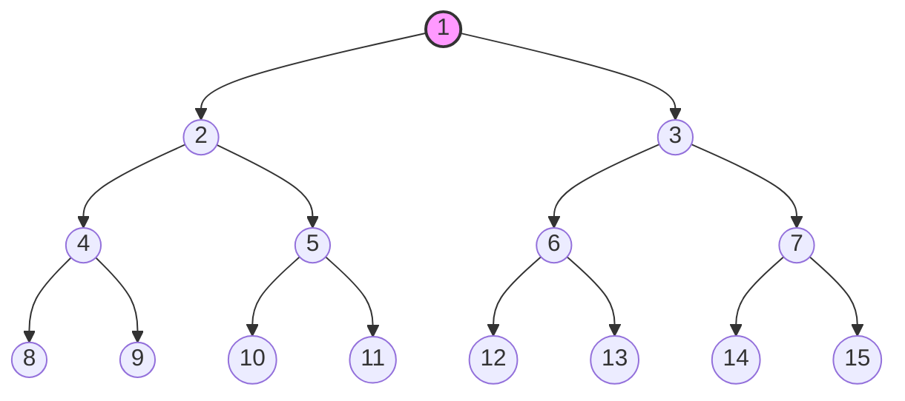

# Development Status:

* Most developed markdown content has been created, except a few exceptions, notably 2.7, 2.8, and a few others.
* Most developed content has illustrations and needed explanation. More detailed explanations, examples, and mini-exercises still need to be added.

# Module Structure:
| No. | Topic Name |
| --- | --- |
| **1**	| **Data Structures & Algorithms** |
| 1.1 | Foundations |
| 1.2	| Correctness and Complexity |
| 1.3	| Arrays & Dynamic Arrays |
| 1.4	| Linked Lists |
| 1.5	| Stacks & Queues |
| 1.6	| Recursion & Divide-and-Conquer |
| 1.7	| Hash Tables |
| 1.8	| Trees, Binary Search Trees, and Tries |
| 1.9	| Heaps & Priority  |
| 1.10 | Algorithm Design Paradigms |
| 1.11 | Graphs |
| 1.12 | Specialized Structures |
| **2** | **Connectionist AI** |
| 2.1	| Foundations |
| 2.2	| The Artificial Neuron |
| 2.3	| Neural Network  |
| 2.4	| How Neural Networks Learn |
| 2.5	| Evaluating Learning |
| 2.6	| Major Neural Network Types |
| 2.7	| Practical Implementation |
| 2.8 | Applications, Limitations, and Responsible AI |

---

# 1.1 Foundations of Algorithms and Data Structures

## 1. Core Concepts

### What is an Algorithm?
An **algorithm** is a step-by-step computational procedure designed to transform a given set of inputs into a predictable outputs. It acts as a systematic tool for solving specific computational problems by detailing the exact operations a computer must perform.

Key characteristics of an algorithm include:
* **Input:** Zero or more defined values or datasets provided to the algorithm.
* **Output:** One or more results corresponding to the calculated inputs.
* **Definiteness:** Every step must be clear, unambiguous, and precisely specified.
* **Finiteness:** The procedure must terminate after a finite number of steps for all valid inputs to avoid endless loop.
* **Effectiveness:** Each operation must be basic, practical, and feasible enough to be executed using available resources.  
* **Generality:** It should be able to solve an entire class of problems with varied inputs, rather than just one specific case.  
* **Language Independence:** An algorithm is a conceptual plan; it is independent of any specific programming language and can be written in pseudocode, flowcharts, or plain prose.

## 2. Formal Problem Statements and Problem Instances

To analyze an algorithm mathematically, a computational problem must be formally stated in terms of its required input and desired output properties.

### Example: The Sorting Problem
* **Input:** A sequence of $n$ numbers represented as:
  $$\langle a_1, a_2, \dots, a_n \rangle$$

* **Output:** A reordering (permutation) of the input sequence such that the elements satisfy the ordering relationship:
  $$a'_1 \le a'_2 \le \dots \le a'_n$$

### Instance of a Problem
A **problem instance** refers to a specific set of input data that satisfies all constraints defined by the problem statement.
* **Example Input Instance:** $$\langle 31, 41, 59, 26, 41, 58 \rangle$$
* **Expected Output Instance:** $$\langle 26, 31, 41, 41, 58, 59 \rangle$$

## 3. Algorithm Correctness and Efficiency

### Correctness
An algorithm is considered **correct** if, for every valid input instance, it eventually halts and produces the exact specified output. 
* **Incorrect Algorithms:** Algorithms that either fail to terminate (enter an infinite loop) or halt with an invalid result.
* **Controlled Error Rates:** In specific specialized domains (such as probabilistic primality testing or randomized search), algorithms with small, mathematically bounded error rates can still be practical and useful.

### Efficiency
Algorithm efficiency measures how well an algorithm utilizes computational resources—primarily time and memory—as the scale of the problem increases. An algorithm must be efficient enough to execute within acceptable time and resource limits.   When selecting or analyzing an algorithm, efficiency is governed by several core factors such as input size ($n$) and the volume of data being processed. As $n$ grows, the execution time or memory footprint changes according to the algorithm's growth rate.   There is also initial structures which also affect the extent to which the data is already organized or formatted prior to processing. For example, sorting an already sorted array takes far fewer operations than sorting a completely randomized array. 

### Selecting the Right Algorithm
Choosing the optimal algorithm for a given task depends on several trade-offs:
1. **Input Size:** The volume of data ($n$) being processed.
2. **Initial Structure:** The extent to which the data is already organized or partially sorted.
3. **Hardware Constraints:** Available main memory (RAM), storage bandwidth, and CPU architecture.

## 4. What is a Data Structure?

A **data structure** is a specialized format for organizing, managing, and storing data in memory so that specific operations—such as access, insertion, deletion, and searching—can be executed efficiently.

## 5. Modern Computing and Parallelism

Historically, performance improvements relied on increasing single-core processor clock speeds. Due to physical power and thermal limitations, modern processor architectures rely heavily on **multi-core designs**.

To maximize computational performance on multi-core hardware, algorithms must be designed with **parallelism** in mind, breaking down tasks into independent threads that execute concurrently across multiple processing units.

---

# Algorithm and Design Paradigm

## A. Design and proof toolkit

Every algorithm you meet in this module follows four steps: **specify** (precisely state the input, the output, and any
preconditions), **design** (choose a paradigm and write the algorithm), **prove** (it terminates and its output meets
the specification), **analyze** (time and space). Most beginners skip the first and third steps; this module makes them
routine.

**The four proof tools**

- **Loop invariants.** A statement that is true before every iteration. You prove three things: *initialization* (true
  before the first iteration), *maintenance* (if true before an iteration, true after it), and *termination* (when the
  loop exits, the invariant plus the exit condition gives the postcondition). Example invariant for insertion sort: "the
  first $(i$) elements are the original first $(i$) elements, now in sorted order."
- **Induction.** Correctness of a recursive algorithm is an induction on input size: base case correct; assuming the
  algorithm is correct on all smaller inputs, the recursive step produces a correct answer. Divide and conquer usually
  needs **strong** induction.
- **Exchange argument.** Take any optimal solution and swap its pieces, one at a time, toward what the algorithm chose,
  showing each swap does not make the solution worse. Used mainly for greedy (P3).
- **Counterexamples.** To refute a plausible algorithm you need one input where it fails. Search small first (size 3–5),
  and compare against a brute-force solver. A single counterexample beats any amount of "it worked on my tests."
  **Traps.** Proving the output is *valid* but not *optimal*; forgetting termination; "proof by example"; an invariant
  that is true but too weak to imply the postcondition.

## B. Brute force, recursion, backtracking

Brute force enumerates every candidate and checks it. Recursion organizes the enumeration as a tree of decisions
(include or skip this element; which element goes next). **Backtracking** walks that tree depth-first and abandons a
partial candidate as soon as it cannot lead to a valid solution (**pruning**).

**Search-space sizes you should know cold**

- Subsets of $(n$) items: $(2^n$). Permutations: $(n!$), which grows faster than any $(c^n$). $(k$)-subsets:
  $($binom{n}{k}$).
- Recurrence for "decide one item, recurse on the rest": $(T (n)=2T (n-1)+O (1)$), which unrolls to $($Theta (2^n)$)$.
  The master theorem does not apply here (the subproblem is $(n-1$), not $(n/b$)), so you expand the recurrence or draw
  the recursion tree.
- Outputting every permutation costs $($Theta (n$cdot n!)$), because each of the $(n!$) results has length $(n$).
  **Backtracking template (plain pseudocode)**

```
search(partial):
    if partial is complete:   record it; return
    for each choice that extends partial:
        if choice is feasible (not pruned):
            apply choice
            search(partial)
            undo choice          // this undo step is the "backtrack"
```

**Example: $(n$)-queens.** Place one queen per row: $(n^n$) raw placements; forcing distinct columns leaves $(n!$); also
checking the diagonals prunes far more. Pruning helps enormously in practice, but the worst case remains exponential.

**Correctness.** The search is exhaustive over all candidates that survive pruning; you must argue that pruning only
removes candidates that could not be valid.

**Traps.** Forgetting to undo state; duplicate outputs when the input has repeated values; pruning too late to matter;
mutating a shared structure that was already recorded as a result.

## C. Divide and conquer

Split, solve, combine: merge sort, quickselect, binary search; Karatsuba and Strassen as extensions Substitution,
recursion-tree and master-theorem methods; strong induction Core

## D. Greedy

Greedy-choice property plus optimal substructure; interval scheduling, fractional knapsack, Huffman coding Exchange
argument, “greedy stays ahead”; counterexamples (arbitrary coin systems, 0/1 knapsack)    Core

## E. Dynamic programming I

Overlapping subproblems; memoization vs tabulation; a fixed recipe (subproblems, recurrence, order, base cases, answer,
time); Fibonacci, coin change, rod cutting Time = (number of subproblems) × (work per subproblem); induction on the
recurrence Core

## F. Dynamic programming II

LIS, LCS, edit distance, 0/1 knapsack, DP on DAGs; reconstruction with parent pointers; space optimization
Pseudo-polynomial vs polynomial time; correctness of each recurrence Core

## G. Dynamic programming III

Matrix-chain, optimal BST, DP on trees Interval-DP complexity Extension

## H. Choosing a paradigm

Decision checklist; one problem viewed through several paradigms Comparative analysis Core

## I. Beyond the big three

Amortized analysis, randomized algorithms, reductions and NP-hardness (awareness only)    Aggregate and potential-method
intuition Extension

---

# Graphs

## A. Vocabulary and modeling
Directed/undirected, weighted, degree, path, cycle, connected, DAG, tree, bipartite; turning real problems into graphs	Handshake lemma; maximum edges in terms of $V$	Core

## B. Representations
Adjacency matrix, adjacency list, edge list	$\Theta(V^2)$ vs $\Theta(V+E)$ space; cost of “list the neighbors”; sparse vs dense	Core

## C. Breadth-first search
Queue, levels, BFS tree; connected components, bipartite test, grids	$O(V+E)$; proof that BFS finds fewest-edge paths	Core

## D. Depth-first search
Recursive and explicit-stack versions; discovery/finish times; edge classification; cycle detection	$O(V+E)$; parenthesis structure	Core

## E. DAGs and topological order
DFS-based sort and Kahn’s algorithm; strongly connected components as an extension	A DAG has a topological order iff it has no cycle	Core (SCC: Ext)

## F. Disjoint sets (union-find)
Union by rank and path compression	Near-constant amortized cost ($\alpha(n)$); only the intuition, not the full proof	Core (proof: Ext)

## G. Minimum spanning trees
Kruskal (sort + union-find) and Prim (priority queue)	Cut property and cycle property proofs; $O(E \log V)$	Core

## H. Single-source shortest paths
Relaxation, triangle inequality; Dijkstra; Bellman–Ford; shortest paths on DAGs	Dijkstra correctness and why negative edges break it; Bellman–Ford in $O(VE)$; negative-cycle detection	Core

## I. All-pairs shortest paths
Floyd–Warshall as DP; Johnson’s algorithm (overview)	$O(V^3)$; the DP recurrence	Core (Johnson: Ext)

## J. Flow and matching
Max-flow/min-cut, Ford–Fulkerson/Edmonds–Karp, bipartite matching	Max-flow min-cut theorem (sketch)	Extension

---

# Disjoint Set Union (DSU)
Disjoint Set Unions (DSUs) are used to find which elements belong to the same group. This data structure enables the merging of separate sets and addressing different inquiries concerning them, such as determining if elements a and b belong to the same set and finding out the size of the set. 

Two sets are called disjoint sets if they don't have any element in common. The disjoint set data structure is used to store such sets. DSU maintains a collection of separate sets, or groups which are represented by trees. Each group has a representative element called its root or representative.


In DSU, two main operations can be performed:
- Find, finding representative of a disjoint set.
    For example, if we want to find the group of C, we need to follow the parent pointers to the root. Suppose we have, C points to B and B points to A. From this, we know that C belongs to the group represented by A.
- Union, merging two disjoint sets to a single set.
    For example, A and B are two different groups. B points to A, hence we perform the union operation on them. Both groups now share the representative of A. However, we need to keep in mind, the union operation merges groups, but it does not necessarily connect the exact two elements directly. It merges the sets that contain them.

Optimisations can help DSU to be more efficient:
- Path compression
    When finding an element's root, make the elements encountered point directly to that root. For example,
    D->C->B->A can be shortened to just D->A.
- Union by size or rank
    When merging two groups, attach the smaller or shallower tree to the larger or taller one. This helps prevent unnecessarily long chains.

# Balanced Search Trees (BST)
Binary Search Trees (BSTs) organizes values based on three rules:
- Values smaller than a node go to its left.
- Values larger than a node go to its right.
- Each node has at most two children.

However, BSTs aren't always well-shaped or divided properly. Unbalanced BSTs can make search times much longer than it has to be, that is why Balanced Search Trees tries to keep the tree's height small. When a tree becomes unbalanced, it rearranges its nodes while still following the BST rules.


There are three conditions to check if a Binary Search Tree is balanced:
- The absolute difference between heights of left and right subtrees at any node should be less than or equal to 1.
- For each node, its left subtree should be a balanced binary tree.
- For each node, its right subtree should be a balanced binary tree.

There are two well-known self-balancing BSTs:
- AVL Trees, where the difference between heights of left and right subtrees cannot be more than one for all nodes.


- Red-Black Tree, where each node has an additional attribute: a color, which can be either red or black. The primary objective of these trees is to maintain balance during insertions and deletions, ensuring efficient data retrieval and manipulation.


References:
- https://www.geeksforgeeks.org/dsa/introduction-to-disjoint-set-data-structure-or-union-find-algorithm/
- https://www.w3schools.com/dsa/dsa_data_binarytrees.php
- https://www.geeksforgeeks.org/dsa/balanced-binary-tree/

---

# 1.2 Correctness Complexity

## 1. Algorithm Correctness

### What is algorithm correctness
An algorithm is correct if it produces the expected output for every valid input.  
This breaks down into two levels:
* **Partial Correctness:** If the algorithm finishes running, the output is guaranteed to be correct.
* **Total Correctness:** The algorithm is partially correct and it is mathematically guaranteed to teminate (it will nver get stuck in an infinite loop).

To prove correctness, computer scientists use structural logic:
* **Preconditions and Postconditions:** The state that must exist before the algorithm runs and the state guaranteed after it finishes must be true.
* **Loop Invariants:** A property that remains true before, during, and after every iteration of a loop. Proving an invariant usually relies on mathematical induction.
* **Variants:** A quantitative measure that strictly decreases during every loop iteration. When it reaches a baseline (like zero), the loop stops, guaranteeing termination.

## 2. Algorithm Complexity

### What is algorithm complexity?
Complexity abstracts away specific hardware speeds to measure how an algorithm's resource consumption scales as the input size ($n$) grows. 
* **Time Complexity:** The number of basic operations (comparisons, assignments, arithmetic) executed.
* **Space Complexity:** The amount of auxiliary memory required beyond the input itself.

## 3. The Role of Data Structures

Algorithms and data structures are inseparable because the layout of the data directly dictates the complexity bounds.

### Complexity Trade-offs
* If you need $O(1)$ constant time lookups, you might choose a Hash Table, but you sacrifice memory to get it. 
* If you need memory efficiency and strictly ordered data, you might use a Binary Search Tree, which slows lookups to $O(\log n)$.

### Structural Correctness
Data structures maintain their own invariants. For example, a Max-Heap must always guarantee that every parent node is greater than its children. If an insertion algorithm temporarily breaks this invariant, it must restore it before completing. If it fails, the data structure is no longer structurally "correct," and its efficiency guarantees collapse.

## 4. Asymptotic Notation (Big O)
We use Asymptotic Notation to categorize this scaling into bounds: Big O for the worst-case upper bound, Big Omega for the best-case lower bound, and Big Theta for a tight bound. 

This graph below show the best-case and worst-case based on the complexity for data structures and algorithms:


---

# 1.3 Arrays and Dynamic Arrays

## 1. Arrays

### What is array
An **array** is a foundational data structure that stores a collection of elements in a linked block of memory. Because the memory is linked together, the computer can instantly calculate the exact memory address of any element using a simple mathematical offset, making retrieval lightning-fast.

### Visualisation:


## 1. Standard (Static) Arrays

When you create a standard array (like in C or Java), you must declare its size upfront. The operating system allocates exactly that amount of linked together memory and nothing more.

### Key Characteristics:
* **Fast Access (`O(1)`):** Accessing an element by index (e.g., `array[3]`) takes `O(1)` time. The computer simply takes the base memory address and adds `3 * (element size)`.
* **Cache Friendliness:** Because elements are stored right next to each other, processors can load chunks of the array into the CPU cache simultaneously, making iteration extremely fast.
* **The Limitation:** Static arrays cannot grow. If you declare an array of size 10 and need to add an 11th element, you cannot simply append it—the memory space immediately following your array might already be occupied by another program.

### Visualisation:


## 2. Dynamic Arrays

**Dynamic arrays** (like `list` in Python, `std::vector` in C++, or `ArrayList` in Java) solve the size limitation of static arrays while preserving their fast `O(1)` indexing. They achieve this by managing a static array behind the scenes and automatically resizing it when it gets full.

### The Resizing Mechanism:
1. **Initialization:** The dynamic array starts with an underlying static array of a small fixed capacity (e.g., capacity of 4).
2. **Insertion:** As you append elements, it fills up the available slots.
3. **Capacity Reached:** When you try to add an element but the capacity is full, the dynamic array creates a *new*, larger static array in memory (typically doubling the size, e.g., from 4 to 8).
4. **Copy and Swap:** It copies all existing elements from the old array into the new one, adds your new element, and then frees the old array's memory.

Because resizing happens infrequently (e.g., at sizes 4, 8, 16, 32...), the heavy cost of copying elements is spread out over many cheap insertions. This makes the **amortized time complexity** for appending an element `O(1)`.

### Visualisation:


## 3. Time Complexity Comparison

| Operation | Static Array | Dynamic Array |
| :--- | :--- | :--- |
| **Access (Index)** | `O(1)` | `O(1)` |
| **Append (End)** | N/A (Fixed size) | `O(1)` Amortized* |
| **Insert/Delete (Middle)**| `O(n)` | `O(n)` |
| **Search (Unsorted)** | `O(n)` | `O(n)` |

*\*The worst-case for a single append in a dynamic array is `O(n)` if a resize is triggered, but it averages to `O(1)` over time.*

---

# 1.4 Linked Lists

## 1. Introduction to Linked Lists
A linked list is a foundational linear data structure where elements (referred to as nodes) are stored in non-linked memory locations.

Unlike arrays, which store elements in a continuous block of memory, the elements of a linked list are connected via pointers (or references). Each node typically consists of two components:
* **Data:** The actual value you want to store (e.g., an integer, string, or object).
* **Next (Pointer):** A reference pointing to the memory address of the next node in the sequence.

### Visualisation:


## 2. Core Types of Linked Lists

### Types of Linked Lists:

* **Singly Linked List:** The most basic type. Each node points only to the next node. Traversal can only move in a single direction (forward from the head to the tail).
* **Doubly Linked List:** Each node contains two pointers: one pointing to the next node and another pointing to the previous node. This allows bidirectional traversal (both forward and backward).
* **Circular Linked List:** The last node points back to the first node instead of pointing to `null`, forming a continuous loop. This can be implemented as either singly or doubly linked.

### Visualisation:


## 3. Key Operations and Performance
Because linked lists manage memory differently than arrays, their performance characteristics vary significantly depending on the operation:

| Operation | Singly Linked List | Array or Dynamic Array |
| :--- | :--- | :--- |
| **Access (by index)** | $O(n)$ — Must traverse sequentially | $O(1)$ — Direct memory lookup |
| **Insertion or Deletion at Head** | $O(1)$ — Instant pointer update | $O(n)$ — Requires shifting elements |
| **Insertion or Deletion at Tail** | $O(n)$ (or $O(1)$ if tail pointer is tracked) | $O(1)$ amortized |
| **Search (by value)** | $O(n)$ | $O(n)$ (unsorted) / $O(\log n)$ (sorted binary search) |

## 4. Advantages and Disadvantages

### Advantages:
* **Dynamic Size:** They can easily grow or shrink in size at runtime, avoiding the fixed-size limitations of static arrays.
* **Efficient Insertions or Deletions:** Adding or removing items doesn't require shifting elements around in memory; you simply update the pointer references.

### Disadvantages:
* **No Random Access:** You cannot access the $i$-th element directly. To find an element, you must start from the head node and traverse through every preceding node
* **Memory Overhead:** Each node requires extra memory to store the pointer(s) in addition to the data itself.
* **Poor Cache Locality:** Because nodes are scattered across memory rather than stored in linked, CPU caching is less efficient compared to arrays.

---

## Outline:
- Basic concept:
    - Stacks: last in, first out (LIFO)
    - Queue: first in, first out (FIFO)

## Definition:
Stacks and queues are two ways to store items. They differ in one rule: which item you take out first. A stack removes the newest item first, while a queue removes the oldest item first. Both can use an array, where markers (top for a stack, head and tail for a queue) track where to add and remove, so no items have to be moved.
- Stacks: Add (Push) & Remove (Pop)
- Queue: Add (Enqueue) & Remove (Dequeue)

## Easy Analogy:
- Stack: a pile of plates. You put a clean plate on top, and you also take a plate from the top. The last plate placed is the first one taken.
- Queue: a line at a cashier. The person who arrived first is served first, and new people join at the back.

## Key Terms
| Term | Meaning |
| ----------- | ----------- |
| Top | The end of a stack where items are added and removed. It holds the newest item. |
| Push | Add an item to the top of a stack.|
| Pop | Remove the top item of a stack and return it.|
| Front | The end of a queue where items are removed. It holds the oldest item.|
| Back | The end of a queue where items are added. It holds the newest item. |
| Enqueue | Add an item to the back of a queue. |
| Dequeue | Remove the front item of a queue and return it. |
| Marker | A number that remembers a position in an array |
| Head | The marker for the front of a queue. It points to the oldest item, the next one to be removed. |
| Tail | The marker for where the next new item will go. It points to the empty spot just after the newest item. |

## Worked Example:
- Stack example (last in, first out)

| Step | Action |  Stack (left = bottom, right = top) | Removed |
| ----------- | ----------- | ----------- | ----------- |
|1|Push 5|5||
|2|Push 3|5,3||
|3|Push 6|5,3,6||
|4|Pop|5,3|6|
|5|Push 4|5,3,4||
|6|Pop|5,3|4|
|7|Pop|5|3|

<br/><br/>

- Queue example (first in, first out)

| Step | Action |  Queue (left = front, right = back) | Removed |
| ----------- | ----------- | ----------- | ----------- |
|1|Enqueue 5|5||
|2|Enqueue 3|5,3||
|3|Enqueue 6|5,3,6||
|4|Dequeue|3,6|5|
|5|Enqueue 4|3,6,4||
|6|Dequeue|6,4|3|
|7|Dequeue|4|6|


## Visual:


Stack: items enter and leave at the same end. Queue: items enter at the back and leave from the front.
https://gohighbrow.com/wp-content/uploads/2018/07/Computer-science-fundamentals_6.1.png

## Question exercise & Answer:
| Step | Action |
| ------|----- |
|1|Add 5|
|2|Add 8|
|3|Remove one item|
|4|Add 2|
|5|Add 9|
|6|Remove one item|

1. Which items are removed in the stack, and what is left?
    - (8 and 9 are removed) & (5,2 remained)
2. Which items are removed in the queue, and what is left?
    - (5 and 8 are removed) & (2,9 remained)
3. Which structure would you use to model a line of people at a bank, and why?
    - Queue, because first come first served. The one who waits the longest will be served first.

## References:
1. Cormen, T. H., Leiserson, C. E., Rivest, R. L., & Stein, C. (2009). Introduction to Algorithms (3rd ed.). MIT Press. §10.1, pp. 232–236.
2. https://fahadsultan.com/csc122/data/stacks_queues.html


---

## Outline: 
- Recursion vs. loops. A loop finishes a set of steps and then repeats it. Recursion repeats the steps as a subtask of itself. The situation that is small enough to answer directly, so the repeating stops. For example, a list with no items, or a list with only one item.
<br/><br/>
- Divide-and-Conquer
    - Some problems are too big to solve in one go. D&C breaks them into smaller copies of the same problem.
    - It works in three steps: divide, conquer, combine.
    - It uses recursion to solve the smaller parts.

## Definition:
Recursion is solving a task by repeating the same steps on a smaller version of the same task, until the task is small enough to answer directly. In other words, it is a procedure that refers to itself to solve a smaller version of the problem. Divide-and-Conquer is a way to solve a big problem by splitting it into smaller problems of the same kind, solving each small one, and then joining the answers.
- Divide: split the problem into smaller parts that look like the original.
- Conquer: solve each part by using the same method again (recursion). If a part is small enough, just solve it directly.
- Combine: put the small answers together into the answer to the big problem.

## Easy Analogy:
- Recursion
    - The “higher or lower” guessing game.
    - Your friend thinks of a number from 1 to 100.
    - You guess 50. Your friend says “higher”.
    - Now you only need to look at 51–100, so you guess 75.
    - Each guess cuts the possibilities in half, and you repeat the same idea each time.
<br/><br/>
- Divide-and-Conquer
    - Sorting a pile of exam papers:
    - Split the pile into two smaller piles.
    - Ask two friends to sort one pile each.
    - Join the two sorted piles into one: look at the top paper of each pile, take the one that comes first, and repeat.

## Worked Example:
- Recursion. Task: Find 27 in this sorted list: 3, 8, 12, 15, 21, 27, 34, 40.
    1. If the list is empty → the number is not here. Stop.
    2. Otherwise, look at the middle number. (If the list has an even number of entries, the middle is the first entry of the second half.)
        - If it matches → found it. Stop.
        - If your number is smaller → search the first half, using these same steps.
        - If your number is bigger → search the second half, using these same steps.|

|Step|List|Middle|What Happens|
|---|---|---|---|
|1|3,8,12,15,21,27,34,40|21|27 is bigger, so keep the right half|
|2|27,34,40|34|27 is smaller, so keep the left half|
|3|27|27|Found it!|

<br/><br/>


- Divide-and-Conquer. sort 8, 3, 5, 1

|Step|What Happens|Result|
|---|---|---|
|Divide|Split the list in half|[8, 3] and [5, 1]|
|Divide|Split again until each part has 1 item|[8], [3], [5], [1]|
|Conquer|One item is already sorted, so stop splitting||
|Combine|Merge [8] and [3]|[3, 8]|
|Combine|Merge [5] and [1]|[1, 5]|
|Combine|Merge [3, 8] and [1, 5]|[1, 3, 5, 8]|

- Compare 3 and 1. Take 1.
- Compare 3 and 5. Take 3.
- Compare 8 and 5. Take 5.
- Only 8 are left. Take 8.


## Visual:


## Question exercise & Answer:
- Use the sorted list 2, 6, 10, 14, 19, 23, 30.
    1.  Search for 23. Which middle numbers do you check?
        - The list has 7 entries, so the middle is the 4th entry.
            - Check 14. 23 is bigger, so keep 19, 23, 30.
            - Check 23. Found after 2 checks.

    2. Search for 5. What happens?
        - Check 14. 5 is smaller, so keep 2, 6, 10.
        - Check 6. 5 is smaller, so keep 2.
        - Check 2. 5 is bigger, but nothing is left on the right side
        - The list becomes empty, so 5 is not in the list.

    3. What is the stopping rule (base case) in this search?
        - The search stops when the list is empty (not found) or when the middle number matches (found).

<br/><br/>

- Use the sorted list 6, 2, 9, 4
    1. Sort 6, 2, 9, 4 with merge sort. Show each step.
        - Divide: [6, 2] and [9, 4], then [6], [2], [9], [4].
        - Combine: [6] + [2] → [2, 6]. [9] + [4] → [4, 9].
        - Last merge: compare 2 and 4, take 2. Compare 6 and 4, take 4. Compare 6 and 9, take 6. Then take 9.
        - Result: [2, 4, 6, 9].

    2. What are the three steps of Divide-and-Conquer?
        - Divide, Conquer, Combine.

    3. How is merge sort different from binary search?
        - Merge sort solves both halves and then combines them. Binary search keeps only one half and has no combined step.
<br/><br/>
## References:
1. Brookshear, J. Glenn. Computer Science: An Overview, 11th ed. (2011). §5.5 “Recursive Structures”, pp. 214-221; pseudocode in Figure 5.14, p. 216.
2. Cormen et al. Introduction to Algorithms, 3rd ed. §2.3.1 “The divide-and-conquer approach”, pp. 30-31.

---

## Outline: 
A hash table is a way to store items so we can add, find, and delete them quickly. A rule called a hash function turns each item’s key into a slot number. Sometimes two keys get the same slot, which is called a collision, and chaining fixes this by keeping a list in each slot.

## Definition:
A hash table stores items in numbered slots, and a hash function decides which slot each key goes to. One simple hash function is k mod m, which means “the remainder when the key k is divided by the number of slots m”. When two keys land in the same slot (a collision), chaining keeps them together in a list in that slot. Searching is usually very fast, because we go straight to one slot, but it is slow in the worst case, when all keys land in the same slot.

## Easy Analogy:
1. A shoe rack has shelves labeled A to Z.
2. The rule: each person’s shoes go on the shelf matching the first letter of their name.
3. Maria’s shoes go on shelf M. Tom’s shoes go on shelf T.
4. Mike’s shoes also belong on shelf M. Maria is already there, so Mike’s shoes go on the same shelf, next to Maria’s.
5. To find Mike’s shoes, you don’t check all 26 shelves. You look at the name, see “M”, and go straight to shelf M.
6. On that shelf, you check the few pairs there until you find Mike’s.

## Work Example:
Store the keys 10, 22, 31, 4, 15 in a table with m = 7 slots (0 to 6).
|Key|Calculation|Slot|What Happens|
|---|----|----|----|
|10|10 ÷ 7 = 1 remainder 3|3|Slot 3 is empty, so store 10|
|22|22 ÷ 7 = 3 remainder 1|1|Slot 1 is empty, so store 22|
|31|31 ÷ 7 = 4 remainder 3|3|Collision with 10. Add 31 to the front of the list|
|4|4 ÷ 7 = 0 remainder 4|4|Slot 4 is empty, so store 4|
|15|15 ÷ 7 = 2 remainder 1|1|Collision with 22. Add 15 to the front of the list|

## Visual

Hash table visual. https://www.geeksforgeeks.org/java/java-program-to-implement-hash-tables-chaining-with-doubly-linked-lists/

## Question exercise & Answer:
A table has m = 5 slots (0 to 4) and uses h(k) = k mod 5 with chaining (new keys go to the front). Insert, in order: 12, 7, 20, 17, 9.
1. Which slot does each key go to?
    - 12 mod 5 = 2 → slot 2
    - 7 mod 5 = 2 → slot 2
    - 20 mod 5 = 0 → slot 0
    - 17 mod 5 = 2 → slot 2
    - 9 mod 5 = 4 → slot 4

2. Which keys collide?
    - 12, 7, and 17 are in slot 2.

3. Search for 22. Which slot do you check, and is it on the table?
    - 22 mod 5 = 2, so check slot 2. Its list is 17, 7, 12, and 22 is not there. So 22 is not in the table.

4. Why can’t we avoid collisions completely?
    - There are more possible keys than slots, so some keys must share a slot (Cormen p. 257).

## References:
1. Cormen et al. Introduction to Algorithms, 3rd ed. Chapter 11 introduction, p. 253; §11.1 “Direct-address tables”, p. 254; §11.2 “Hash tables”, pp. 256-258 (hash function, collisions, chaining, load factor); §11.3.1 “The division method”, p. 263.
2. https://www.geeksforgeeks.org/java/java-program-to-implement-hash-tables-chaining-with-doubly-linked-lists/


---

## Outline: 
A tree stores items in levels, like a company chart, with one item at the top and branches below. A binary search tree (BST) is a tree where smaller numbers go left and bigger numbers go right, so searching is fast. A trie is a tree for words, where each step down the tree is one letter.

## Definition: 
A tree is a set of items called nodes arranged in levels. The top node is the root, and a node’s children are the nodes directly below it. A node with no children is a leaf. A binary tree gives each node at most two children. A binary search tree is a binary tree where, for every node, smaller keys are in its left branch and larger keys are in its right branch. A trie is a tree where each word is stored as a path of letters from the root, and a mark shows where a word ends.

## Conditions for a Tree to be a Binary Search Tree
For a tree to be called a binary search, it should fulfill the following conditions:
- All the nodes in the left subtree of any node contain smaller values and all the nodes in the right subtree of any node contain larger values.
- Both the left and right subtrees of any node in the tree should themselves be a BST. This means that they should follow the BST rule.
- A unique path exists from the root node to every other node.

## Easy Analogy
- Tree: a company chart. The president is at the top, and the vice presidents and managers hang below.
- BST: a road with signs at every junction: “smaller numbers left, bigger numbers right”. To find 6, you follow the signs and never check the whole tree.
- Trie: phone autocomplete. When you type “c”, then “a”, the phone follows the letters one by one and suggests “car” or “cat”.

## Basics terminologies used in BST:
- Children: The successor nodes of a node are called its children.
- Parent: The predecessor node of a node is called its parent.
- Root: The "beginning" node is called the root i.e. a node that has no parent.
- leaf: A node that has no children is called a leaf.

## Basic 3 operation: search, insertion and deletion in a binary search tree.
|Operations|Description|Best Case Time Complexity|Average Case Time Complexity|Worse Case Time Complexity|
|--|--|--|--|--|
|Search|This function is used to search a given key in BST.|O(log n)|O(log n)|O(n)|
|Insertion|This function is used to insert values in a BST.|O(log n)|O(log n)|O(n)|
|Deletion|This function is used to delete the specified node from a BST.|O(log n)|O(log n)|O(n)|

## Work Example:
1. Build a BST. Insert 8, 3, 10, 1, 6 in this order. The first key becomes the root. Each next key walks down: smaller goes left, bigger goes right, until it finds an empty spot.

|Insert|Path|Result|
|--|--|--|
|8|Tree is empty|8 becomes the root|
|3|3 < 8, go left|3 is left child of 8|
|10|10 > 8, go right|10 is right child of 8|
|1|1 < 8, left; 1 < 3, left|1 is left child of 3|
|6|6 < 8, left; 6 > 3, right|6 is right child of 3|

2. Search.
    - Search 6: start at 8, 6 is smaller so go left to 3, 6 is bigger so go right to 6. Found after 3 checks.
    - Search 7: 8 → left to 3 → right to 6 → 7 is bigger, but 6 has no right child. Not in the tree.

3. Read the tree in order
    - You get 1, 3, 6, 8, 10, which is sorted.

4. A trie
    - stores the words car, cat, do, dog. Search “ca”: follow c → a. There is no end mark on “a”, so “ca” is not a word (only the start of one). Search “cab”: after c → a there is no “b” branch, so it is not in the trie.

## Visual

BST Visual. https://www.geeksforgeeks.org/cpp/cpp-binary-search-tree/


## Question exercise & Answer:
A tree has root A. A’s children are B and C. B’s children are D and E.
1. Name the leaves, the parent of D, and the sibling of B.
    - Leaves: C, D, E. Parent of D: B. Sibling of B: C.

2. Insert 5, 2, 8, 1, 4 into an empty BST, in this order. Then search for 4 and for 7.
    - 5 is the root. 2 goes left of 5. 8 goes right of 5. 1 goes left of 2. 4 goes right of 2.
    - Search 4: 5 → left to 2 → right to 4. Found after 3 checks.
    - Search 7: 5 → right to 8 → 7 is smaller, but 8 has no left child. Not in the tree.

3. List the keys of that tree in order (left branch, node, right branch).
    - 1, 2, 4, 5, 8.

5. In a trie holding “to”, “tea”, and “ten”, is “te” a word?
    - No. The path t → e exists, but no word ends at “e”. It is only the start of “tea” and “ten”.

6. What does the BST look like if you insert 1, 2, 3, 4 in that order, and why is that a problem?
    - Every new key is bigger, so it always goes right. The tree becomes one long chain, 1 → 2 → 3 → 4. Searching then takes as many steps as a plain list. Cormen p. 286 says the same: the speed depends on the tree’s height, and a chain of n nodes is the slow case.

## References
1. Cormen et al. Introduction to Algorithms, 3rd ed. Chapter 12 “Binary Search Trees”: introduction p. 286; §12.1 pp. 286-288 (BST property, inorder walk); §12.2 pp. 289-290 (search); §12.3 p. 294 (insertion).
2. Sedgewick, R. and Wayne, K. Algorithms, 4th ed. §5.2 “Tries” (for the trie part).
3. https://www.geeksforgeeks.org/cpp/cpp-binary-search-tree/

---

# Heaps and Priority Queues

## A. The Priority Queue ADT

### What is a Priority Queue?

As we have learnt before, a **queue** is a data structure that allows for the storage and retrieval of elements in a
specific order. A priority queue is a special type of queue where each element has a "priority" associated with it. In a
priority queue, elements are dequeued based on their priority rather than their order of insertion.

- A normal queue gives you the oldest element (_FIFO_).
- A stack gives you the newest (_LIFO_).
- A priority queue gives you **the most important** element, regardless of arrival order.

Think of it as like an emergency room. Patients arrive over time, but the nurse always treats the most urgent one next,
not the one who arrived first.

Before moving on, let's clarify the difference between an ADT and a data structure.
An **ADT (abstract data type)** is an _interface_, meaning a set of operations and what they promise. It says nothing
about memory. You can think of it as a _template_ for other data structures. For example, a priority queue is an ADT
that defines operations like `insert`, `remove`, and `peek`, but it doesn't specify how these operations are
implemented.
Meanwhile, a **data structure** is a concrete way of storing data in memory that implements an ADT. It specifies **how**
the data is organized and **how** the operations are carried out. For example, a _binary heap_ is a data structure that
can be used to implement a _priority queue_.

### Basic Operations

| Operation                | Description                                                     |
|--------------------------|-----------------------------------------------------------------|
| `insert(item, priority)` | Adds an item to the queue with a given priority.                |
| `remove()`               | Removes and returns the item with the highest priority.         |
| `peek()`                 | Returns the item with the highest priority without removing it. |
| `size()`                 | Returns the number of items in the queue.                       |
| `is_empty()`             | Returns `true` if the queue is empty, otherwise `false`.        |

An optional operation set appears later, `decrease_key`, `delete`, `merge`. We’ll need decrease_key for Dijkstra in H7.

There are two main types of priority queues:

1. **Min-Priority Queue**: The element with the lowest priority value is served first
2. **Max-Priority Queue**: The element with the highest priority value is served first

**Why does it exist?**

You could ask why not just sort the data and take from the front? Because in many problems the data arrives **over
time**, and you need the best element repeatedly while new things keep arriving. Re-sorting after every arrival is
wasteful, and you only ever need the _minimum/maximum_, not the full order.

Priority queues are useful because they efficiently manage elements by priority, allowing us to retrieve the highest or
lowest priority element in $O (1)$ time and insert or remove elements in $O (log n)$ time using a binary heap. Compared
to naive implementations such as arrays, linked lists, or other data structures that can require $O (n^2)$ time to
process ($n$) elements, priority queues can reduce the total time to $O (n log n)$. As a result, they are much more
efficient for large datasets.

## B. Binary Heap Structure

### What is binary heap structure?



_<small>A min-priority binary heap</small>_

A binary heap is a **binary tree** that satisfies two properties at once.

1. Shape property: the tree is **complete**. Every level is full except possibly the last, and the last level is filled
   **left to right** with no gaps.
2. Heap-order property (for min-priority queues): every node’s key is $\le$ the keys of its children.

Both properties are essential, and each does a different job. For example, the illustration provided above is
min-priority binary heap.

**Why “complete”? (the shape property)**

The shape property lets us store the tree in a **plain array** with no _pointers_ and no _gaps_, and it keeps the tree
**as short as possible**, which is what makes operations $O (\log n)$. A lopsided tree could have height $n$.

**The array layout**

Number the nodes level by level, left to right, starting at 0:

```yaml
index: 0      1      2      3      4      5      6
value: [ 1 ]  [ 10 ] [ 2 ]  [ 11 ] [ 12 ] [ 3 ]  [ 4 ]
```

The root is at index 0. Its children, 10 and 2, are at indices 1 and 2. The children of index 1 (value 10) are at
indices 3 and 4, and so on. You never store a pointer, because **position** encodes the **structure**. That's why the
binary tree has to be complete. If it were not complete, you would have **gaps** in the array.

#### Index Arithmetic

For an 0-index array:

| Node                    | Formula                   |
|-------------------------|---------------------------|
| parent of node $i$      | $\lfloor (i-1)/2 \rfloor$ |
| left child of node $i$  | $2i + 1$                  |
| right child of node $i$ | $2i + 2$                  |

For an 0-index array, the index arithmetic works like this:

| i | parent | left        | right       |
|---|--------|-------------|-------------|
| 0 | none   | 1           | 2           |
| 1 | 0      | 3           | 4           |
| 2 | 0      | 5           | 6           |
| 3 | 1      | 7 (absent)  | 8 (absent)  | 
| 4 | 1      | 9 (absent)  | 10 (absent) |
| 5 | 2      | 11 (absent) | 12 (absent) |
| 6 | 2      | 13 (absent) | 14 (abs     |

<small>*absent means the child do not exist, as the index is $\ge$ the number of elements in the array</small>
<br/><br/>

> ### **Quick Learning Check 1**
> Why is the binary heap stored in an array instead of using pointers like a typical binary tree?
>
> **Solution.** The binary heap is stored in an _array_ because it is a **complete** binary tree, which allows for
> efficient storage without the need for pointers. The shape property of the heap ensures that there are no gaps in the
> array, and the position of each element can be calculated using simple index arithmetic. This results in better cache
> performance and reduced memory overhead compared to a pointer-based implementation.

### Try it yourself!

Try to implement these four functions. Solutions are provided below. You can use the test cases in `main()` to check
your implementation.

```c
#include <assert.h>
#include <stddef.h>

/* 0-based index helpers. Precondition for heap_parent: i > 0. */
size_t heap_parent(size_t i);
size_t heap_left(size_t i);
size_t heap_right(size_t i);

/* Returns 1 if a[0..n-1] satisfies the min-heap order property, else 0.
   n == 0 and n == 1 are valid heaps. Equal values are allowed. */
int is_min_heap(const int *a, size_t n);

int main(void) {
    assert(heap_parent(1) == 0 && heap_parent(2) == 0);
    assert(heap_parent(5) == 2 && heap_parent(6) == 2);
    assert(heap_left(0) == 1 && heap_right(0) == 2);
    assert(heap_left(3) == 7 && heap_right(3) == 8);

    int good[]  = {1, 10, 2, 11, 12, 3, 4};
    int bad[]   = {1, 10, 2, 11, 12, 3, 0};   /* 0 is smaller than its parent 2 */
    int ties[]  = {5, 5, 5};
    int one[]   = {42};

    assert(is_min_heap(good, 7));
    assert(!is_min_heap(bad, 7));
    assert(is_min_heap(ties, 3));
    assert(is_min_heap(one, 1));
    assert(is_min_heap(good, 0));             /* empty heap */
    return 0;
}
```

<br/>
Solutions:

```c
size_t heap_parent(size_t i) {
    return (i - 1) / 2;
}

size_t heap_left(size_t i) {
    return 2 * i + 1;
}

size_t heap_right(size_t i) {
    return 2 * i + 2;
}

int is_min_heap(const int *a, size_t n) {    
    // Empty heaps or single-element heaps are valid min-heaps
    if (n <= 1) {
        return 1;
    }
    // We only need to check nodes that have at least one child.
    // The last node with children is at index: (n - 2) / 2
    size_t last_parent = (n - 2) / 2;

    for (size_t i = 0; i <= last_parent; i++) {
        size_t left = heap_left(i);
        size_t right = heap_right(i);

        // Check if left child violates the min-heap property
        if (left < n && a[i] > a[left]) {
            return 0;
        }

        // Check if right child violates the min-heap property
        if (right < n && a[i] > a[right]) {
            return 0;
        }
    }

    return 1;
}
```

## C. Insert and extract

### The core idea behind every heap operation

The two properties pull in different directions, so we fix them in a fixed order:

- First, repair the shape. Add or remove only at the end of the array (index $n$ or $n-1$). This keeps the tree
  complete, with no holes.
- Then, repair the order. The element we moved may now violate heap order. Walk it along one path until the order is
  restored.
  Since the tree has height $\lfloor \log_2 n \rfloor$, one path means $O (\log n)$.

### Insert and sift-up

What it does: put the new element in the next free slot (index $n$), then let it float up while it is smaller than its
parent.

```pseudocode
SIFT-UP(a, i):
    while i > 0 and a[parent(i)] > a[i]:
        swap a[i], a[parent(i)]
        i = parent(i)

INSERT(a, n, x):
    a[n] = x            # grow the array first if n == capacity
    n = n + 1
    SIFT-UP(a, n - 1)
```

### Worked example:

Insert 0 into [1, 10, 2, 11, 12, 3, 4]

```
Place 0 at index 7        swap with parent 11        swap with parent 10       swap with parent 1
(parent = index 3)        (now at index 3)           (now at index 1)          (now at index 0, done)

        1                        1                          1                         0
      /   \                    /   \                      /   \                     /   \
    10      2                10      2                   0      2                  1      2
   /  \    /  \             /  \    /  \                / \    / \                / \    / \
  11  12  3    4           0   12  3    4             10  12  3   4             10  12  3   4
 /                        /                           /                         /
0                       11                          11                        11

[1,10,2,11,12,3,4,0]   [1,10,2,0,12,3,4,11]   [1,0,2,10,12,3,4,11]   [0,1,2,10,12,3,4,11]
```

### **Explanation**

At the top of each iteration, every parent/child pair obeys heap order except possibly the pair (parent ($i$), $i$).
Also, if $i$ has children, then $a[\text{parent} (i)]$ is $\le$ both of them. (In other words, the parent's index
is $\le$ both children's indices.)

- Start: the new element is a leaf at index $i$, so it has no children. All other pairs were untouched and were already
  valid.
- Maintenance: if $a[\text{parent} (i)] \le a[i]$, the one suspect pair is fine (already follows the parent $\le$ child
  rule), so the whole array is a heap and the loop stops. Otherwise, we swap, and let $v$ be the new smaller value at
  the parent slot and $u$ the old parent value, now at $i$.
    * The pair $(p, i)$ is fixed because $v < u$.
    * The pairs below $i$ are fine because of the second half of the invariant: $u \le$ its children.
    * The pair $(p, \text{sibling})$ is fine because $v < u \le a[\text{sibling}]$.
    * The only possibly broken pair is now $(\text{parent} (p), p)$, so the invariant holds for $i := p$.
- End: $i$ strictly decreases, so either the loop stops early (heap restored) or $i$ reaches 0, where no parent pair
  exists.

Each swap is $O (1)$ and there are at most $h = \lfloor \log_2 n \rfloor$ of them, so insert is $O (\log n)$ worst case.
The best case is $O (1)$ (the new element is already $\ge$ its parent). It is commonly stated that inserting random data
averages $O (1)$ swaps, which is plausible because most nodes sit near the bottom.

### Extract and sift-down

What it does: the minimum is at index 0. We can’t just delete it because that leaves a hole at the root. Instead:

Save a[0] as the answer.
Move the last element (index $n-1$) into the root. This keeps the shape complete.
The root is now probably too big, so let it sink down, always swapping with the smaller child.

```
SIFT-DOWN(a, n, i):
  loop:
    c = 2i + 1                         # left child
    if c >= n: break                   # no children: i is a leaf
    if c + 1 < n and a[c+1] < a[c]:    # right child exists and is smaller
      c = c + 1
    if a[i] <= a[c]: break             # heap order holds, stop
    swap a[i], a[c]
    i = c

EXTRACT(a, n):
  if n == 0: report error
  min  = a[0]
  a[0] = a[n - 1]
  n    = n - 1
  if n > 0: SIFT-DOWN(a, n, 0)
  return min
```

### Worked example:

Extract from [0, 1, 2, 10, 12, 3, 4, 11]. 

```
Answer = 0. Move last (11)    smaller child of 11 is 1     smaller child of 11 is 10
to the root, n becomes 7      (vs 2): swap                 (vs 12): swap, then stop
                                                           (index 3 has no children)
          11                           1                             1
         /  \                        /   \                         /   \
        1    2                      11     2                      10      2
       / \  / \                    /  \   / \                    /  \    /  \
     10 12 3   4                 10   12 3   4                 11   12  3    4

[11,1,2,10,12,3,4]              [1,11,2,10,12,3,4]            [1,10,2,11,12,3,4]
```

### Explanation

At the top of each iteration, every pair obeys heap order except possibly the pairs between $i$ and its
children. Also, if $i > 0$, then $a[\text{parent} (i)]$ is $\le$ both children of $i$.

- Start: only the root changed, and it has no parent.
- Maintenance: let $m$ be the smaller child value, which sits at index $c$.
    - If $a[i] \le m$, then $a[i] \le$ both children, so everything is valid and we stop.
    - Otherwise, we swap. Now $m$ is at $i$. It is $\le$ the other child (it was the smaller one) and $\le$ the value
      that moved down.
    - By the invariant, $a[\text{parent} (i)] \le m$, so the pair above is fine.
    - The only possibly broken pairs are now below $c$. Its children were $\ge m$ already, since $m$ used to be their
      parent.
- End: $i$ strictly increases and the loop stops at a leaf at the latest.

At most, this requires $h$ iterations, each with 2 comparisons and 1 swap, so $O (\log n)$ worst case (about $2\log_2 n$
comparisons).

The element we move to the root came from the bottom level, so it is usually large and
tends to sink almost all the way back down. Extract is therefore $\Theta (\log n)$ in typical cases, while insert is
often much cheaper.

## D. Build-heap

### The problem

Given an arbitrary array of $n$ values, turn it into a heap.

Naive approach: insert the elements one at a time. The worst case is a reverse-sorted array, where each new element
climbs to the root, which costs $\Theta (n \log n)$.

Floyd’s approach: work in place, from the bottom of the tree to the top.

```
BUILD-HEAP(a, n):
    for i = floor(n/2) - 1 down to 0:     # last internal node, back to the root
    SIFT-DOWN(a, n, i)
```

Why start at $\lfloor n/2 \rfloor - 1$? From Part 1, indices $\lfloor n/2 \rfloor$ through $n-1$ are leaves, and a leaf
is already a valid one-element heap. Only the internal nodes need work.

### Worked example:

[9, 8, 7, 6, 5, 4, 3] (reverse sorted)

```toml
i = 2: node 7, children 4 and 3 -> swap with 3      [9, 8, 3, 6, 5, 4, 7]
i = 1: node 8, children 6 and 5 -> swap with 5      [9, 5, 3, 6, 8, 4, 7]
i = 0: node 9, children 5 and 3 -> swap with 3      [3, 5, 9, 6, 8, 4, 7]
continue: node 9 at index 2, children 4 and 7 -> swap with 4
[3,5, 4, 6, 8, 9,7]   done
```

That is 4 swaps. Building the same array by repeated insertion takes 10 swaps (1, 1, 2, 2, 2, 2). The gap grows quickly
with $n$.

### Explanation

Before processing index $i$, every node with an index greater than $i$ is the root of a valid heap.

- Start: at $i = \lfloor n/2 \rfloor - 1$, all higher indices are leaves, which are trivially heaps.
- Maintenance: both children of $i$ are roots of valid heaps. This is exactly the situation sift-down was proved for,
  since only the root of that subtree can be out of place. After `SIFT-DOWN (i)`, node $i$ roots a valid heap too.
- End: after $i = 0$, the root of the whole array is a heap.

## E. Heapsort

Heapsort sorts an array in three conceptual steps:

1. Rearrange the array into a max-heap.
2. Swap the root with the last element of the heap. That element is now in its **final** position.
3. Shrink the heap by one, restore the heap property at the root (sift-down), and repeat.

**Key concept:** when the heap is shrunk by one, it creates an _invisible barrier_ in the array. Think of it as a
process to keep extracting from the heap, whilst the extracted number is placed at the end of the array.

- Left side: The shrinking max-heap (unsorted elements).
- Right side: The growing sorted partition.

It was published by J. W. J. Williams in 1964, and R. W. Floyd quickly improved the build phase to linear time. It
exists because it is the only classic comparison sort that offers all three of these at once:

$\Theta (n \log n)$ in the worst case (unlike quicksort’s $O (n^2)$)
$O (1)$ auxiliary space (unlike merge sort’s $\Theta (n)$)
no recursion and no extra allocation

During sorting, the array is partitioned into two parts: the heap and the sorted portion. The heap shrinks from the
left, while the sorted portion grows from the right. The algorithm continues until the heap is empty, at which point the
entire array is sorted.

```
  0                       end            n-1
  +------------------------+---------------+
  |  max-heap (unsorted)   | sorted, final |
  +------------------------+---------------+
        shrinks  <-----------   grows
```

### **Stability: heapsort is not stable**

Tag equal keys as 2a, 2b with input [2a, 2b, 1]. This is already a valid max-heap. Swap root and last: [1, 2b, 2a].
Heap is [1, 2b], so sift-down swaps: [2b, 1, 2a]. Swap root and index 1: [1, 2b, 2a]. The output is 1, 2b, 2a, so the
equal keys were reversed. The long-distance swaps (root to end) are what destroy relative order, and there is no cheap
fix.

So choose heapsort when you need a hard worst-case guarantee with no extra memory: embedded and real-time
systems, kernels (the Linux kernel’s `sort()` is a heapsort variant for this reason), or as the fallback inside
introsort. Avoid it when stability matters (use merge sort, TimSort), when speed on typical data matters most (use
quicksort or introsort), or when input is nearly sorted (use insertion sort or TimSort).

## F. Usage patterns

### What it is, and why these patterns exist

A heap answers one question cheaply: “what is the **best** remaining element?” Insert and extract-best both
cost $O (\log n)$, and peek costs $O (1)$. Every pattern below is a trick for turning a problem into repeated “give me
the best one” queries on a small or changing set.

The key idea is that a heap’s size, not the input’s size, controls the $\log$ factor. Keep the heap small (size $k$) and
the cost drops from $\log n$ to $\log k$.

| Pattern         | Heap holds                    | Heap kind           | Size       |
|-----------------|-------------------------------|---------------------|------------|
| Top-$k$ largest | the $k$ best seen so far      | min-heap            | $k$        |
| $k$-way merge   | the current head of each list | min-heap            | $\le k$    |
| Running median  | lower half / upper half       | max-heap + min-heap | $n/2$ each |

### Pattern 1: Top-$k$

Problem: from $n$ numbers, find the $k$ largest.

| Approach                     | Time                           | Space            | Notes                      |
|------------------------------|--------------------------------|------------------|----------------------------|
| Sort everything              | $O(n\log n)$                   | $O(1)$ or $O(n)$ | needs all data in memory   |
| Max-heap of all $n$, pop $k$ | $O(n + k\log n)$               | $O(n)$           | heapify is $O(n)$          |
| Min-heap of size $k$         | $O(n\log k)$                   | $O(k)$           | works on a stream          |
| Quickselect                  | $O(n)$ average, $O(n^2)$ worst | $O(1)$           | mutates the array, offline |

The counter-intuitive part: to keep the largest $k$, use a min-heap. The root is the weakest of the current winners,
which is exactly the one you need to compare against and evict.

```
 Keeping top-3 of: 5 1 9 3 7 8        min-heap of size 3

 after 5,1,9:      1            see 3: 3 > root(1) → evict 1, insert 3
                  / \                      3
                 5   9                    / \
                                         5   9

 see 7: 7 > 3 → evict 3                  see 8: 8 > 5 → evict 5
        5                                       7
       / \                                     / \
      7   9                                   8   9      → answer {7, 8, 9}
```

### Pattern 2: $k$-way merge

Problem: merge $k$ sorted lists with $N$ elements total into one sorted list.

Idea: the next output is always the minimum of the $k$ list heads. Keep those heads in a min-heap, and when you pop one,
push its successor from the same list.

```
 L0: 1 4 7        heap holds ONE head per list (size ≤ k)
 L1: 2 5 8
 L2: 3 6 9          [1(L0) 2(L1) 3(L2)]  pop 1 → push 4(L0)
                    [2 3 4]  pop 2 → push 5(L1) ... output: 1 2 3 4 5 ...
```

The heap contains exactly one element (the current head) from each non-exhausted list, so its size never exceeds $k$.
Every element not yet output is $\ge$ the head of its own list, so the heap minimum is the global minimum of what
remains. That gives correctness by induction on output position.

### Pattern 3: Running median (two heaps)

Problem: numbers arrive one at a time. After each, report the median.

Idea: split the data into a smaller half and a larger half. Only the boundary between them matters, and the boundary
elements are exactly the max of the lower half and the min of the upper half.

```
   lo = MAX-heap (smaller half)       hi = MIN-heap (larger half)
          7                                 9
         / \                               / \
        4   6                             12  10
       /
      1
   invariant 1:  |lo| == |hi|  or  |lo| == |hi| + 1
   invariant 2:  max(lo) <= min(hi)
   7 elements → median = top of lo = 7      (even count → average of both tops)
```

## G. Decrease-key and indexed PQs

Many algorithms hold a priority queue of items and later discover that an item’s priority has improved:

- Dijkstra: you found a shorter path to vertex $v$, so $v$’s distance key goes down.
- Prim: you found a lighter edge connecting $v$ to the tree.
- Simulation or scheduler: a pending event or timer is rescheduled to an earlier time or cancelled.

A plain binary heap has a problem: it is only ordered top-down. It can give you the minimum, but it cannot find an
arbitrary item. Searching for $v$ in the array is $\Theta (n)$, so “lower $v$’s key” would cost $O (n)$. In Dijkstra
that makes $\Theta (VE)$-ish behavior, which is far too slow.
There are two standard fixes:

| Approach             | Idea                                                                                                              |
|----------------------|-------------------------------------------------------------------------------------------------------------------|
| Indexed PQ (handles) | Maintain a position map pos[id] so you can jump straight to the item’s slot, then sift it up.                     |
| Lazy deletion        | Don’t touch the old entry. Push a duplicate with the better key, and when a stale entry is popped later, skip it. |

### Approach A: Indexed priority queue

Design (assume items are integer ids $0..N-1$, like graph vertices)
Three parallel arrays:

- heap[i]: the id stored in heap slot $i$
- pos[id]: the slot where id currently lives, or NONE if it is not in the heap
- key[id]: the priority of id (indexed by id, not by slot, so it never moves)

**Core invariant**: for every slot $i< n$, pos[heap[i]] == i; and pos[id] == NONE for every id not in the heap. Every
time
two heap slots swap, pos must be updated for both ids.

```
 N = 6 ids. key[0..5] = 9 4 7 2 8 5      heap holds ids {3,1,5,0,4}; id 2 is absent

 heap[] (slot→id):   slot: 0  1  2  3  4          tree (id:key)
                          [3][1][5][0][4]                 3:2
                                                        /     \
 pos[] (id→slot):    id:  0  1  2  3  4  5          1:4         5:5
                         [3][1][N][0][4][2]         /  \
                                                 0:9    4:8
 N = NONE    invariant: pos[heap[i]] == i
```

After decrease_key (id=4, new key=1): id 4 sifts up past id 1, then past id 3.

```
 heap[]: [4][3][5][0][1]         tree:       4:1
 pos[]:  id0→3 id1→4 id2→N                 /     \
         id3→1 id4→0 id5→2               3:2      5:5
                                         /  \
                                      0:9    1:4
```

### Approach B: Lazy deletion

Idea: never modify an entry in place. When a better key is found, push a new entry. The old, worse one stays in the heap
as stale garbage. When an entry is popped, check whether it is still current. If not, discard it.

This uses the plain Heap from H6 (Item.key = distance, Item.a = vertex):

## H. Heap variants

$d$-ary, binomial, Fibonacci, pairing (overview)    First taste of amortized analysis; Fibonacci heaps’ $O (1)$

## G. Decrease-key and indexed PQs

Position map (handles); why Dijkstra and Prim need it; lazy deletion as the alternative Decrease-key in $O (\log n)$;
trade-offs of the two approaches

## H. Heap variants

$d$-ary, binomial, Fibonacci, pairing (overview)    First taste of amortized analysis; Fibonacci heaps’ $O (1)$
amortized decrease-key


---

# What is Artificial Intelligence (AI)?
Artificial Intelligence (AI) is a field of computer science focused on enabling computers and machines to do tasks that are commonly associated with intelligent beings. This includes, but not limited to, processing thoughts, decision-making, and creativity. In the 21st century, AI has become increasingly integrated into everyday life. Examples include AI-generated images, enemy behavior in video games, recommendation systems, and Large Language Models (LLMs) such as ChatGPT and Claude. These examples show how AI can be used across entertainment, communication, and many other fields.

Components of Artificial Intelligence:
## 1. Machine Learning
Machine Learning is a subset of AI that focuses on making machines or algorithms "learn" patterns from training data and use them to make predictions or decisions. This "training" enables machine learning models to make decisions or predictions without explicit, hard-coded instructions. The core idea behind machine learning is that if you optimize a model's performance on a dataset of tasks that resemble the real-world problems it will be used for, through a process called model training, the model can make accurate predictions on the new data it is used for.

Examples:
- Taobao Recommendations: Recommendation systems analyze, user behavior, inputs like browsing history, and other interactions to suggest products users might be interested in.
- Spam Detection: Machine learning models learn patterns from examples of spam and legitimate emails to filter incoming messages.

Main types of machine learning algorithms:
### 1. Supervised Learning
Supervised Learning is when a model is trained on "Labelled Datasets" or in simpler terms, datasets that are categorized. The raw data that these algorithms use already have a predetermined label attached to them. For example, a model trained on labeled images of cats and dogs can learn patterns that help it classify a previously unknown image.

Supervised learning has two main categories:
- **Classification**, predicts categorical outputs, meaning it assigns data into predefined classes like spam/non-spam emails or disease risk categories. These algorithms learn to map input features to discrete labels. 

- **Regression**, predicts continuous values, such as house prices or product sales. It learns the relationship between input features and a numerical target variable.

### 2. Unsupervised Learning
Unsupervised learning is when a model is trained on unlabelled data. The algorithm has to find any hidden patterns, groups or relationships within the data on its own. It's mainly used for clustering, dimensionality reduction and data visualization. For example, a model analyzing customer purchasing behavior may identify groups of customers with similar shopping habits without being given predetermined customer categories.

Unsupervised learning has three main categories :
- **Clustering**, groups data points into clusters based on their similarity. This technique is useful for identifying patterns and relationships in data without the need for labeled examples.
- **Dimensionality Reduction Techniques**, reduces the number of features while preserving important information.
- **Association Rule Learning**, technique for discovering relationships between items in a dataset. It identifies rules that indicate the presence of one item implies the presence of another item with a specific probability.

### 3. Reinforcement Learning
Reinforcement learning is when a model is trained to make a sequence of decisions through trial and error. The system or we call the agent, interacts with the environment, receives feedback in the form of rewards or penalties and learns optimal actions over time. For example, an AI agent learning to play chess gets positive feedback for good moves and negative for poor ones. Over time, it improves its strategies through repeated games.

Types of Reinforcement Learning :
- Positive Reinforcement, rewarding desired behavior (e.g., giving points for correct answers).
- Negative Reinforcement, removing negative outcomes to encourage good actions (e.g., turning off a buzzer after the right move).

## 2. Deep Learning 
Deep learning is a subset of machine learning that builds multilayered neural networks, called deep neural networks, that more closely simulate the complex decision-making power of the human brain.

Neural networks consist of interconnected artificial neurons organized into layers. In a deep neural network, information passes through multiple layers, where mathematical transformations allow the model to learn increasingly complex patterns.

The deep learning process consists of three layers, the input layer receives data, the hidden layers transform the information, and the output layer generates a prediction or other result. Through training, the network adjusts itself to improve its performance.

# What is Connectionist AI?
Connectionist AI is an approach to artificial intelligence that models human behavior through networks of interconnected artificial neurons or processing units we call nodes. Instead of relying on hard-coded rules or instructions, connectionist models learn patterns from data by adjusting the strengths of connections between neurons. 

## Symbolic vs Connectionist AI
Symbolic AI and Connectionist AI are two approaches to developing artificial intelligence. They differ mainly in how they represent information and solve problems. Symbolic AI uses rules and logical structures to solve problems based on the principle of warrantable knowledge. Connectionist, or neural network AI  is based on the structure of the human brain, processes data and adapts easily to new data as it relies on patterns. 

For example, when trying to recognize a cat using symbolic AI, hard-coded rules will be used to give categorisations or characteristics to a cat, like a cat has four legs, two ears, or other feline characteristics. If these conditions are fulfilled, the AI will recognise it as a cat. In contrast, connectionist AI can only recognize a cat once it has been trained sufficiently to distinguish what is a cat. It has to be trained on labeled cat and non-cat images, learning patterns in the data that help it distinguish cats from other objects. This is just one among the many differences between these two.

| **Aspect** | **Symbolic AI** | **Connectionist AI** |
| :---     | :----:   | ---:     |
| Knowledge Representation     | Uses explicit symbols and rules   | Uses connections and weights in networks    |
| Transparency     | High, interpretable and traceable     | Low, hard to interpret   |
| Reasoning Ability	     | Excels in logical reasoning and problem-solving     | Excels in pattern recognition and prediction   |
| Scalability     | Struggles with large, complex datasets     | Scales well with large datasets   |
| Flexibility     | Less flexible and adaptable     | Highly adaptable through training   |
| Resource Requirements     | Less resource-intensive     | Requires significant computational resources   |
| Risk of Overfitting     | Lower risk     | Higher risk   |

*Overfitting = Cases when an AI model fits training data too closely, instead of learning the underlying patterns behind the data.

In present day, hybrid forms of these AI have been created, called Neuro-Symbolic AI. This combines neural networks with symbolic reasoning to tackle tasks like visual question answering, where understanding complex scenes and answering questions requires both pattern recognition and logical reasoning.

References:
- https://www.ibm.com/think/topics/artificial-intelligence
- https://www.geeksforgeeks.org/machine-learning/types-of-machine-learning/
- https://www.geeksforgeeks.org/deep-learning/introduction-deep-learning/
- https://www.geeksforgeeks.org/deep-learning/neural-networks-a-beginners-guide/
- https://www.geeksforgeeks.org/artificial-intelligence/difference-between-symbolic-and-connectionist-ai/


---

# Artificial Neural Network (ANN)
Artificial Neural Networks (ANNs) are the fundamental building blocks of deep learning systems and connectionist AI. It consists of interconnected artificial neurons organized into layers. Each neuron receives inputs, combines them using weights and a bias, and applies an activation function to produce an output.


The idea behind neural networks themselves comes from human biology and is inspired by the brain. This structure can be compared to biological neurons, with dendrites receiving signals as inputs, the cell body processing them, and the axon transmitting signals to other neurons. Similarly, artificial neurons receive inputs, process them, and pass their outputs to other neurons. However, artificial neural networks are only simplified mathematical models and do not reproduce the full complexity of biological neurons.

## How does an Artificial Neuron Work?
We can think of an artificial neuron as a small decision-maker. It receives information, processes it, and produces an output. For example, when identifying an image, a neuron might respond more strongly to certain patterns in the image.

Each neuron receives inputs, such as numbers or pixel values, from the input data or other neurons. Each input has a **weight**, which determines how strongly it influences the neuron's result. The neuron combines these weighted inputs with a value called a **bias**, then applies an **activation function** to determine its output.

Neurons are organized into layers, each with a different role:
- Input Layer: Receives the original data, such as the pixel values of an image.
- Hidden Layers: Process the information and learn patterns, such as edges, shapes, or other features in an image.
- Output Layer: Produces the final result, such as predicting whether an image contains a cat or a dog.

Information passes from one layer to the next, with each layer transforming the information it receives. You can think of this process as gradually assembling puzzle pieces: early layers may identify simple patterns, while later layers combine them into more complex features. Through training, the network adjusts its weights and biases to improve its predictions.

## How do these networks learn (Simple)?
Neural networks learn through training, which involves adjusting their parameters to improve their performance. This process generally involves three stages:
- Input Computation: Data is fed into the network.
- Output Generation: Based on the current parameters, the network generates an output.
- Iterative Refinement: The network refines its output by adjusting weights and biases, gradually improving its performance on diverse tasks.

By repeating this process across many training examples, the network can gradually learn patterns that help it make better predictions on new data.

Next:
- Add mathematical concepts of an artificial neuron

References:
- https://www.ibm.com/think/topics/artificial-intelligence
- https://www.geeksforgeeks.org/machine-learning/types-of-machine-learning/
- https://www.geeksforgeeks.org/deep-learning/introduction-deep-learning/
- https://www.geeksforgeeks.org/deep-learning/neural-networks-a-beginners-guide/
- https://www.geeksforgeeks.org/artificial-intelligence/difference-between-symbolic-and-connectionist-ai/


---

2.3 Neural Network Architecture

A neural network takes input data and 
passes it through layers of 
connected nodes to make a prediction.

2.3.1 Input Layer

The input layer is where data enters the network. 
It receives raw feature values from a dataset.
For example, to predict house prices using three features:
House size in square feet
Number of bedrooms
Age of the house in years

Activity 1: Guess Task Type 

​Imagine you are training an Artificial Intelligence (AI) model. 
Determine whether each scenario below represents a Regression or Classification task:

1.​Predicting tomorrow's weather temperature in degrees Celsius example: (28.5°C).

2.​Detecting whether an incoming email is "Spam" or "Not Spam".


2.3.2 Hidden Layers

Hidden layers sit between the input and output layers. 
They perform math steps to find patterns between features. 
Instead of looking at size and age separately, a hidden node
can combine them to measure something deeper, like
overall wear and tear or space efficiency, before making a final prediction.

2.3.3 Output Layer

The output layer gives the final calculated result. The type of result depends on the task:
Regression Tasks: Predicts a continuous number (estimating a house price of $250,000).
Classification Tasks: Predicts a category probability (a 90% chance of being a cat and a 10% chance of being a dog).

2.3.4 Weights and Biases

Weight: A number that multiplies an input to show its importance.
A higher weight gives an input a bigger impact on the final answer.
Bias: An extra value added to the calculation that helps shift the output
so the network can fit the data better.

2.3.5 Activation Functions

Activation functions add curves and non-linear logic to the network. 
This allows the model to learn complex relationships instead of simple straight lines.
Key types include:
ReLU: Turns negative numbers into zero, but keeps positive numbers the same.
Sigmoid: Squashes any number into a value between 0 and 1, which represents a probability.

Activity 2:Check Quiz

1.​Which component of a neural network converts negative numbers into zero 
while leaving positive numbers unchanged?
​A) Output Layer
​B) ReLU 
​C) Bias
​D) Input Layer

2.​What is the primary function of "Weights" in a neural network?
​A) Shifting the calculation curve to better fit the data.
​B) Storing raw input features directly from the dataset.
​C) Showing how important a specific input feature is to the final prediction.
​D) Counting the total number of features.


ACTIVITY 1 ANSWER KEY

1.​Regression (predicts a continuous number).

2.​Classification (predicts a category or class probability).

ACTIVITY 2 ANSWER KEY

1. B (ReLU sets all negative values to zero
while leaving positive values unchanged so the model can handle non-linear patterns).
2. C (Weights act as importance multipliers
 that determine how strongly each input feature influences the final prediction).


---

2.4 Mechanics of Neural Network Training

Training is the process of updating weights and biases 
so the model's guesses get closer to the real values.

2.4.1 Training Step-by-Step

1.Forward Propagation: Input data flows forward
through the network to make a guess
（predicting a house costs $300,000).

2.Loss Function Calculation: The loss function measures 
how far the guess is from the true value. 
If the real price is $250,000, the error is 50,000.

3.Backpropagation: The network works backward from the error. 
It calculates how much each weight contributed to the 50,000 error.

4.Gradient Descent and Learning Rate: The network updates its weights to reduce 
future errors using the learning rate.
Too Large Learning Rate: Takes steps that are too big and misses the best answer.
Too Small Learning Rate: Takes tiny steps and requires thousands of slow updates to learn.

Activity 1: Put the Steps in Order

1.​Rearrange these 4 steps into the correct order of how a neural network learns:
A) Backpropagation (Working backward to see which weights caused the error)
​B) Forward Propagation (Passing inputs forward to make a guess)
​C) Gradient Descent (Updating weights using the learning rate)
​D) Loss Function Calculation (Measuring how wrong the guess was)

Activity 2: Check Quiz

1.​What happens if a neural network uses a learning rate that is set too large?
​A) The network learns instantly in one step.
​B) The network takes steps that are too big and overshoots the best answer.
​C) The network takes millions of tiny steps and learns very slowly.
​D) The network stops making predictions entirely.

2.​Which step in neural network training specifically measures the difference between the model's guess and the actual target value?
​A) Loss Function Calculation
​B) Backpropagation
​C) Forward Propagation
​D) Learning Rate Tuning

ACTIVITY 1 ANSWER KEY:
​1.B-D-A-C (network must first guess, calculate its error, trace that error backward,
and finally adjust its weights to improve next time).

ACTIVITY 2 ANSWER KEY:
1.B (learning rate that is too high causes step sizes
to be too large, causing the algorithm to jump over and miss the lowest error point).
2.A (The loss function evaluates model accuracy by calculating
a mathematical score of how far the prediction is from the real value).


---

2.5 Model Evaluation and Generalization

After training, you test how well 
the network works on new,unseen data.

2.5.1 Dataset Splitting

To keep testing honest, the dataset is split into three separate parts:
Training Set (~70%): Used directly to train weights and biases.

Validation Set (~15%): Used during training to tweak settings and prevent the model from memorizing.

Test Set (~15%): Saved for the very end to check real-world accuracy.

2.5.2 Common Training Mistakes

Overfitting: The model gets high accuracy on training data,
but low accuracy on test data because it memorized noise instead of learning main trends.

Underfitting: The model gets poor accuracy on both training and test data
because it is too simple to learn anything useful.

2.5.3 Classification Metrics

To measure classification performance, these metrics look at correct and incorrect predictions:

Accuracy: The percentage of total correct predictions.

Precision: Out of all positive predictions, how many were actually correct.

Recall: Out of all real positive items, how many did the model find.

F1-Score: The balance between precision and recall, best used when data classes are uneven (detecting rare fraud cases).

Activity 1: Match the Training Mistake

​Read the scenarios below and identify whether they describe Overfitting or Underfitting:

​-An AI model scores 98% on its practice questions (training data), 
but fails miserably with a 45% score on the real exam using brand-new questions.

-​An AI model scores 50% on practice questions and 50% on the real exam 
because the model is too basic to grasp the rules.

​Activity 2: Concept Check Quiz

​Which dataset portion is safely locked away until the very end of development to test how well the model works on completely real-world, unseen data?
​A) Training Set
​B) Validation Set
​C) Test Set
​D) Noise Set

​Which metric should you use when your dataset has very uneven classes, such as detecting rare medical conditions or credit card fraud?
​A) Accuracy
​B) F1-Score
​C) Dataset Splitting
​D) Underfitting

ACTIVITY 1 ANSWER KEY

​1.Overfitting (Overfitting happens when a model memorizes 
specific training data instead of learning general rules).

2.​Underfitting (Underfitting happens when 
a model is too simple to learn anything useful from the data).

ACTIVITY 2 ANSWER KEY

1. C) test set (The test set is kept completely untouched
until the end to give an honest measure of real-world accuracy).

​2. B) F1-Score (The F1-score balances both precision and recall, 
making it reliable when dealing with uneven data classes).


---

# 2.6 Major Neural Network Types
Connectionist AI relies on Artificial Neural Networks (ANNs), which model cognition using layers of interconnected processing units (artificial neurons) that adjust weighted connections through data.

### Major Types of Neural Networks
* Feed Forward Networks (FNNs)

  To put it simply Feed forward Network is like an asembly line. It is the most basic type of neural network. Where information only moves in one direction, forward. Data enters through an "input layer", passes through one or more "hidden layers" that process the information, and exits as a final decision through an "output layer". Feedforward Neural Network are best for: Simple tasks like identifying if an email is spam or predicting a price based on a spreadsheet of basic data.


* Convolutional Neural Networks (CNNs)

  To put it simply Convolutional Neural Networks is like scanning a picture with a magnifying glass. CNNs are designed specifically to look at grids of data, like images by scanning small chunks of the image piece by piece. It looks for basic edges and shapes first, then pieces them together. Convulutional Neural Networks are best for: Facial recognition, identifying diseases in medical x-ray, and computer vision for self driving cars.


* Recurrent Neural Networks (RNNs)

  To put it simply Recurrent Neural Networks is like reading a book and remembering the last sentence you read. Standard networks forget everything they just did the moment they started a new job ask. RNN solves this problem problem by using a built in "memory" loop that lets them remember previous inputs, so they can understand context in a sequence of data over time. Recurrent Neural Networks are best for: Speech recognition (like alexa, siri, or google), translating sentences between languages, and predicting the weather.


* Transformers

  To put it simply Transformers is like looking at a whole paragraph at once and instantly understanding how every word relates to the other. Transformers are the modern heavyweight of the ai world. Transformers use an "attention mechanism." This allows the networks to look at an entire sequence of data simultaneously and figure out which part are the most important, making them incredibly fast and smart with language. Transformers are best for Large Language Models (LLMs) like Chat GPT, Gemini, and advanced text generation.


* Generative Adversarial Networks (GANs)

  To put it simply Generative Adversarial Networks is like an art forger and a police detective. GANs are actually two networks competing against eachother. Where one network (The forger) tries to generate fake data, like a realistic picture of a human face and the other one (the detective) tries to spot whether the iamhe is real or fake. They constantly learn from eachother until the forger creates images the detective couldn't tell the difference between its real or fake. Since its so lifelike. Generative Adversarial Networks are best for: Creating AI art, deepfakes, generating realistic video game assets, and enhancing low resolution images.


* Autoencoders

  To put it simply Autoencoders is like packing and unpacking a perfectly organized suitcase. An autoencoders learns how to compress (encode) data down to its most essential, bare bones information to save space, and then learns how to rebuild (decode) it back to its original form. Autoencoders are best for: Removing background noises from audio or grainy spots from photos, and detecting anomalies (like credit card fraud) by noticing when data doesn't "unpack" normally.


* Long Short-Term Memory Networks (LSTMs)

  To put it simply Long Short-Term Memory Networks is like taking detailed notes so you don't forget the beginning of a long lecture. LSTMs are an upgraded, highly popular version of RNNs. LSTMs have a special internal "gates" that actively decide what information is important enough to keep in long-term memory and what to throw away. Long Short-Term Memory Network are best for: Complex language translation, generating text, and analyzing time sensitive data like stock market trends.


* Self-Organizing Maps (SOMs)

  To put it simply Self-Organizing Maps is like sorting a massive, messy pile of laundry by putting similar colors and fabrics next to eachother. SOMs are given chaotic, unlabeled data and left alone to figure it out. They organize the data into a 2D map where similar items are grouped close together. Self-Organizing Maps are best for: Customer segmentation (grouping similar types pf shoppers together), identifying weather patterns, and visualizing complex data.


* Spiking Neural Networks (SNNs)

  To put it simply Spiking Neural Networks is like sending a message using flashes of flashlight in the dark. SNNs are the closest networks to how biological human brains actually work. Instead of processing numbers constantly, SNNs only send a signal (a "spike") when they gather enough information to reach a certain threshold. Because they aren't "on" all the time. Spiking Neural Networks are best for: Extremely low power AI chips, robotics, and advanced brain computer interference.


* Modular Neural Networks

  To put it simply Modular Neural Networks is like a large company specialized departments. Instead of building one massive network to solve a huge problem, a modular network links several smaller separate networks together. Each small network is an expert at one spesific task, and a "manager" network combines their findings to make a final decision. Modular Neural Networks are best for:  Highly complex systems like self-driving cars (where one module watches for pedestrians, another reads signs, and another controls the steering wheel).


Exercise 2.6
1. This networks is like sending a message using flashes of flashlight in the dark. What network type is it?

   a. SNNs

   b. SOMs

   c. FNNs

   d. CNNs

   e. RNNs

   
2. What's FNNs stand for?

   a. Federal News Networks

   b. False Nearest Neighbors

   c. Financial News Networks

   d. Feed Forward Networks

   e. Fuzzy Neural Networks

   
3. What's Modular Neural Networks like?

   a. A large company specialized departments.

   b. Sorting a massive pile of laundry by putting similar fabric and colors near eachother.

   c. Packing and unpacking a perfectly organized suitcase.

   d. Reading a book and remembering the last sentence you read.

   e. An art forger and a police detective

4. How does Convolutional Neural Networks works?

   a. Using a built in "memory" loop that lets them remember previous inputs.

   b. Linking several smaller seperate networks together.

   c. Send a "spike" when they gather enough information to reach a certain threshold.

   d. Organizing data into a 2D map where similar items are grouped close together.

   e. Scanning small chunks of the image piece by piece. Then pieces them together.

   
5. If you want to identify weather patterns what's the best Major Neural Network Types to use?

   a. SOMs

   b. Modular Neural Networks

   c. RNNs

   d. Autoencoders

   e. Federal News Networks


---


---


