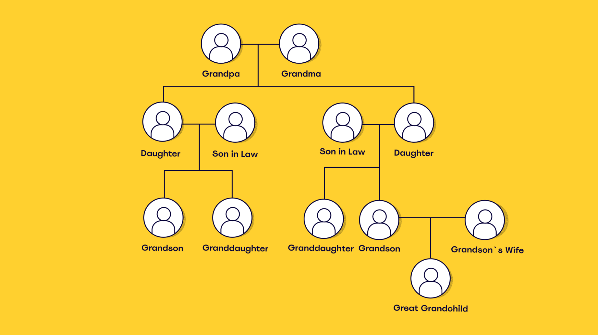

# 1.1 Foundations of Data Structures

## 1. What is a Data Structure?

A **data structure** is a way of organizing and storing data in a computer so that it can be accessed, modified, and processed efficiently. It defines how data is arranged and how different pieces of information relate to one another, influencing the operations that can be performed and how efficiently they can be executed.

What's an example of data structures in our daily life. Take for example, recording family history. In this case, we would use make a family tree such as the following.

We choose a family tree as the data structure because we have information about people we are related to and how they are related, and we want an overview so that we can easily find a specific family member, several generations back. With this, it's easier to see the links and the relations between each individual. 

Data structures give us the possibility to manage large amounts of data efficiently for uses such as large databases and internet search engine functions.

## 2. Purpose and Utility

The primary goal of a data structure is to minimize computational complexity (both time and space) for common data manipulation tasks. Different data structures are optimized for different types of operations:
* **Arrays and Lists:** Ideal for sequential access and storing collections of items with index-based lookups.
* **Stacks and Queues:** Manage data according to specific processing orders, such as last-in, first-out (LIFO) or first-in, first-out (FIFO).
* **Hash Tables:** Optimized for rapid key-value lookups, insertions, and deletions.
* **Trees and Graphs:** Designed for representing hierarchical relationships and network topologies.

Choosing the correct data structure depends on how the data needs to be accessed, updated, or processed.

## 3. Efficiency and Big-O Notation
The efficiency of a data structure is determined by how effectively it supports the operations required by a program. Different structures may perform the same operation at different speeds or require different amounts of memory. These differences become increasingly significant as the volume of data grows. These time differences are notated using Big-O notation.

Big-O notation is a mathematical notation used to describe the asymptotic growth of an algorithm's time or space requirements as the input size increases. It allows programmers to compare algorithmic efficiency without relying on specific hardware or execution times.

For example, (O(1)) represents constant time growth and does not depend on the input size , while (O(n)) represents linear growth, where (n) is the input size and the operation's growth is proportional to the input size. Thus, indexed array access is typically (O(1)), while searching an unsorted array takes (O(n)) time in the worst case.

## 4. Selection and Trade-offs

Choosing the appropriate data structure for a given application involves balancing competing priorities:
* **Time Efficiency:** Different data structures can perform the same operation at different speeds. For example, accessing an element by index in an array typically takes constant time, whereas searching an unsorted array may require examining every element. These differences become increasingly important as the amount of data grows. 
* **Modification Speed:** Operations such as insertion and deletion also have different costs across data structures. Inserting an element into the middle of an array may require shifting subsequent elements, while inserting into a linked list can be efficient when the insertion position is already known. These differences affect the overall efficiency of algorithms that frequently modify data.
* **Memory Usage:** Data structures vary in their storage requirements. Arrays store elements in a side-by-side sequence, while linked lists require additional memory for references connecting their elements. The choice may therefore involve trading memory overhead for more flexible data manipulation.
* **Problem Requirements:** The most suitable data structure depends on the operations an application performs most frequently. A hash table may be appropriate for retrieving records by key, while a queue is better suited to processing tasks in arrival order.

Ultimately, selecting a data structure requires balancing processing efficiency, memory consumption, and application requirements.

References:
- https://www.w3schools.com/dsa/dsa_intro.php
- https://www.geeksforgeeks.org/dsa/analysis-algorithms-big-o-analysis/
- https://www.w3schools.com/dsa/dsa_timecomplexity_theory.php