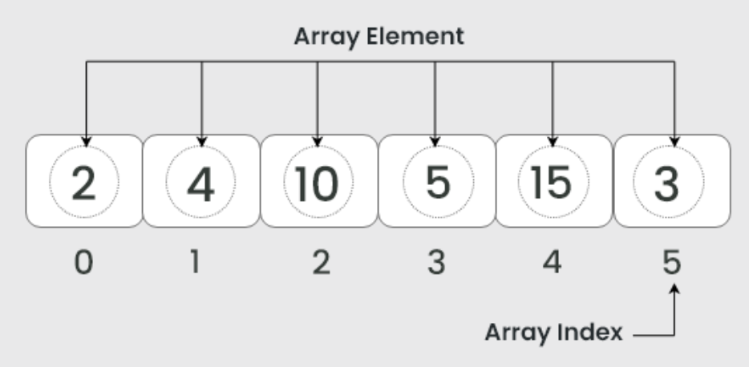
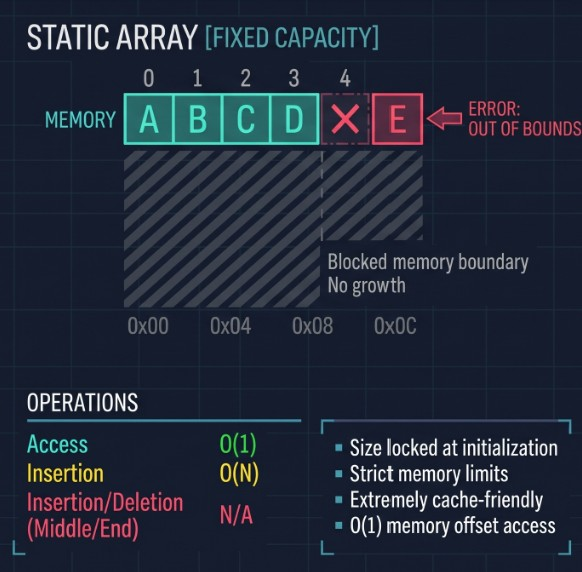
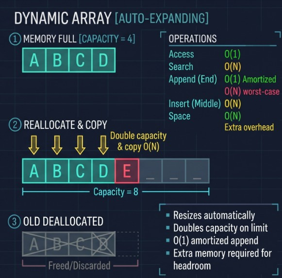

# 1.2 Arrays and Dynamic Arrays

## What is an Array?
Imagine a school grading program needs to store the scores of 1000 students. One way we could do it would be to create a separate variable for every score. However, this would make the data difficult to organize, access, and process, especially when the number of students changes.

A better way to solve this would be to group the scores into a single collection of data. This allows the program to manage the values together, access individual elements, and process the entire collection using indexes and algorithms, instead of doing it one by one.

An **array** is a data structure that stores a collection of elements in a linked block of memory, allowing elements to be accessed using their positions, known as indexes. Because the memory is linked together, the computer can instantly calculate the exact memory address of any element using a simple mathematical offset, making retrieval lightning-fast.

### Visualisation:


For example we have this array labelled represented as:
```
Numbers = [2, 4, 10, 5, 15, 3]
```
Each array's index starts from 0 and increases based on the order of the elements. Using the example array, Numbers[0] retrieves 2 and Numbers[3] retrieves 5.

## Standard (Static) Arrays

When you create a standard array (like in C or Java), you must declare its size upfront. The operating system allocates exactly that amount of linked together memory and nothing more. For example, you can do this by declaring for example int array[n], with n being the size of the array.

### Key Characteristics:
* **Fast Access (`O(1)`):** Accessing an element by index (e.g., `array[3]`) takes `O(1)` time. The computer simply takes the base memory address and adds `3 * (element size)`.
* **Cache Friendliness:** Because elements are stored right next to each other, processors can load chunks of the array into the CPU cache simultaneously, making iteration extremely fast.
* **The Limitation:** Static arrays cannot grow. If you declare an array of size 10 and need to add an 11th element, you won't be able to append or add it.

### Visualisation:


## Dynamic Arrays

**Dynamic arrays** (like `list` in Python, `std::vector` in C++, or `ArrayList` in Java) solve the size limitation of static arrays while preserving their fast `O(1)` indexing. They achieve this by managing a static array behind the scenes and automatically resizing it when it gets full.

### The Resizing Mechanism:
1. **Initialization:** The dynamic array starts with an underlying static array of a small fixed capacity (e.g., capacity of 4).
2. **Insertion:** As you append or insert elements to the end of the list, it fills up the available slots.
3. **Capacity Reached:** When you try to add an element but the capacity is full, the dynamic array creates a *new*, larger static array in memory (typically doubling the size, e.g., from 4 to 8).
4. **Copy and Swap:** It copies all existing elements from the old array into the new one, adds your new element, and then frees the old array's memory.

Because resizing happens infrequently (e.g., at sizes 4, 8, 16, 32...), the heavy cost of copying elements is spread out over many cheap insertions. This makes the **amortized time complexity** for appending an element `O(1)`.

### Visualisation:


## Operations
| Operation | Description |
| :--- | :--- |
| **read** | Shows a value from an index in the array. |
| **update** | Updates the existing value at an array index position. |
| **insert** | Inserts a new value in the array, in addition to the existing values. |
| **remove** | Removes a value from the array at a given index position. |
| **length** | Gives us the number of values in the array. The number of values is the length of an array. |
| **loop** | Shows the entire array one-by-one, using a loop. |

## Example
```
int main(void) {
    int arr[10] = {5, 12, 8, 20};

    // 1
    int val = arr[2];
    printf("%d\n", val);

    // 2
    arr[2] = 21;
    printf("%d\n", arr[2]);
}
```
Try to predict what happens in operation 1 and 2.
- In operation 1, it reads the value of arr[2], which is 8.
- In operation 2, it updates the value of arr[2] to 21.

## Performance

### 1. Space Complexity
Both static and dynamic arrays have the same space complexity of O(n). The memory required grows proportionally to the number of elements stored.

### 2. Time Complexity

Singly Linked List:
| Operation | Best Case | Worst Case | Average |
| :--- | :--- | :--- | :--- |
| **Access** | `O(1)` | `O(1)` | `O(1)` |
| **Search** | `O(1)` | `O(N)` | `O(N)` |
| **Insertion**| `O(1)` | `O(N)` | `O(N)` |
| **Deletion** | `O(1)` | `O(N)` | `O(N)` |

References:
- https://www.geeksforgeeks.org/dsa/introduction-to-arrays-data-structure-and-algorithm-tutorials/
- https://www.w3schools.com/programming/prog_arrays.php
- https://www.geeksforgeeks.org/dsa/difference-between-static-arrays-and-dynamic-arrays/