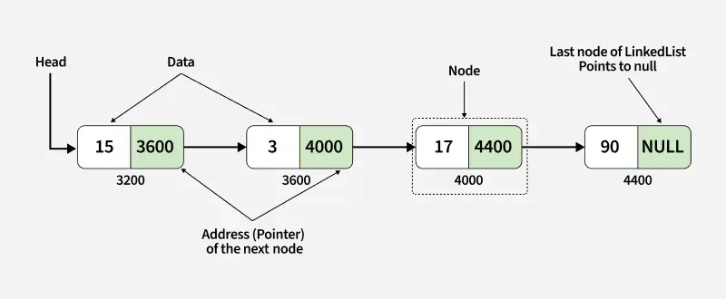
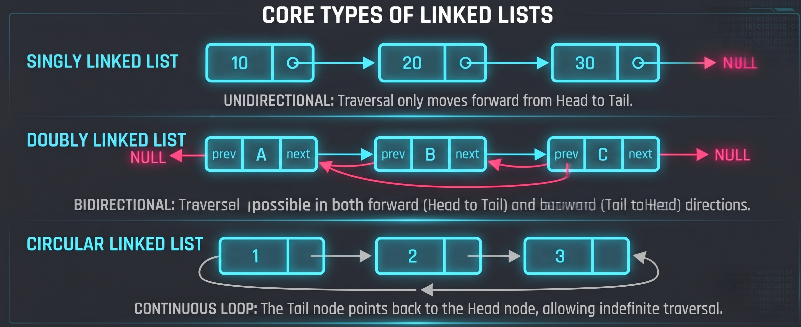

# 1.3 Linked Lists

## What is a Linked List?
In a treasure hunt, each clue you get leads you directly toward the end goal, the treasure. Each clue tells you what you need to do and what steps you need to take to get to your destination. To reach the end, you must follow the clues from the starting point instead of jumping whichever point you want. This process is similar to how linked lists work.

A linked list is a foundational linear data structure where elements (referred to as nodes) are stored in non-linked memory locations. Unlike arrays, which store elements in a continuous block of memory, the elements of a linked list are connected via pointers (or references). When adding or removing nodes in linked lists, the rest of the nodes in the list do not have to be shifted. 

Each node typically consists of two components:
* **Data:** The actual value you want to store (e.g., an integer, string, or object).
* **Next (Pointer):** A reference pointing to the memory address of the next node in the sequence.

### Visualisation:


## Types of Linked Lists:

* **Singly Linked List:** The most basic type. Each node points only to the next node. Traversal can only move in a single direction (forward from the head to the tail).
* **Doubly Linked List:** Each node contains two pointers: one pointing to the next node and another pointing to the previous node. This allows bidirectional traversal (both forward and backward).
* **Circular Linked List:** The last node points back to the first node instead of pointing to `null`, forming a continuous loop. This can be implemented as either singly or doubly linked.

### Visualisation:


## Advantages and Disadvantages

### Advantages:
* **Dynamic Size:** They can easily grow or shrink in size at runtime, avoiding the fixed-size limitations of static arrays.
* **Efficient Insertions or Deletions:** Adding or removing items doesn't require shifting elements around in memory; you simply update the pointer references.

### Disadvantages:
* **No Random Access:** You cannot access the $i$-th element directly. To find an element, you must start from the head node and traverse through every preceding node
* **Memory Overhead:** Each node requires extra memory to store the pointer(s) in addition to the data itself.
* **Poor Cache Locality:** Because nodes are scattered across memory rather than stored in linked, CPU caching is less efficient compared to arrays.

## Operations
| Operation | Description |
| :--- | :--- |
| **traversal** | Goes through the linked list by following the links from one node to the next. |
| **search** | Find a node containing a specific value by traversing |
| **insertion** | Add a new node (at the head, tail, or specific position) and adjust pointers. |
| **deletion** | Remove a node by bypassing it and updating the previous pointer. |

## Example
```
#include <stdio.h>
#include <stdlib.h>

struct Node {
    int data;
    struct Node* next;
};
void traverseAndPrint(struct Node* head) {
    struct Node* current = head;

    while (current != NULL) {
        printf("%d -> ", current->data);
        current = current->next;
    }
    printf("null\n");
}

int main() {
    struct Node node1, node2, node3, node4, node5;

    node1.data = 7;
    node2.data = 11;
    node3.data = 3;
    node4.data = 2;
    node5.data = 9;

    node1.next = &node2;
    node2.next = &node3;
    node3.next = &node4;
    node4.next = &node5;
    node5.next = NULL;

    traverseAndPrint(&node1);

    return 0;
}
```
Try to predict the output and execute the code in an IDE.
- The code outputs “7 -> 11 -> 3 -> 2 -> 9 -> null”

## Performance

### 1. Space Complexity
Linked lists have the space complexity of O(n), as each element requires a separate node containing the data and a pointer/reference to the next node

### 2. Time Complexity
Singly Linked List:
| Operation | Best Case | Worst Case | Average |
| :--- | :--- | :--- | :--- |
| **Access** | `O(1)` | `O(N)` | `O(N)` |
| **Search** | `O(1)` | `O(N)` | `O(N)` |
| **Insertion** | `O(1)` | `O(N)` | `O(1)` |
| **Deletion** | `O(1)` | `O(N)` | `O(1)` |

Doubly Linked List:
Singly Linked List:
| Operation | Best Case | Worst Case | Average |
| :--- | :--- | :--- | :--- |
| **Access** | `O(1)` | `O(N)` | `O(N)` |
| **Search** | `O(1)` | `O(N)` | `O(N)` |
| **Insertion** | `O(1)` | `O(1)` | `O(1)` |
| **Deletion** | `O(1)` | `O(1)` | `O(1)` |

References:
- https://www.geeksforgeeks.org/dsa/linked-list-data-structure/
- https://www.w3schools.com/dsa/dsa_algo_linkedlists_operations.php