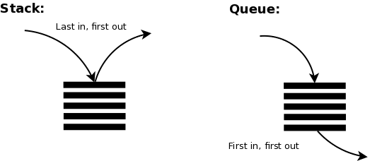

# 1.4 Stacks and Queues

## What are Stacks and Queues?
While piling up plates vertically, You put a clean plate on top, and you also take a plate from the top. The last plate placed is the first one taken. This is similar to a **stack** data structure.

When we are standing in a line at a cashier. The person who arrived first is served first, and new people join at the back. This is similar to a **queue** data structure.

**Stacks** and **queues** are two ways to store items. They differ in one rule: which item you take out first. A stack removes the newest item first, while a queue removes the oldest item first. Both can use an array, where markers (top for a stack, head and tail for a queue) track where to add and remove, so no items have to be moved.

This process is called ”Last in, first out (LIFO)” for stacks and “First in, first out (FIFO)” for queues.

## Advantages and Disadvantages

## Stacks

### Advantages:
* **Time & Memory Efficiency:** Push and pop operations on a stack can be performed in constant time `O(1)`, enabling efficient data access, they are memory-efficient because they only store pushed elements, compared to other data structures.
* **Last-In, First-Out (LIFO):** Stacks follow the LIFO principle, ensuring the last element added is the first one removed. This behavior is useful in scenarios like function calls and expression evaluation.

### Disadvantages:
* **Limited access:** Elements in a stack can only be accessed from the top, which makes it difficult to retrieve or modify elements in the middle.
* **Potential for overflow:** Pushing more elements onto a stack than it can hold results in an overflow error, leading to data loss.

## Queues

### Advantages:
* **Time & Memory Efficiency:** Enqueue and dequeue operations in a properly implemented queue can be performed in constant time `O(1)`, enabling efficient data processing. They can also be memory-efficient because they only store elements that have been added.
* **First-In, First-Out (FIFO):** Queues follow the FIFO principle, ensuring the first element added is the first one removed. This behavior is useful in scenarios like task scheduling and request processing.

### Disadvantages:
* **Limited Access:** Elements in a queue can only be directly accessed from the front and rear, making it difficult to retrieve or modify elements in the middle.
* **Potential for Overflow:** In fixed-size queue implementations, adding more elements than the queue can hold results in an overflow error, preventing additional elements from being inserted.

## Operations

### Stacks:
| Operation | Description |
| :--- | :--- |
| **push** | Add an item to the top of a stacks. |
| **pop** | Remove and return the top element from the stack. |
| **peek (top)** | Look at the top element of the stack. |

### Queues:
| Operation | Description |
| :--- | :--- |
| **enqueue** | Add an item to the top of a stacks. |
| **dequeue** | Remove and return the top element from the stack. |
| **getFront** | Look at the top element of the stack. |

### Both:
| Operation | Description |
| :--- | :--- |
| **isEmpty** | Checks whether the stack contains any elements. |
| **size** | Checks the size of the stack |

## Example
This is an example of stacks (last in, first out).
| Step | Action | Stack (left = bottom, right = top) | Removed |
| :--- | :--- | :--- | :--- |
| 1 | Push 5 | 5 | |
| 2 | Push 3 | 53 | |
| 3 | Push 6 | 536 | |
| 4 | Pop | 53 | 6 |
| 5 | Push 4 | 534 | |
| 6 | Pop | 53 | 4 |
| 7 | Pop | 5 | 3 |

## Performance

### Space Complexity
Stacks and queues have a space complexity of `O(n)`, as memory usage grows proportionally to the number of elements stored.

### Time Complexity

#### Stacks:
| Operation | Best Case | Worst Case | Average |
| :--- | :--- | :--- | :--- |
| **Access** | `O(1)` | `O(N)` | `O(N)` |
| **Search** | `O(1)` | `O(N)` | `O(N)` |
| **Insertion** | `O(1)` | `O(1)` | `O(1)` |
| **Deletion** | `O(1)` | `O(1)` | `O(1)` |

#### Queues:
| Operation | Best Case | Worst Case | Average |
| :--- | :--- | :--- | :--- |
| **Access** | `O(1)` | `O(N)` | `O(N)` |
| **Search** | `O(1)` | `O(N)` | `O(N)` |
| **Insertion** | `O(1)` | `O(1)` | `O(1)` |
| **Deletion** | `O(1)` | `O(1)` | `O(1)` |

## References:
1. Cormen, T. H., Leiserson, C. E., Rivest, R. L., & Stein, C. (2009). Introduction to Algorithms (3rd ed.). MIT Press. §10.1, pp. 232–236.
2. https://fahadsultan.com/csc122/data/stacks_queues.html
