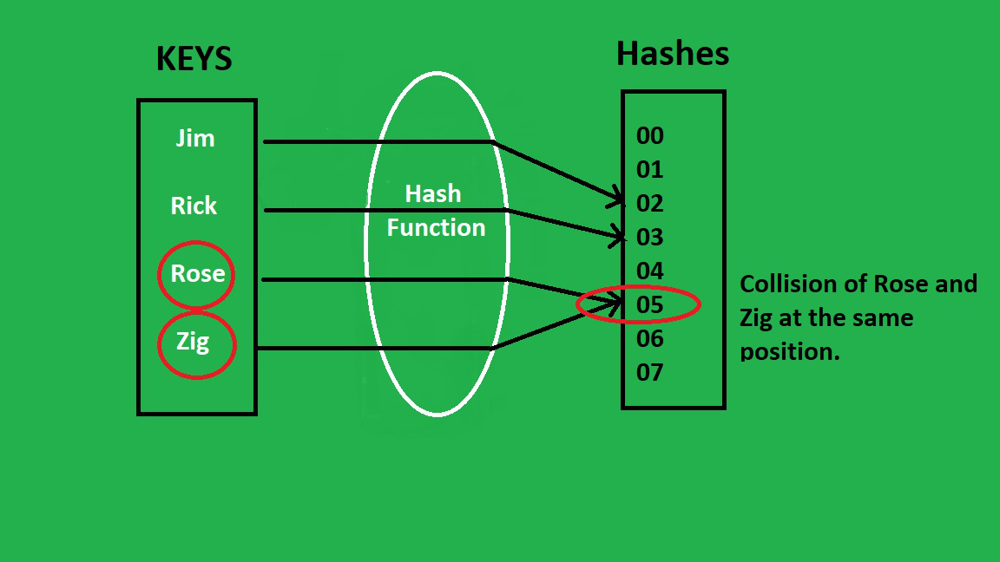

# 1.5 Hash Tables

## What are Hash Tables?
Imagine A shoe rack has shelves labeled A to Z. The rule: each person’s shoes go on the shelf matching the first letter of their name. Maria’s shoes go on shelf M. Tom’s shoes go on shelf T. Mike’s shoes also belong on shelf M. Maria is already there, so Mike’s shoes go on the same shelf, next to Maria’s. To find Mike’s shoes, you don’t check all 26 shelves. You look at the name, see “M”, and go straight to shelf M. On that shelf, you check the few pairs there until you find Mike’s. This is an easy analogy of hash tables.

A **hash table** stores items in numbered slots, and a hash function decides which slot each key goes to. One simple hash function is k mod m, which means “the remainder when the key k is divided by the number of slots m”. When two keys land in the same slot (a collision), chaining keeps them together in a list in that slot. Searching is usually very fast, because we go straight to one slot, but it is slow in the worst case, when all keys land in the same slot.

In this illustration, it shows four input keys, Jim, Rick, Rose, and Zig. These processed by a hash function to map to index positions ranging from 00 to 07. A collision occurs because both Rose and Zig are incorrectly mapped to the exact same hash position (05). It also shows a hash collision outputting the same hash value. This often results in the function being slower.

## Advantages and Disadvantages

### Advantages:
* **High Performance:** Provides fast, constant-time `O(1)` lookups and efficient insertions and deletions without requiring element shifting.
* **Space Efficiency & Flexibility:** Uses memory efficiently without extra pointer overhead (unlike trees), supports diverse data types, and suits applications like databases and caches.
* **Built-in Handling:** Has built in features to solve hash collisions, by storing multiple entries in a linked list or tree at the same index position or generating a location for storing or searching the data called probes.

### Disadvantages:
* **Collision Vulnerability & Limits:** Collisions are inevitable with large key sets and cause inefficiency. Tables also have limited capacity.
* **Usability Constraints:** Does not allow null values, fails to maintain element order, and can be complex to implement.

## Operations
| Operation | Description |
| :--- | :--- |
| **insertion** | Add a new piece of data, usually a key-value pair. |
| **search** | Look up the value associated with a given key. |
| **deletion** | Remove a key-value pair from the hash table. |

## Example
Imagine we want to store the keys 10, 22, 31, 4, and 15 in a hash table with 7 slots (0–6), using the division method (h(k) = k mod 7).
| Key | Calculation | Slot | What Happens |
| :--- | :--- | :--- | :--- |
| 10 | 10 ÷ 7 = 1 remainder 3 | 3 | Slot 3 is empty, so store 10. |
| 22 | 22 ÷ 7 = 3 remainder 1 | 1 | Slot 1 is empty, so store 22. |
| 31 | 31 ÷ 7 = 4 remainder 3 | 3 | Collision with 10. Add 31 to the front of the list. |
| 4 | 4 ÷ 7 = 0 remainder 4 | 4 | Slot 4 is empty, so store 4. |
| 15 | 15 ÷ 7 = 2 remainder 1 | 1 | Collision with 22. Add 15 to the front of the list. |

## Performance

### Space Complexity
Hash tables have a space complexity of `O(N)`, as memory usage grows proportionally to the number of elements stored.

### Time Complexity

#### Stacks:
| Operation | Best Case | Worst Case | Average |
| :--- | :--- | :--- | :--- |
| **Access** | `O(1)` | `O(N)` | `O(1)` |
| **Search** | `O(1)` | `O(N)` | `O(1)` |
| **Insertion** | `O(1)` | `O(N)` | `O(1)` |
| **Deletion** | `O(1)` | `O(N)` | `O(1)` |

#### Queues:
| Operation | Best Case | Worst Case | Average |
| :--- | :--- | :--- | :--- |
| **Access** | `O(1)` | `O(N)` | `O(N)` |
| **Search** | `O(1)` | `O(N)` | `O(N)` |
| **Insertion** | `O(1)` | `O(1)` | `O(1)` |
| **Deletion** | `O(1)` | `O(1)` | `O(1)` |

## References:
1. Cormen et al. Introduction to Algorithms, 3rd ed. Chapter 11 introduction, p. 253; §11.1 “Direct-address tables”, p. 254; §11.2 “Hash tables”, pp. 256-258 (hash function, collisions, chaining, load factor); §11.3.1 “The division method”, p. 263.
2. https://www.geeksforgeeks.org/java/java-program-to-implement-hash-tables-chaining-with-doubly-linked-lists/
