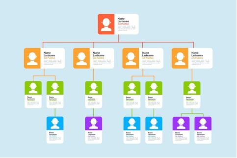
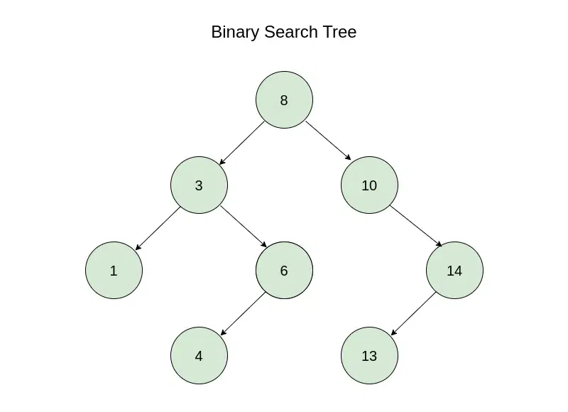
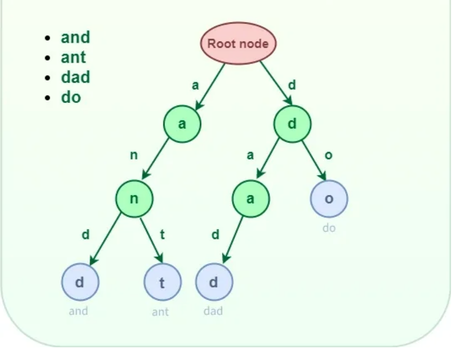

# 1.6 Trees, Binary Search Trees, and Tries

## What are Trees?
Imagine a company organization chart. The president sits at the top, with vice presidents and managers positioned below. Each person has a specific position and may oversee other employees. This structure is similar to how trees work.

A **tree** is a set of items called nodes arranged in levels. A tree stores items in levels, like a company chart, with one item at the top and branches below. 

A tree has a few components:
* **Children:** The successor nodes of a node are called its children.
* **Parent:** The predecessor node of a node is called its parent.
* **Root:** The "beginning" node is called the root i.e. a node that has no parent.
* **Leaf:** A node that has no children is called a leaf.

A **binary tree** gives each node at most two children. A **binary search tree (BST)** is a binary tree where, for every node, smaller keys are in its left branch and larger keys are in its right branch. A trie is a tree where each word is stored as a path of letters from the root, and a mark shows where a word ends.

For a tree to be called a binary search tree, it should fulfill the following conditions:
* All the nodes in the left subtree of any node contain smaller values and all the nodes in the right subtree of any node contain larger values.
* Both the left and right subtrees of any node in the tree should themselves be a BST. This means that they should follow the BST rule.
* A unique path exists from the root node to every other node.

In this example, we can see a binary search tree with the root node as 8. Following the BST rules, all nodes in its left subtree contain smaller values, while all nodes in its right subtree contain larger values. The root's left child is 3, which has a left child of 1 and a right child of 6, with 6 further extending to a left child of 4. On the other side, the root's right child is 10, which has a right child of 14, and 14 has its own left child of 13.

## What are Tries?
When using our phones to type words. When you type “c”, then “a”, the phone follows the letters one by one and suggests “car” or “cat”. This is how tries work.

A **trie** is a tree where each word is stored as a path of letters from the root, and a mark shows where a word ends. It is also known as a **prefix tree** or **radix tree**. This makes tries useful for autocomplete and word-search applications.

In this trie, each branch starts from the root node and represents an individual letter. As we move down, the letters are combined to form prefixes and become complete words. Each path represents a sequence of letters, while a marked node indicates the end of a complete word. For example, following the paths from the root allows us to form the words and, ant, dad, and do. Some words share the same letters at the beginning, allowing them to share branches and avoid storing repeated prefixes.

## Advantages and Disadvantages

## Binary Search Trees

### Advantages:
* **Simple Structure:** Easy to implement and understand for basic hierarchical data representation.
* **Flexibility:** No ordering or balancing constraints, allowing nodes to be added freely.

### Disadvantages:
* **Inefficient Searching:** Operations take O(n) time in the worst case because it lacks sorted ordering or self-balancing, meaning the heights of the left and right subtrees differ significantly.
* **Unpredictable Growth:** Can easily degrade into a linear linked list if unbalanced.

## Tries

### Advantages:
* **Fast Searching:** Searches take O(L) time, where L is the length of the word.
* **Prefix Searching:** Efficiently finds words with shared prefixes, making them useful for autocomplete.
* **Shared Prefixes:** Words with common beginnings can share branches, avoiding repeated storage.

### Disadvantages:
* **High Memory Usage:** Each node may require multiple pointers, consuming additional memory.
* **Complex Implementation:** More complicated to implement than simpler data structures.
* **Limited Use:** Primarily designed for storing and searching strings.

## Operations
| Operation | Description |
| :--- | :--- |
| **insertion** |  Insert values in a BST. |
| **search** |  Search a given key in BST. |
| **deletion** | Delete the specified node from a BST. |

## Example
Build a BST. Insert 8, 3, 10, 1, 6 in this order. The first key becomes the root. Each next key walks down: smaller goes left, bigger goes right, until it finds an empty spot.
| Insert | Path | Result |
| :--- | :--- | :--- |
| 8 | Tree is empty | 8 becomes the root |
| 3 | 3 < 8, go left | 3 is left child of 8 |
| 10 | 10 > 8, go right | 10 is right child of 8 |
| 1 | 1 < 8, left; 1 < 3, left | 1 is left child of 3 |
| 6 | 6 < 8, left; 6 > 3, right | 6 is right child of 3 |

## Performance

### Space Complexity
A BST has a space complexity of `O(N)`, as it stores n nodes, each containing data and pointers to its children. A trie has a space complexity of `O(N × L)`, where `N` is the number of words and `L` is their maximum length, although shared prefixes can reduce memory usage.

### Time Complexity
| Operation | Best Case | Worst Case | Average |
| :--- | :--- | :--- | :--- |
| **Access** | `O(logN)` | `O(N)` | `O(logN)` |
| **Search** | `O(logN)` | `O(N)` | `O(logN)` |
| **Insertion** | `O(logN)` | `O(N)` | `O(logN)` |
| **Deletion** | `O(logN)` | `O(N)` | `O(logN)` |

## References
1. Cormen et al. Introduction to Algorithms, 3rd ed. Chapter 12 “Binary Search Trees”: introduction p. 286; §12.1 pp. 286-288 (BST property, inorder walk); §12.2 pp. 289-290 (search); §12.3 p. 294 (insertion).
2. Sedgewick, R. and Wayne, K. Algorithms, 4th ed. §5.2 “Tries” (for the trie part).
3. https://www.geeksforgeeks.org/cpp/cpp-binary-search-tree/