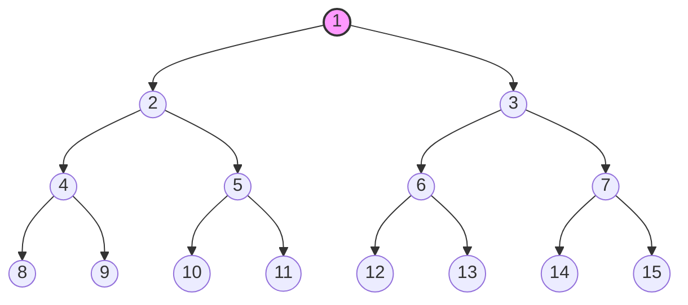

# Heaps and Priority Queues

## A. The Priority Queue ADT

### What is a Priority Queue?

As we have learnt before, a **queue** is a data structure that allows for the storage and retrieval of elements in a
specific order. A priority queue is a special type of queue where each element has a "priority" associated with it. In a
priority queue, elements are dequeued based on their priority rather than their order of insertion.

- A normal queue gives you the oldest element (_FIFO_).
- A stack gives you the newest (_LIFO_).
- A priority queue gives you **the most important** element, regardless of arrival order.

Think of it as like an emergency room. Patients arrive over time, but the nurse always treats the most urgent one next,
not the one who arrived first.

Before moving on, let's clarify the difference between an ADT and a data structure.
An **ADT (abstract data type)** is an _interface_, meaning a set of operations and what they promise. It says nothing
about memory. You can think of it as a _template_ for other data structures. For example, a priority queue is an ADT
that defines operations like `insert`, `remove`, and `peek`, but it doesn't specify how these operations are
implemented.
Meanwhile, a **data structure** is a concrete way of storing data in memory that implements an ADT. It specifies **how**
the data is organized and **how** the operations are carried out. For example, a _binary heap_ is a data structure that
can be used to implement a _priority queue_.

### Basic Operations

| Operation                | Description                                                     |
|--------------------------|-----------------------------------------------------------------|
| `insert(item, priority)` | Adds an item to the queue with a given priority.                |
| `remove()`               | Removes and returns the item with the highest priority.         |
| `peek()`                 | Returns the item with the highest priority without removing it. |
| `size()`                 | Returns the number of items in the queue.                       |
| `is_empty()`             | Returns `true` if the queue is empty, otherwise `false`.        |

An optional operation set appears later, `decrease_key`, `delete`, `merge`. We’ll need decrease_key for Dijkstra in H7.

There are two main types of priority queues:

1. **Min-Priority Queue**: The element with the lowest priority value is served first
2. **Max-Priority Queue**: The element with the highest priority value is served first

**Why does it exist?**

You could ask why not just sort the data and take from the front? Because in many problems the data arrives **over
time**, and you need the best element repeatedly while new things keep arriving. Re-sorting after every arrival is
wasteful, and you only ever need the _minimum/maximum_, not the full order.

Priority queues are useful because they efficiently manage elements by priority, allowing us to retrieve the highest or
lowest priority element in $O (1)$ time and insert or remove elements in $O (log n)$ time using a binary heap. Compared
to naive implementations such as arrays, linked lists, or other data structures that can require $O (n^2)$ time to
process ($n$) elements, priority queues can reduce the total time to $O (n log n)$. As a result, they are much more
efficient for large datasets.

## B. Binary Heap Structure

### What is binary heap structure?



_<small>A min-priority binary heap</small>_

A binary heap is a **binary tree** that satisfies two properties at once.

1. Shape property: the tree is **complete**. Every level is full except possibly the last, and the last level is filled
   **left to right** with no gaps.
2. Heap-order property (for min-priority queues): every node’s key is $\le$ the keys of its children.

Both properties are essential, and each does a different job. For example, the illustration provided above is
min-priority binary heap.

**Why “complete”? (the shape property)**

The shape property lets us store the tree in a **plain array** with no _pointers_ and no _gaps_, and it keeps the tree
**as short as possible**, which is what makes operations $O (\log n)$. A lopsided tree could have height $n$.

**The array layout**

Number the nodes level by level, left to right, starting at 0:

```yaml
index: 0      1      2      3      4      5      6
value: [ 1 ]  [ 10 ] [ 2 ]  [ 11 ] [ 12 ] [ 3 ]  [ 4 ]
```

The root is at index 0. Its children, 10 and 2, are at indices 1 and 2. The children of index 1 (value 10) are at
indices 3 and 4, and so on. You never store a pointer, because **position** encodes the **structure**. That's why the
binary tree has to be complete. If it were not complete, you would have **gaps** in the array.

#### Index Arithmetic

For an 0-index array:

| Node                    | Formula                   |
|-------------------------|---------------------------|
| parent of node $i$      | $\lfloor (i-1)/2 \rfloor$ |
| left child of node $i$  | $2i + 1$                  |
| right child of node $i$ | $2i + 2$                  |

For an 0-index array, the index arithmetic works like this:

| i | parent | left        | right       |
|---|--------|-------------|-------------|
| 0 | none   | 1           | 2           |
| 1 | 0      | 3           | 4           |
| 2 | 0      | 5           | 6           |
| 3 | 1      | 7 (absent)  | 8 (absent)  | 
| 4 | 1      | 9 (absent)  | 10 (absent) |
| 5 | 2      | 11 (absent) | 12 (absent) |
| 6 | 2      | 13 (absent) | 14 (abs     |

<small>*absent means the child do not exist, as the index is $\ge$ the number of elements in the array</small>
<br/><br/>

> ### **Quick Learning Check 1**
> Why is the binary heap stored in an array instead of using pointers like a typical binary tree?
>
> **Solution.** The binary heap is stored in an _array_ because it is a **complete** binary tree, which allows for
> efficient storage without the need for pointers. The shape property of the heap ensures that there are no gaps in the
> array, and the position of each element can be calculated using simple index arithmetic. This results in better cache
> performance and reduced memory overhead compared to a pointer-based implementation.

### Try it yourself!

Try to implement these four functions. Solutions are provided below. You can use the test cases in `main()` to check
your implementation.

```c
#include <assert.h>
#include <stddef.h>

/* 0-based index helpers. Precondition for heap_parent: i > 0. */
size_t heap_parent(size_t i);
size_t heap_left(size_t i);
size_t heap_right(size_t i);

/* Returns 1 if a[0..n-1] satisfies the min-heap order property, else 0.
   n == 0 and n == 1 are valid heaps. Equal values are allowed. */
int is_min_heap(const int *a, size_t n);

int main(void) {
    assert(heap_parent(1) == 0 && heap_parent(2) == 0);
    assert(heap_parent(5) == 2 && heap_parent(6) == 2);
    assert(heap_left(0) == 1 && heap_right(0) == 2);
    assert(heap_left(3) == 7 && heap_right(3) == 8);

    int good[]  = {1, 10, 2, 11, 12, 3, 4};
    int bad[]   = {1, 10, 2, 11, 12, 3, 0};   /* 0 is smaller than its parent 2 */
    int ties[]  = {5, 5, 5};
    int one[]   = {42};

    assert(is_min_heap(good, 7));
    assert(!is_min_heap(bad, 7));
    assert(is_min_heap(ties, 3));
    assert(is_min_heap(one, 1));
    assert(is_min_heap(good, 0));             /* empty heap */
    return 0;
}
```

<br/>
Solutions:

```c
size_t heap_parent(size_t i) {
    return (i - 1) / 2;
}

size_t heap_left(size_t i) {
    return 2 * i + 1;
}

size_t heap_right(size_t i) {
    return 2 * i + 2;
}

int is_min_heap(const int *a, size_t n) {    
    // Empty heaps or single-element heaps are valid min-heaps
    if (n <= 1) {
        return 1;
    }
    // We only need to check nodes that have at least one child.
    // The last node with children is at index: (n - 2) / 2
    size_t last_parent = (n - 2) / 2;

    for (size_t i = 0; i <= last_parent; i++) {
        size_t left = heap_left(i);
        size_t right = heap_right(i);

        // Check if left child violates the min-heap property
        if (left < n && a[i] > a[left]) {
            return 0;
        }

        // Check if right child violates the min-heap property
        if (right < n && a[i] > a[right]) {
            return 0;
        }
    }

    return 1;
}
```

## C. Insert and extract

### The core idea behind every heap operation

The two properties pull in different directions, so we fix them in a fixed order:

- First, repair the shape. Add or remove only at the end of the array (index $n$ or $n-1$). This keeps the tree
  complete, with no holes.
- Then, repair the order. The element we moved may now violate heap order. Walk it along one path until the order is
  restored.
  Since the tree has height $\lfloor \log_2 n \rfloor$, one path means $O (\log n)$.

### Insert and sift-up

What it does: put the new element in the next free slot (index $n$), then let it float up while it is smaller than its
parent.

```pseudocode
SIFT-UP(a, i):
    while i > 0 and a[parent(i)] > a[i]:
        swap a[i], a[parent(i)]
        i = parent(i)

INSERT(a, n, x):
    a[n] = x            # grow the array first if n == capacity
    n = n + 1
    SIFT-UP(a, n - 1)
```

### Worked example:

Insert 0 into [1, 10, 2, 11, 12, 3, 4]

```
Place 0 at index 7        swap with parent 11        swap with parent 10       swap with parent 1
(parent = index 3)        (now at index 3)           (now at index 1)          (now at index 0, done)

        1                        1                          1                         0
      /   \                    /   \                      /   \                     /   \
    10      2                10      2                   0      2                  1      2
   /  \    /  \             /  \    /  \                / \    / \                / \    / \
  11  12  3    4           0   12  3    4             10  12  3   4             10  12  3   4
 /                        /                           /                         /
0                       11                          11                        11

[1,10,2,11,12,3,4,0]   [1,10,2,0,12,3,4,11]   [1,0,2,10,12,3,4,11]   [0,1,2,10,12,3,4,11]
```

### **Explanation**

At the top of each iteration, every parent/child pair obeys heap order except possibly the pair (parent ($i$), $i$).
Also, if $i$ has children, then $a[\text{parent} (i)]$ is $\le$ both of them. (In other words, the parent's index
is $\le$ both children's indices.)

- Start: the new element is a leaf at index $i$, so it has no children. All other pairs were untouched and were already
  valid.
- Maintenance: if $a[\text{parent} (i)] \le a[i]$, the one suspect pair is fine (already follows the parent $\le$ child
  rule), so the whole array is a heap and the loop stops. Otherwise, we swap, and let $v$ be the new smaller value at
  the parent slot and $u$ the old parent value, now at $i$.
    * The pair $(p, i)$ is fixed because $v < u$.
    * The pairs below $i$ are fine because of the second half of the invariant: $u \le$ its children.
    * The pair $(p, \text{sibling})$ is fine because $v < u \le a[\text{sibling}]$.
    * The only possibly broken pair is now $(\text{parent} (p), p)$, so the invariant holds for $i := p$.
- End: $i$ strictly decreases, so either the loop stops early (heap restored) or $i$ reaches 0, where no parent pair
  exists.

Each swap is $O (1)$ and there are at most $h = \lfloor \log_2 n \rfloor$ of them, so insert is $O (\log n)$ worst case.
The best case is $O (1)$ (the new element is already $\ge$ its parent). It is commonly stated that inserting random data
averages $O (1)$ swaps, which is plausible because most nodes sit near the bottom.

### Extract and sift-down

What it does: the minimum is at index 0. We can’t just delete it because that leaves a hole at the root. Instead:

Save a[0] as the answer.
Move the last element (index $n-1$) into the root. This keeps the shape complete.
The root is now probably too big, so let it sink down, always swapping with the smaller child.

```
SIFT-DOWN(a, n, i):
  loop:
    c = 2i + 1                         # left child
    if c >= n: break                   # no children: i is a leaf
    if c + 1 < n and a[c+1] < a[c]:    # right child exists and is smaller
      c = c + 1
    if a[i] <= a[c]: break             # heap order holds, stop
    swap a[i], a[c]
    i = c

EXTRACT(a, n):
  if n == 0: report error
  min  = a[0]
  a[0] = a[n - 1]
  n    = n - 1
  if n > 0: SIFT-DOWN(a, n, 0)
  return min
```

### Worked example:

Extract from [0, 1, 2, 10, 12, 3, 4, 11]. 

```
Answer = 0. Move last (11)    smaller child of 11 is 1     smaller child of 11 is 10
to the root, n becomes 7      (vs 2): swap                 (vs 12): swap, then stop
                                                           (index 3 has no children)
          11                           1                             1
         /  \                        /   \                         /   \
        1    2                      11     2                      10      2
       / \  / \                    /  \   / \                    /  \    /  \
     10 12 3   4                 10   12 3   4                 11   12  3    4

[11,1,2,10,12,3,4]              [1,11,2,10,12,3,4]            [1,10,2,11,12,3,4]
```

### Explanation

At the top of each iteration, every pair obeys heap order except possibly the pairs between $i$ and its
children. Also, if $i > 0$, then $a[\text{parent} (i)]$ is $\le$ both children of $i$.

- Start: only the root changed, and it has no parent.
- Maintenance: let $m$ be the smaller child value, which sits at index $c$.
    - If $a[i] \le m$, then $a[i] \le$ both children, so everything is valid and we stop.
    - Otherwise, we swap. Now $m$ is at $i$. It is $\le$ the other child (it was the smaller one) and $\le$ the value
      that moved down.
    - By the invariant, $a[\text{parent} (i)] \le m$, so the pair above is fine.
    - The only possibly broken pairs are now below $c$. Its children were $\ge m$ already, since $m$ used to be their
      parent.
- End: $i$ strictly increases and the loop stops at a leaf at the latest.

At most, this requires $h$ iterations, each with 2 comparisons and 1 swap, so $O (\log n)$ worst case (about $2\log_2 n$
comparisons).

The element we move to the root came from the bottom level, so it is usually large and
tends to sink almost all the way back down. Extract is therefore $\Theta (\log n)$ in typical cases, while insert is
often much cheaper.

## D. Build-heap

### The problem

Given an arbitrary array of $n$ values, turn it into a heap.

Naive approach: insert the elements one at a time. The worst case is a reverse-sorted array, where each new element
climbs to the root, which costs $\Theta (n \log n)$.

Floyd’s approach: work in place, from the bottom of the tree to the top.

```
BUILD-HEAP(a, n):
    for i = floor(n/2) - 1 down to 0:     # last internal node, back to the root
    SIFT-DOWN(a, n, i)
```

Why start at $\lfloor n/2 \rfloor - 1$? From Part 1, indices $\lfloor n/2 \rfloor$ through $n-1$ are leaves, and a leaf
is already a valid one-element heap. Only the internal nodes need work.

### Worked example:

[9, 8, 7, 6, 5, 4, 3] (reverse sorted)

```toml
i = 2: node 7, children 4 and 3 -> swap with 3      [9, 8, 3, 6, 5, 4, 7]
i = 1: node 8, children 6 and 5 -> swap with 5      [9, 5, 3, 6, 8, 4, 7]
i = 0: node 9, children 5 and 3 -> swap with 3      [3, 5, 9, 6, 8, 4, 7]
continue: node 9 at index 2, children 4 and 7 -> swap with 4
[3,5, 4, 6, 8, 9,7]   done
```

That is 4 swaps. Building the same array by repeated insertion takes 10 swaps (1, 1, 2, 2, 2, 2). The gap grows quickly
with $n$.

### Explanation

Before processing index $i$, every node with an index greater than $i$ is the root of a valid heap.

- Start: at $i = \lfloor n/2 \rfloor - 1$, all higher indices are leaves, which are trivially heaps.
- Maintenance: both children of $i$ are roots of valid heaps. This is exactly the situation sift-down was proved for,
  since only the root of that subtree can be out of place. After `SIFT-DOWN (i)`, node $i$ roots a valid heap too.
- End: after $i = 0$, the root of the whole array is a heap.

## E. Heapsort

Heapsort sorts an array in three conceptual steps:

1. Rearrange the array into a max-heap.
2. Swap the root with the last element of the heap. That element is now in its **final** position.
3. Shrink the heap by one, restore the heap property at the root (sift-down), and repeat.

**Key concept:** when the heap is shrunk by one, it creates an _invisible barrier_ in the array. Think of it as a
process to keep extracting from the heap, whilst the extracted number is placed at the end of the array.

- Left side: The shrinking max-heap (unsorted elements).
- Right side: The growing sorted partition.

It was published by J. W. J. Williams in 1964, and R. W. Floyd quickly improved the build phase to linear time. It
exists because it is the only classic comparison sort that offers all three of these at once:

$\Theta (n \log n)$ in the worst case (unlike quicksort’s $O (n^2)$)
$O (1)$ auxiliary space (unlike merge sort’s $\Theta (n)$)
no recursion and no extra allocation

During sorting, the array is partitioned into two parts: the heap and the sorted portion. The heap shrinks from the
left, while the sorted portion grows from the right. The algorithm continues until the heap is empty, at which point the
entire array is sorted.

```
  0                       end            n-1
  +------------------------+---------------+
  |  max-heap (unsorted)   | sorted, final |
  +------------------------+---------------+
        shrinks  <-----------   grows
```

### **Stability: heapsort is not stable**

Tag equal keys as 2a, 2b with input [2a, 2b, 1]. This is already a valid max-heap. Swap root and last: [1, 2b, 2a].
Heap is [1, 2b], so sift-down swaps: [2b, 1, 2a]. Swap root and index 1: [1, 2b, 2a]. The output is 1, 2b, 2a, so the
equal keys were reversed. The long-distance swaps (root to end) are what destroy relative order, and there is no cheap
fix.

So choose heapsort when you need a hard worst-case guarantee with no extra memory: embedded and real-time
systems, kernels (the Linux kernel’s `sort()` is a heapsort variant for this reason), or as the fallback inside
introsort. Avoid it when stability matters (use merge sort, TimSort), when speed on typical data matters most (use
quicksort or introsort), or when input is nearly sorted (use insertion sort or TimSort).

## F. Usage patterns

### What it is, and why these patterns exist

A heap answers one question cheaply: “what is the **best** remaining element?” Insert and extract-best both
cost $O (\log n)$, and peek costs $O (1)$. Every pattern below is a trick for turning a problem into repeated “give me
the best one” queries on a small or changing set.

The key idea is that a heap’s size, not the input’s size, controls the $\log$ factor. Keep the heap small (size $k$) and
the cost drops from $\log n$ to $\log k$.

| Pattern         | Heap holds                    | Heap kind           | Size       |
|-----------------|-------------------------------|---------------------|------------|
| Top-$k$ largest | the $k$ best seen so far      | min-heap            | $k$        |
| $k$-way merge   | the current head of each list | min-heap            | $\le k$    |
| Running median  | lower half / upper half       | max-heap + min-heap | $n/2$ each |

### Pattern 1: Top-$k$

Problem: from $n$ numbers, find the $k$ largest.

| Approach                     | Time                           | Space            | Notes                      |
|------------------------------|--------------------------------|------------------|----------------------------|
| Sort everything              | $O(n\log n)$                   | $O(1)$ or $O(n)$ | needs all data in memory   |
| Max-heap of all $n$, pop $k$ | $O(n + k\log n)$               | $O(n)$           | heapify is $O(n)$          |
| Min-heap of size $k$         | $O(n\log k)$                   | $O(k)$           | works on a stream          |
| Quickselect                  | $O(n)$ average, $O(n^2)$ worst | $O(1)$           | mutates the array, offline |

The counter-intuitive part: to keep the largest $k$, use a min-heap. The root is the weakest of the current winners,
which is exactly the one you need to compare against and evict.

```
 Keeping top-3 of: 5 1 9 3 7 8        min-heap of size 3

 after 5,1,9:      1            see 3: 3 > root(1) → evict 1, insert 3
                  / \                      3
                 5   9                    / \
                                         5   9

 see 7: 7 > 3 → evict 3                  see 8: 8 > 5 → evict 5
        5                                       7
       / \                                     / \
      7   9                                   8   9      → answer {7, 8, 9}
```

### Pattern 2: $k$-way merge

Problem: merge $k$ sorted lists with $N$ elements total into one sorted list.

Idea: the next output is always the minimum of the $k$ list heads. Keep those heads in a min-heap, and when you pop one,
push its successor from the same list.

```
 L0: 1 4 7        heap holds ONE head per list (size ≤ k)
 L1: 2 5 8
 L2: 3 6 9          [1(L0) 2(L1) 3(L2)]  pop 1 → push 4(L0)
                    [2 3 4]  pop 2 → push 5(L1) ... output: 1 2 3 4 5 ...
```

The heap contains exactly one element (the current head) from each non-exhausted list, so its size never exceeds $k$.
Every element not yet output is $\ge$ the head of its own list, so the heap minimum is the global minimum of what
remains. That gives correctness by induction on output position.

### Pattern 3: Running median (two heaps)

Problem: numbers arrive one at a time. After each, report the median.

Idea: split the data into a smaller half and a larger half. Only the boundary between them matters, and the boundary
elements are exactly the max of the lower half and the min of the upper half.

```
   lo = MAX-heap (smaller half)       hi = MIN-heap (larger half)
          7                                 9
         / \                               / \
        4   6                             12  10
       /
      1
   invariant 1:  |lo| == |hi|  or  |lo| == |hi| + 1
   invariant 2:  max(lo) <= min(hi)
   7 elements → median = top of lo = 7      (even count → average of both tops)
```

## G. Decrease-key and indexed PQs

Many algorithms hold a priority queue of items and later discover that an item’s priority has improved:

- Dijkstra: you found a shorter path to vertex $v$, so $v$’s distance key goes down.
- Prim: you found a lighter edge connecting $v$ to the tree.
- Simulation or scheduler: a pending event or timer is rescheduled to an earlier time or cancelled.

A plain binary heap has a problem: it is only ordered top-down. It can give you the minimum, but it cannot find an
arbitrary item. Searching for $v$ in the array is $\Theta (n)$, so “lower $v$’s key” would cost $O (n)$. In Dijkstra
that makes $\Theta (VE)$-ish behavior, which is far too slow.
There are two standard fixes:

| Approach             | Idea                                                                                                              |
|----------------------|-------------------------------------------------------------------------------------------------------------------|
| Indexed PQ (handles) | Maintain a position map pos[id] so you can jump straight to the item’s slot, then sift it up.                     |
| Lazy deletion        | Don’t touch the old entry. Push a duplicate with the better key, and when a stale entry is popped later, skip it. |

### Approach A: Indexed priority queue

Design (assume items are integer ids $0..N-1$, like graph vertices)
Three parallel arrays:

- heap[i]: the id stored in heap slot $i$
- pos[id]: the slot where id currently lives, or NONE if it is not in the heap
- key[id]: the priority of id (indexed by id, not by slot, so it never moves)

**Core invariant**: for every slot $i< n$, pos[heap[i]] == i; and pos[id] == NONE for every id not in the heap. Every
time
two heap slots swap, pos must be updated for both ids.

```
 N = 6 ids. key[0..5] = 9 4 7 2 8 5      heap holds ids {3,1,5,0,4}; id 2 is absent

 heap[] (slot→id):   slot: 0  1  2  3  4          tree (id:key)
                          [3][1][5][0][4]                 3:2
                                                        /     \
 pos[] (id→slot):    id:  0  1  2  3  4  5          1:4         5:5
                         [3][1][N][0][4][2]         /  \
                                                 0:9    4:8
 N = NONE    invariant: pos[heap[i]] == i
```

After decrease_key (id=4, new key=1): id 4 sifts up past id 1, then past id 3.

```
 heap[]: [4][3][5][0][1]         tree:       4:1
 pos[]:  id0→3 id1→4 id2→N                 /     \
         id3→1 id4→0 id5→2               3:2      5:5
                                         /  \
                                      0:9    1:4
```

### Approach B: Lazy deletion

Idea: never modify an entry in place. When a better key is found, push a new entry. The old, worse one stays in the heap
as stale garbage. When an entry is popped, check whether it is still current. If not, discard it.

This uses the plain Heap from H6 (Item.key = distance, Item.a = vertex):

## H. Heap variants

$d$-ary, binomial, Fibonacci, pairing (overview)    First taste of amortized analysis; Fibonacci heaps’ $O (1)$

## G. Decrease-key and indexed PQs

Position map (handles); why Dijkstra and Prim need it; lazy deletion as the alternative Decrease-key in $O (\log n)$;
trade-offs of the two approaches

## H. Heap variants

$d$-ary, binomial, Fibonacci, pairing (overview)    First taste of amortized analysis; Fibonacci heaps’ $O (1)$
amortized decrease-key


