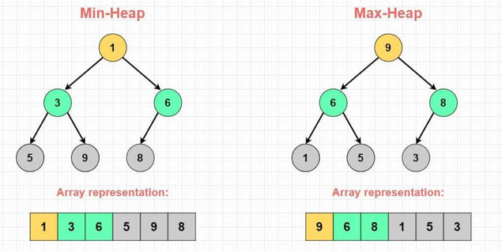

# 1.7 Heaps and Priority Queues

## What is a Priority Queue ADT?
Imagine an emergency room. Patients arrive over time, but the nurse always treats the most urgent patient next, not the one who arrived first, and not the one who arrived last.

Three structures give three different answers to "which item do I get next?":

## A. The Priority Queue ADT

### The problem

Imagine an **emergency room**. Patients arrive over time, but the nurse always treats the *most urgent* patient next,
not the one who arrived first, and not the one who arrived last.

Three structures give three different answers to "which item do I get next?":

| Structure | Gives you next… | Rule |
| :--- | :--- | :--- |
| **Queue** | the *oldest* item | FIFO (first in, first out) |
| **Stack** | the *newest* item | LIFO (last in, first out) |
| **Priority queue** | the *most important* item | by priority, regardless of arrival order |

This need appears everywhere: operating-system schedulers (run the most urgent process), Dijkstra's shortest-path algorithm (visit the closest unvisited vertex), event simulations (handle the earliest event), Huffman coding (merge the two rarest symbols) and search engines (keep the best few results).

An **abstract data type (ADT)** is an interface, meaning a set of operations and what they promise. It says nothing about memory. You can think of it as a template for other data structures. For example, a priority queue is an ADT that defines operations like insert, remove, and peek, but it doesn't specify how these operations are implemented.

## What are Binary Heaps?
A binary heap is a binary tree that keeps just enough order to answer **which item is the most extreme** (largest or smallest). It has two properties, mainly
* **Shape property** - every level is full, except possibly the last, which is filled from left to right
* **Heap-order property** - Every node’s key is ≤ for the keys of its children (for a min-heap)

These two properties makes binary heaps a *complete binary tree*, which makes it possible to represent it into an **array** form, where the **index** of the array determines the entry’s **position** in the heap.

## Advantages and Disadvantages

### Advantages:
Binary heaps’ main advantage is its **efficiency**:
* Retrieving the minimum or maximum element from the root takes `O(1)` time.
* Adding a new element (inserting) or extracting the root takes `O(logN)`
* It is stored in a array rather than node-pointer, which makes it space efficient.
* Using the build-heap pattern (bottom-up), constructing a heap takes linear time `O(N)`.
* Supports heapsort, which is an efficient sorting algorithm with minimal extra space.

### Disadvantages:
* Inefficient for **general search**, since the tree is not fully sorted like a binary search tree.
* Because the elements are **partially ordered** (only parent-child order), no natural in-order traversal exists for general queries.
* Unstable sorting, where equal keys may not **preserve** their **initial** order during heapsort.
* Updating the priority of an arbitrary element takes `O(logN)` time since looking up an **arbitrary element** is not efficient in heaps.

## Operations
| Operation | What It Does | Returns |
| :--- | :--- | :--- |
| **insert(item, priority)** |  Adds an item with the given priority | nothing |
| **extract()** |  Removes and returns the highest priority item | the highest priority item |
| **peek()** | Returns the highest priority item without removing it | the item |
| **size()** | Counts the item stored | an integer |

## Example
An emergency room as a min-heap (smaller number = more urgent)
| Step | Operation | Queue afterwards (name, priority) | Returned |
| :--- | :--- | :--- | :--- |
| 1 | "insert(Alice, 3)" | Alice 3 | |
| 2 | "insert(Bob, 1)" | "Alice 3, Bob 1" | |
| 3 | "insert(Cara, 2)" | "Alice 3, Bob 1, Cara 2" | |	
| 4 | extract() | "Alice 3, Cara 2"	| Bob |
| 5 | "insert(Dan, 0)" | "Alice 3, Cara 2, Dan 0" | |
| 6 | extract() | "Alice 3, Cara 2" | Dan |
| 7 | extract() | Alice 3 | Cara |
| 8 | extract() | (empty) | Alice |

## Performance

### Space Complexity
A binary heap has a total space complexity of `O(N)`, as it is stored as an **array** and no pointer is needed, since it is a **complete** binary tree (the index of the array tells the position in the heap)

### Time Complexity
| Operation | Time | Why |
| :--- | :--- | :--- |
| **Insert** | worst `O(logN)`; best `O(1)` | at most log₂ n swaps (one per level); best case is a new item already its parent |
| **Extract** | `O(logN)` | at most log₂ n iterations, each doing 2 comparisons and 1 swap |
| **Peek** | `O(1)` | read a[0] |