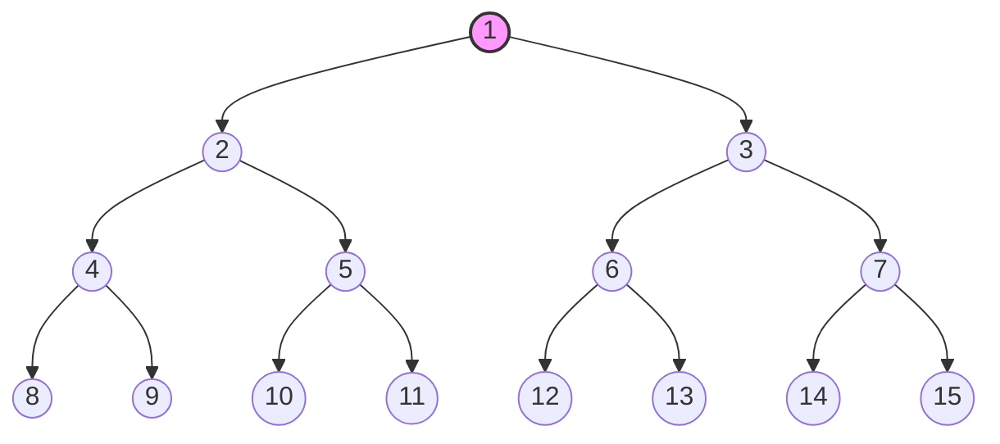
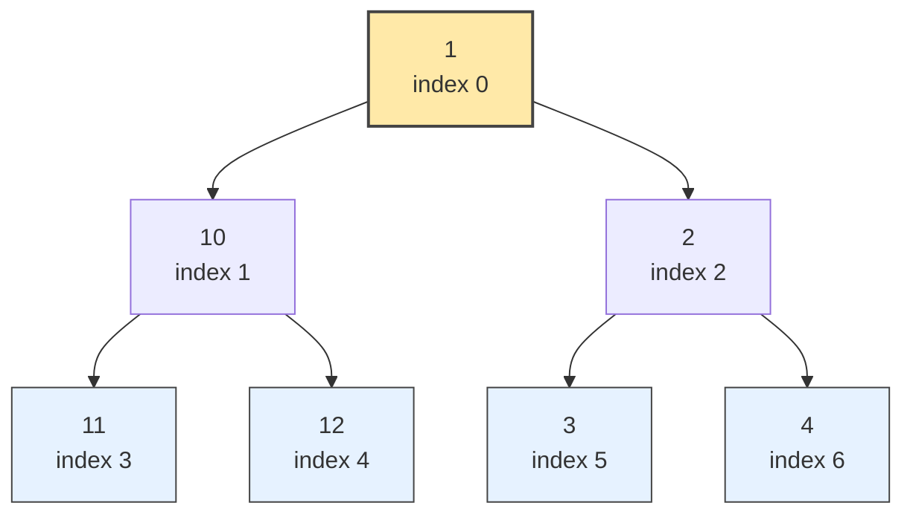

# Heaps and Priority Queues

## What you will learn

By the end of this guide you will be able to:

- explain what a priority queue is and how it differs from a queue and a stack;
- state the two properties of a binary heap and explain why a heap can live in a plain array;
- trace insert, extract, build-heap and heapsort by hand, and implement them in C;
- recognise three classic heap patterns: top-$k$, $k$-way merge, and running median;
- explain why Dijkstra's algorithm needs decrease-key, and two ways to provide it.

## A. The Priority Queue ADT

### The problem

Imagine an **emergency room**. Patients arrive over time, but the nurse always treats the *most urgent* patient next,
not the one who arrived first, and not the one who arrived last.

Three structures give three different answers to "which item do I get next?":

| Structure          | Gives you next…           | Rule                                     |
|:-------------------|:--------------------------|:-----------------------------------------|
| **Queue**          | the *oldest* item         | FIFO (first in, first out)               |
| **Stack**          | the *newest* item         | LIFO (last in, first out)                |
| **Priority queue** | the *most important* item | by priority, regardless of arrival order |

This need appears everywhere: operating-system **schedulers** (run the most urgent process), **Dijkstra's**
shortest-path algorithm (visit the closest unvisited vertex), **event simulations** (handle the earliest event),
**Huffman coding** (merge the two rarest symbols) and **search engines** (keep the best few results).

### The core idea

An **abstract data type (ADT)** is an _interface_, meaning a set of operations and what they promise. It says _nothing_
about memory. You can think of it as a _template_ for other data structures. For example, a priority queue is an ADT
that defines operations like `insert`, `remove`, and `peek`, but it doesn't specify how these operations are
implemented.

A **data structure** is a *concrete* way of storing data that fulfils such a contract. It decides **how** the data is
laid out and **how** each operation is carried out.

> **Analogy.** The buttons on a vending machine are the ADT: press B4, get a snack. What is behind the glass (spirals,
> belts, a robot arm) is the data structure.

A **priority queue** is an ADT. It promises `insert`, `extract`, `peek` and so on, but not *how*. A **binary heap** is
one data structure that fulfils the contract efficiently; a sorted array or an unsorted linked list also fulfil it, just
less efficiently (see *Complexity* below).

### How it works

**The operations.**

| Operation                | What it does                                          | Returns      |
|:-------------------------|:------------------------------------------------------|:-------------|
| `insert(item, priority)` | Adds an item with the given priority.                 | nothing      |
| `extract()`              | **Removes** and returns the most urgent item.         | the item     |
| `peek()`                 | Returns the most urgent item **without** removing it. | the item     |
| `size()`                 | Counts the items stored.                              | an integer   |
| `is_empty()`             | Tells whether the queue is empty.                     | true / false |

> **Names vary.** `extract` is also called `pop`, `poll`, `dequeue`, `extract-min` or `delete-min`. This guide uses
> **`extract`** everywhere.

There are two main types of priority queues:

1. **Min-Priority Queue**: The element with the lowest priority value is served first
2. **Max-Priority Queue**: The element with the highest priority value is served first

### Complexity

**Why not just sort the data and take from the front?** Because in many problems the data **arrives over time** and you
need the best item *repeatedly* while new items keep arriving. Re-sorting after every arrival wastes work, and you only
ever need the minimum (or maximum), not the full order.

Here is how the obvious implementations compare with a binary heap (Sections B to D):

| Implementation                         | `insert`   | `peek` | `extract`   | Insert $(n)$ items, then extract all |
|:---------------------------------------|:-----------|:-------|:------------|:-------------------------------------|
| Unsorted array                         | $O(1)$     | $O(n)$ | $O(n)$      | $O(n^2)$                             |
| Sorted array (minimum kept at the end) | $O(n)$     | $O(1)$ | $O(1)$      | $O(n^2)$                             |
| Sorted linked list                     | $O(n)$     | $O(1)$ | $O(1)$      | $O(n^2)$                             |
| **Binary heap**                        | $O(log n)$ | $O(1)$ | $O($log n)$ | $O(n \log n)$                        |

The naive versions pay $O (n)$ on *one* of the operations (searching, or shifting items to keep order). The heap keeps
**just enough** order to make *both* operations logarithmic. For a million items, $(n^2)$ is a trillion steps, while $(n
\log n)$ is about twenty million.

### Worked example

An emergency room as a min-PQ (smaller number = more urgent):

| Step | Operation          | Queue afterwards (name, priority) | Returned  |
|:-----|:-------------------|:----------------------------------|:----------|
| 1    | `insert(Alice, 3)` | Alice 3                           |           |
| 2    | `insert(Bob, 1)`   | Alice 3, Bob 1                    |           |
| 3    | `insert(Cara, 2)`  | Alice 3, Bob 1, Cara 2            |           |
| 4    | `extract()`        | Alice 3, Cara 2                   | **Bob**   |
| 5    | `insert(Dan, 0)`   | Alice 3, Cara 2, Dan 0            |           |
| 6    | `extract()`        | Alice 3, Cara 2                   | **Dan**   |
| 7    | `extract()`        | Alice 3                           | **Cara**  |
| 8    | `extract()`        | (empty)                           | **Alice** |

## B. Binary Heap Structure

### The problem

We want a priority queue where **both** `insert` and `extract` are fast. Section A showed why the obvious choices fail:
an unsorted array makes `extract` slow (you must search), and a sorted array makes `insert` slow (you must shift items).

The insight is that we do not need *everything* sorted. We only need to know **which item is the most extreme**. A heap
keeps just enough order to answer that, and that is much cheaper to maintain than a full sort.

### The core idea



_<small>A min-priority binary heap</small>_

A **binary heap** is a **binary tree** that satisfies **two properties at once**:

1. **Shape property.** The tree is **complete**: every level is full, except possibly the last, and the last level is
   filled **from left to right** with no gaps.
2. **Heap-order property** (for a min-heap). Every node's key is $(\le)$ the keys of its children. Consequently, the
   **smallest key is always at the root**.
   Each property does a different job. The **shape** property keeps the tree short and lets us store it in a plain
   array. The **order** property puts the minimum where we can grab it instantly.

**Why "complete"?** Two reasons:

1. **No pointers needed.** With no gaps, a node's *position* in the array tells us where its parent and children are.
   That saves memory and is friendly to the CPU cache.
2. **The tree is as short as possible**, and a short tree means fast operations. A lopsided tree could be $n$ levels
   tall; a complete tree with $(n)$ nodes has height $\lfloor \log_2 n \rfloor$:

|   Items $n$ | Height $(\lfloor \log_2 n \rfloor)$ | Levels |
|--------------:|------------------------------------:|-------:|
|             1 |                                   0 |      1 |
|             7 |                                   2 |      3 |
|            15 |                                   3 |      4 |
|         1,000 |                                   9 |     10 |
|     1,000,000 |                                  19 |     20 |
| 1,000,000,000 |                                  29 |     30 |

A billion-item heap is only 30 levels tall, so following a single root-to-leaf path touches at most about 30 nodes.
**The array layout**

> **Common mistake: a heap is not a binary search tree.** In a BST, *left < parent < right*. In a heap, the only rule is
> *parent $\le$ children*. Siblings are **unordered**. in the heap below, 10 sits to the left of 2, and that is
> perfectly legal. A heap is also **not sorted**; only the root is guaranteed to be the minimum.

### How it works

**The running example.** We will use this min-heap throughout the guide. The labels show the value and its array index.



*The root (yellow) is the minimum. The leaves are blue.*

**The array layout.** Number the nodes level by level, left to right, starting at 0, and store them in that order:

```text
index:   0     1     2     3     4     5     6
      +-----+-----+-----+-----+-----+-----+-----+
value | 1   | 10  | 2   | 11  | 12  | 3   | 4   |
      +-----+-----+-----+-----+-----+-----+-----+
        ^     \___ children of 0 ___/
       root     (indices 1 and 2)
```

The root is at index 0. Its children, 10 and 2, are at indices 1 and 2. The children of index 1 (value 10) are at
indices 3 and 4. No pointers are stored, **position encodes structure**. This is exactly why the tree must be complete;
a hole in the tree would be a hole in the array.

**Index arithmetic** (0-indexed):

| Node                             | Formula                   |
|:---------------------------------|:--------------------------|
| parent of node $i$ (for $i > 0$) | $\lfloor (i-1)/2 \rfloor$ |
| left child of node $i$           | $2i + 1$                  |
| right child of node $i$          | $2i + 2$                  |

> ### **Quick Learning Check 1**
> Why is the binary heap stored in an array instead of using pointers like a typical binary tree?
>
> **Solution.** The binary heap is stored in an _array_ because it is a **complete** binary tree, which allows for
> efficient storage without the need for pointers. The shape property of the heap ensures that there are no gaps in the
> array, and the position of each element can be calculated using simple index arithmetic. This results in better cache
> performance and reduced memory overhead compared to a pointer-based implementation.

### Try it yourself!

Try to implement these four functions. Solutions are provided below. You can use the test cases in `main()` to check
your implementation.

```c
#include <assert.h>
#include <stddef.h>

/* 0-based index helpers. Precondition for heap_parent: i > 0. */
size_t heap_parent(size_t i);
size_t heap_left(size_t i);
size_t heap_right(size_t i);

/* Returns 1 if a[0..n-1] satisfies the min-heap order property, else 0.
   n == 0 and n == 1 are valid heaps. Equal values are allowed. */
int is_min_heap(const int *a, size_t n);

int main(void) {
    assert(heap_parent(1) == 0 && heap_parent(2) == 0);
    assert(heap_parent(5) == 2 && heap_parent(6) == 2);
    assert(heap_left(0) == 1 && heap_right(0) == 2);
    assert(heap_left(3) == 7 && heap_right(3) == 8);

    int good[]  = {1, 10, 2, 11, 12, 3, 4};
    int bad[]   = {1, 10, 2, 11, 12, 3, 0};   /* 0 is smaller than its parent 2 */
    int ties[]  = {5, 5, 5};
    int one[]   = {42};

    assert(is_min_heap(good, 7));
    assert(!is_min_heap(bad, 7));
    assert(is_min_heap(ties, 3));
    assert(is_min_heap(one, 1));
    assert(is_min_heap(good, 0));             /* empty heap */
    return 0;
}
```

<br/>
Solutions:

```c
size_t heap_parent(size_t i) {
    return (i - 1) / 2;
}

size_t heap_left(size_t i) {
    return 2 * i + 1;
}

size_t heap_right(size_t i) {
    return 2 * i + 2;
}

int is_min_heap(const int *a, size_t n) {    
    // Empty heaps or single-element heaps are valid min-heaps
    if (n <= 1) {
        return 1;
    }
    // We only need to check nodes that have at least one child.
    // The last node with children is at index: (n - 2) / 2
    size_t last_parent = (n - 2) / 2;

    for (size_t i = 0; i <= last_parent; i++) {
        size_t left = heap_left(i);
        size_t right = heap_right(i);

        // Check if left child violates the min-heap property
        if (left < n && a[i] > a[left]) {
            return 0;
        }

        // Check if right child violates the min-heap property
        if (right < n && a[i] > a[right]) {
            return 0;
        }
    }

    return 1;
}
```

## C. Insert and extract

### The core idea behind every heap operation

The two properties pull in different directions, so we fix them in a fixed order:

- First, repair the shape. Add or remove only at the end of the array (index $n$ or $n-1$). This keeps the tree
  complete, with no holes.
- Then, repair the order. The element we moved may now violate heap order. Walk it along one path until the order is
  restored.
  Since the tree has height $\lfloor \log_2 n \rfloor$, one path means $O (\log n)$.

### Insert and sift-up

What it does: put the new element in the next free slot (index $n$), then let it float up while it is smaller than its
parent.

```pseudocode
SIFT-UP(a, i):
    while i > 0 and a[parent(i)] > a[i]:
        swap a[i], a[parent(i)]
        i = parent(i)

INSERT(a, n, x):
    a[n] = x            # grow the array first if n == capacity
    n = n + 1
    SIFT-UP(a, n - 1)
```

### Worked example:

Insert 0 into [1, 10, 2, 11, 12, 3, 4]

```
Place 0 at index 7        swap with parent 11        swap with parent 10       swap with parent 1
(parent = index 3)        (now at index 3)           (now at index 1)          (now at index 0, done)

        1                        1                          1                         0
      /   \                    /   \                      /   \                     /   \
    10      2                10      2                   0      2                  1      2
   /  \    /  \             /  \    /  \                / \    / \                / \    / \
  11  12  3    4           0   12  3    4             10  12  3   4             10  12  3   4
 /                        /                           /                         /
0                       11                          11                        11

[1,10,2,11,12,3,4,0]   [1,10,2,0,12,3,4,11]   [1,0,2,10,12,3,4,11]   [0,1,2,10,12,3,4,11]
```

### **Explanation**

At the top of each iteration, every parent/child pair obeys heap order except possibly the pair (parent ($i$), $i$).
Also, if $i$ has children, then $a[\text{parent} (i)]$ is $\le$ both of them. (In other words, the parent's index
is $\le$ both children's indices.)

- Start: the new element is a leaf at index $i$, so it has no children. All other pairs were untouched and were already
  valid.
- Maintenance: if $a[\text{parent} (i)] \le a[i]$, the one suspect pair is fine (already follows the parent $\le$ child
  rule), so the whole array is a heap and the loop stops. Otherwise, we swap, and let $v$ be the new smaller value at
  the parent slot and $u$ the old parent value, now at $i$.
    * The pair $(p, i)$ is fixed because $v < u$.
    * The pairs below $i$ are fine because of the second half of the invariant: $u \le$ its children.
    * The pair $(p, \text{sibling})$ is fine because $v < u \le a[\text{sibling}]$.
    * The only possibly broken pair is now $(\text{parent} (p), p)$, so the invariant holds for $i := p$.
- End: $i$ strictly decreases, so either the loop stops early (heap restored) or $i$ reaches 0, where no parent pair
  exists.

Each swap is $O (1)$ and there are at most $h = \lfloor \log_2 n \rfloor$ of them, so insert is $O (\log n)$ worst case.
The best case is $O (1)$ (the new element is already $\ge$ its parent). It is commonly stated that inserting random data
averages $O (1)$ swaps, which is plausible because most nodes sit near the bottom.

### Extract and sift-down

What it does: the minimum is at index 0. We can’t just delete it because that leaves a hole at the root. Instead:

Save a[0] as the answer.
Move the last element (index $n-1$) into the root. This keeps the shape complete.
The root is now probably too big, so let it sink down, always swapping with the smaller child.

```
SIFT-DOWN(a, n, i):
  loop:
    c = 2i + 1                         # left child
    if c >= n: break                   # no children: i is a leaf
    if c + 1 < n and a[c+1] < a[c]:    # right child exists and is smaller
      c = c + 1
    if a[i] <= a[c]: break             # heap order holds, stop
    swap a[i], a[c]
    i = c

EXTRACT(a, n):
  if n == 0: report error
  min  = a[0]
  a[0] = a[n - 1]
  n    = n - 1
  if n > 0: SIFT-DOWN(a, n, 0)
  return min
```

### Worked example:

Extract from [0, 1, 2, 10, 12, 3, 4, 11].

```
Answer = 0. Move last (11)    smaller child of 11 is 1     smaller child of 11 is 10
to the root, n becomes 7      (vs 2): swap                 (vs 12): swap, then stop
                                                           (index 3 has no children)
          11                           1                             1
         /  \                        /   \                         /   \
        1    2                      11     2                      10      2
       / \  / \                    /  \   / \                    /  \    /  \
     10 12 3   4                 10   12 3   4                 11   12  3    4

[11,1,2,10,12,3,4]              [1,11,2,10,12,3,4]            [1,10,2,11,12,3,4]
```

### Explanation

At the top of each iteration, every pair obeys heap order except possibly the pairs between $i$ and its
children. Also, if $i > 0$, then $a[\text{parent} (i)]$ is $\le$ both children of $i$.

- Start: only the root changed, and it has no parent.
- Maintenance: let $m$ be the smaller child value, which sits at index $c$.
    - If $a[i] \le m$, then $a[i] \le$ both children, so everything is valid and we stop.
    - Otherwise, we swap. Now $m$ is at $i$. It is $\le$ the other child (it was the smaller one) and $\le$ the value
      that moved down.
    - By the invariant, $a[\text{parent} (i)] \le m$, so the pair above is fine.
    - The only possibly broken pairs are now below $c$. Its children were $\ge m$ already, since $m$ used to be their
      parent.
- End: $i$ strictly increases and the loop stops at a leaf at the latest.

At most, this requires $h$ iterations, each with 2 comparisons and 1 swap, so $O (\log n)$ worst case (about $2\log_2 n$
comparisons).

The element we move to the root came from the bottom level, so it is usually large and
tends to sink almost all the way back down. Extract is therefore $\Theta (\log n)$ in typical cases, while insert is
often much cheaper.

## D. Build-heap

### The problem

Given an arbitrary array of $n$ values, turn it into a heap.

Naive approach: insert the elements one at a time. The worst case is a reverse-sorted array, where each new element
climbs to the root, which costs $\Theta (n \log n)$.

Floyd’s approach: work in place, from the bottom of the tree to the top.

```
BUILD-HEAP(a, n):
    for i = floor(n/2) - 1 down to 0:     # last internal node, back to the root
    SIFT-DOWN(a, n, i)
```

Why start at $\lfloor n/2 \rfloor - 1$? From Part 1, indices $\lfloor n/2 \rfloor$ through $n-1$ are leaves, and a leaf
is already a valid one-element heap. Only the internal nodes need work.

### Worked example:

[9, 8, 7, 6, 5, 4, 3] (reverse sorted)

```toml
i = 2: node 7, children 4 and 3 -> swap with 3      [9, 8, 3, 6, 5, 4, 7]
i = 1: node 8, children 6 and 5 -> swap with 5      [9, 5, 3, 6, 8, 4, 7]
i = 0: node 9, children 5 and 3 -> swap with 3      [3, 5, 9, 6, 8, 4, 7]
continue: node 9 at index 2, children 4 and 7 -> swap with 4
[3,5, 4, 6, 8, 9,7]   done
```

That is 4 swaps. Building the same array by repeated insertion takes 10 swaps (1, 1, 2, 2, 2, 2). The gap grows quickly
with $n$.

### Explanation

Before processing index $i$, every node with an index greater than $i$ is the root of a valid heap.

- Start: at $i = \lfloor n/2 \rfloor - 1$, all higher indices are leaves, which are trivially heaps.
- Maintenance: both children of $i$ are roots of valid heaps. This is exactly the situation sift-down was proved for,
  since only the root of that subtree can be out of place. After `SIFT-DOWN (i)`, node $i$ roots a valid heap too.
- End: after $i = 0$, the root of the whole array is a heap.

## E. Heapsort

Heapsort sorts an array in three conceptual steps:

1. Rearrange the array into a max-heap.
2. Swap the root with the last element of the heap. That element is now in its **final** position.
3. Shrink the heap by one, restore the heap property at the root (sift-down), and repeat.

**Key concept:** when the heap is shrunk by one, it creates an _invisible barrier_ in the array. Think of it as a
process to keep extracting from the heap, whilst the extracted number is placed at the end of the array.

- Left side: The shrinking max-heap (unsorted elements).
- Right side: The growing sorted partition.

It was published by J. W. J. Williams in 1964, and R. W. Floyd quickly improved the build phase to linear time. It
exists because it is the only classic comparison sort that offers all three of these at once:

$\Theta (n \log n)$ in the worst case (unlike quicksort’s $O (n^2)$)
$O (1)$ auxiliary space (unlike merge sort’s $\Theta (n)$)
no recursion and no extra allocation

During sorting, the array is partitioned into two parts: the heap and the sorted portion. The heap shrinks from the
left, while the sorted portion grows from the right. The algorithm continues until the heap is empty, at which point the
entire array is sorted.

```
  0                       end            n-1
  +------------------------+---------------+
  |  max-heap (unsorted)   | sorted, final |
  +------------------------+---------------+
        shrinks  <-----------   grows
```

### **Stability: heapsort is not stable**

Tag equal keys as 2a, 2b with input [2a, 2b, 1]. This is already a valid max-heap. Swap root and last: [1, 2b, 2a].
Heap is [1, 2b], so sift-down swaps: [2b, 1, 2a]. Swap root and index 1: [1, 2b, 2a]. The output is 1, 2b, 2a, so the
equal keys were reversed. The long-distance swaps (root to end) are what destroy relative order, and there is no cheap
fix.

So choose heapsort when you need a hard worst-case guarantee with no extra memory: embedded and real-time
systems, kernels (the Linux kernel’s `sort()` is a heapsort variant for this reason), or as the fallback inside
introsort. Avoid it when stability matters (use merge sort, TimSort), when speed on typical data matters most (use
quicksort or introsort), or when input is nearly sorted (use insertion sort or TimSort).

## F. Usage patterns

### What it is, and why these patterns exist

A heap is a structure that answers one question cheaply: “what is the **most extreme** item I’m holding?” (smallest for
a _min-heap_, largest for a _max-heap_). It does not keep everything sorted. It keeps just **enough** order to know the
extreme.

Two facts explain nearly every complexity in this part:

1. Peeking at the extreme is $O (1)$, because it always sits at the **root**.
2. Inserting or removing costs $O (\log m)$, where $m$ is the number of items currently in the heap. A heap is a tree
   filled level by level, and each level holds twice as many nodes as the one above, so $m$ items need only
   about $\log_2 m$ levels. After a change, an item only has to travel along one _root-to-leaf path_ to restore order,
   so it moves at most about $\log_2 m$ steps.

The key point for this part is that the **cost depends on the heap’s size**, not the input’s size. If you can keep the
heap **small**, say $k$ items while the data has $n$, each update costs $\log k$ instead of $\log n$. The patterns
below exploit this.

### Pattern 1: Top-$k$

#### The problem.

Given $n$ items, find the $k$ largest (or smallest). The items may sit in an array or arrive as a stream
you can’t store. Examples: top three leaderboards, “trending now” lists, search engines keeping the best $k$ documents
per query and network monitors tracking the heaviest traffic sources.

Usually $k$ is tiny compared to $n$ (e.g., top 10 out of a billion), and that gap is what the pattern exploits.

| Approach                     | Time                           | Space            | Notes                      |
|------------------------------|--------------------------------|------------------|----------------------------|
| Sort everything              | $O(n\log n)$                   | $O(1)$ or $O(n)$ | needs all data in memory   |
| Max-heap of all $n$, pop $k$ | $O(n + k\log n)$               | $O(n)$           | heapify is $O(n)$          |
| Min-heap of size $k$         | $O(n\log k)$                   | $O(k)$           | works on a stream          |
| Quickselect                  | $O(n)$ average, $O(n^2)$ worst | $O(1)$           | mutates the array, offline |

The first two approaches are **simple** but _wasteful_. The last two are more **efficient**, and the min-heap is the one
that works on a stream.

Think of a sports team that admits only $k$ people, and the rule is “the $k$ best so far.” The coach needs to know
**one**
thing, who is the **weakest** person currently inside? A newcomer is only worth considering if they beat that person. If
they
do, the weakest person is _shown out_ and the newcomer _takes their place_.

The heap’s job is to **track that weakest member**. So to keep the largest $k$, you use a min-heap, whose root is the
smallest of your current top $k$. That root is the "_admission_" threshold.

>
> #### Quick Learning Check 2
> Why does the top-$k$ pattern use a min-heap to keep track of the largest $k$ items, instead of a max-heap?
>
> **Solution.** It may first seem counter-intuitive to use a min-heap to keep the largest $k$. However, with the root is
> the weakest one, we can directly compare it with new elements, acting as a "_gatekeeper_". Say a new element, $x$,
> arrives:
> - If $x$ is no bigger than the threshold, there are already $k$ items at least as large as $x$, so $x$ can’t be in the
>   top $k$. Dropping it is safe.
> - If $x$ is bigger, the old threshold will be evicted, and $x$ will take its place. The new threshold is now the next
>   smallest of the top $k$.

#### Worked Example

```
 Heap holds the current top 3 (min-heap, threshold at the root)

            [7]   <- weakest member = threshold
           /   \
         [8]   [9]

 New item 5:  5 < 7  -> rejected, nothing changes   (1 comparison)
 New item 10: 10 > 7 -> 7 is evicted, 10 takes its place,
                        then settles into position  (a few steps)
```

Each element is handled in one of two ways:

- **Rejected**: compare with the root and stop, $O (1)$.
- **Accepted**: replace the root and let the new item sink to its place. The heap has only $k$ items, so the sink
  travels at
  most about $\log_2 k$ levels, $O (\log k)$.

**Worst case:** $O (n \log k)$. This happens when every element gets accepted, e.g. a strictly ascending input, where
each
new item beats everything before it. Then you pay $\log k$ per element across $n$ elements.

It’s usually much better on random data. Early in the stream, most elements have a good chance of being among the
largest $(k)$. Later in the stream, an incoming element has to be better than an increasingly competitive group of
elements. Therefore, most later elements are rejected with a cheap $(O (1))$ comparison, while only a relatively small
number
require expensive $(O (\log k))$ heap updates.

### Pattern 2: $k$-way merge

#### The problem and why it exists

You have $k$ lists, each **already sorted**, with $N$ items in total, and you want **one sorted list**. Examples:

- **External sorting**: sort a file too large for memory by sorting chunks, writing them out as sorted “runs,” then
  merging the runs.
- **Databases**: compaction merges several sorted files into one.
- **Search engines**: combining sorted lists of document IDs.
- **Logs**: merging sorted log files from many servers.

#### The core idea: _Only the fronts matter_

Because each list is sorted, its smallest remaining item is always at its front. So the smallest remaining item overall
must be one of the $k$ fronts. You never need to look deeper into any list.

So keep a min-heap of the current fronts, one per list that still has items. Repeat: take the smallest front, output it,
and replace it with the next item from the same list.

```
 L0: [1]  4  7         heap of fronts:
 L1: [2]  5  8   -->      (1 from L0)
 L2: [3]  6  9           /           \
                    (2 from L1)   (3 from L2)

 Output 1 -> L0's next front (4) joins the heap
 Output 2 -> L1's next front (5) joins
 Output 3 -> L2's next front (6) joins
 Output 4 -> L0's next front (7) joins
 ... a list that runs out simply stops contributing; the heap shrinks
```

At every step, the heap contains the smallest item of every non-empty list. The overall smallest
remaining item must be one of those, so each output is right, and every item is output exactly once.
Every entry in the heap contains a **value** plus _which list it came from_, so you know where to pull the
**replacement**.

The heap contains exactly one element (the current head) from each non-exhausted list, so its size never exceeds $k$.
Every element not yet output is $\ge$ the head of its own list, so the heap minimum is the global minimum of what
remains. That gives correctness by induction on output position.

#### Why the complexity is what it is

The heap never holds more than $k$ items, because there is one front per list. This is the same “keep the heap small”
trick as top-$k$.
Each of the $N$ output items causes one removal and at most one insertion on a heap of size $\le k$, so each
costs $O (\log k )$.

Building the initial heap from $k$ fronts is $O (k)$. In total, that's $O (k + N\log k) = O (N\log k)$, since $N \ge k$
when all lists are non-empty. Space complexity is  $O (k)$ beyond the output. If you stream the output rather than store
it, you only ever need $O (k)$ memory, which is exactly why this suits external sorting.

### Pattern 3: Running median (two heaps)

#### The problem and why it exists

Numbers arrive one at a time. After each arrival, report the **median** of everything seen so far.

The median is the **middle value** of the sorted data. With an odd count it is the single middle item, and with an even
count it is conventionally the average of the two middle items.

Median has many use cases, including:

- **Latency monitoring**: the “p50” response time of a service, updated live.
- **Robust statistics**: unlike the mean, one absurd outlier barely moves the median.
- **Signal processing**: median filters smooth sensor noise without blurring sharp edges.

| Approach                                                       | 	Insert       | 	Median query | 	Why                                                                                                   |
|:---------------------------------------------------------------|:-------------|:-------------|:------------------------------------------------------------------------------------------------------|
| Re-sort everything on each query	none                           | $O(n\log n)$ | $O(1)$       | 	Throws away all previous work                                                                         |
| Keep a sorted array, insert in place                           | $O (n)$      | $O (1)$      | Finding the slot is cheap ($\log n$ by binary search), but making room means shifting up to $n$ items |
| Balanced search tree with subtree sizes (order-statistic tree) | $O (\log n)$ | $O (\log n)$ | Fully general, but complex, with heavier constants                                                    |
| Two heaps                                                      | $O (\log n)$ | $O (1)$      | Tracks only the boundary, nothing else                                                                |

#### The core idea: _You only need the boundary_

To know the median you **do not need the data sorted**. You only need to know **where the middle is** and what sits on
either side of it.

Split the data into two halves:

- the lower half _(the smaller items)_, and
- the upper half _(the larger items)_.

The median depends only on the _largest_ item of the **lower half** and the _smallest_ item of the **upper** half, the
two items touching the boundary. Everything else is irrelevant until the **boundary** moves.

A heap is a structure that exposes exactly one extreme item cheaply.

- the lower half lives in a _max-heap_, whose root is the lower half’s **largest** item;
- the upper half lives in a _min-heap_, whose root is the upper half’s **smallest** item.

Each heap keeps the item nearest the boundary at its root:

```
 sorted order:    1    3    5   ||   7    8    9   15
                  \___________/     \______________/
                    lower half          upper half
                    MAX-heap            MIN-heap
                    root = 5            root = 7
                          ^____________^
                   the two roots = the boundary
```

#### The two invariants

- **Order** invariant: every item in the lower half is $\le$ every item in the upper half.
- **Balance** invariant: the halves differ in size by at most one. By convention, the lower half is the same size or one
  larger.

If the total count is _odd_, the lower half has one extra item, so the median is the **lower root**.
If it has an _even_ count, the halves are equal, so the median is the **average** of the two roots.
Either way it is a peek, so the time complexity is $O (1)$.

#### Inserting a new item

Compare $x$ with the lower root first, if $x \le$ lower root, push into the **lower** half, otherwise into the **upper**
half. Then, if the sizes differ by more than one, move one root across.

### Worked Example

Stream: `5, 15, 1, 3, 8, 7, 9, 10`:

| Arrival | Lower (max-heap) | Upper (min-heap) | Median            |
|---------|------------------|------------------|-------------------|
| 5       | {5}              | {}               | 5                 |
| 15      | {5}              | {15}             | (5 + 15) / 2 = 10 |
| 1       | {1, 5}           | {15}             | 5                 |
| 3       | {1, 3}           | {5, 15}          | (3 + 5) / 2 = 4   |
| 8       | {1, 3, 5}        | {8, 15}          | 5                 |
| 7       | {1, 3, 5}        | {7, 8, 15}       | (5 + 7) / 2 = 6   |
| 9       | {1, 3, 5, 7}     | {8, 9, 15}       | 7                 |
| 10      | {1, 3, 5, 7}     | {8, 9, 10, 15}   | (7 + 8) / 2 = 7.5 |

#### Why the complexity is what it is

**Inserting** is $O (\log n)$. Each insert performs a constant number (at most three) of heap pushes and extraction
operations. Each
costs $O (\log m)$ where $m$ is that heap’s size. Each heap holds about $n/2$ items, and $\log (n/2) = \log n - 1$,
which is still $\Theta (\log n)$. A constant number of $\Theta (\log n)$ operations is $\Theta (\log n)$.

**Median query** is $O (1)$, since it reads one or two roots.

**Space complexity** is  $O (n)$. This is the important contrast with top-$k$. In top-$k$ the heap could be capped
at $k$ because you only
ever needed the extreme $k$ items, and everything else could be discarded. A median depends on **every item**,
because any past item can become the middle one later as the boundary drifts. So nothing can be thrown away, and memory
_grows with the stream_.

#### Trade-offs and extensions

**1. Any percentile**, not just the median

For the 90th percentile, keep the lower heap holding about 90% of the items and the upper heap about 10%. The balance
invariant changes from “equal sizes” to “sizes in ratio 9:1”. Each insert still shifts the target by at most one item,
so the rebalance cost remains a constant number of $O (\log n)$ moves.

**2. Sliding-window median** (the weakness of heaps)

Suppose you want the median of only the **last $w$ items**. Now old items must be deleted, and a heap only supports
removing its root efficiently. Deleting an arbitrary item means finding it (a scan, $O (n)$) and then repairing the
heap. Two standard fixes:

- **Lazy deletion**: do not remove the old item right away. Record “this value is expired” in a hash table, and only
  discard it when it surfaces at a **root**. The catch is that heaps may temporarily contain expired items, so you must
  track the valid size of each half for balancing, and the heaps can be bigger than $w$.
- Use a balanced tree or indexable skip list instead. It deletes any item in $O (\log w)$ and can find the middle by
  rank directly. This is simpler to reason about, at the cost of heavier machinery.

**3. Heaps versus a balanced tree**

- **Two heaps**: simple, fast, tiny code, perfect for insert-only streams.
- **Order-statistic** tree: handles deletions, arbitrary rank queries (“what’s the 37th smallest?”), and range
  questions, but is much more work to implement.

**4. Real-world use**

- Streaming dashboards and monitoring _(p50 latency)_.
- Median filters on **sensor** and **image** data.
- Online algorithms and competitive programming (the classic “median of a data stream” problem).
- As a _building block_ in algorithms that must repeatedly split data into smaller-and-larger halves.

## G. Decrease-key and indexed PQs

### What it is and why it exists

The basic priority-queue ADT has `insert`, `peek` and `extract`. Many graph algorithms need a fourth operation:

$$\text{decrease-key} (x, k'):\quad \text{set } \text{key} (x) \leftarrow k' \text{ where } k' \le \text{key} (x),\ x \text{ already in the queue.}$$
Basically, it "decreases" an item's priority. This is particularly useful in:

- Dijkstra: you discover a shorter path to vertex (a point) $v$, which is already queued with a worse tentative
  distance.
- Prim: you discover a cheaper edge connecting $v$ to the growing tree.
- A*, event simulations, timers: an item’s priority changes while it waits.

The key problem here is that a heap knows the priorities of its elements, but it doesn't automatically know where a
particular element is stored.

```
Heap array
   A           B           C           17
   2           5           8           12
Index 0     Index 1     Index 2     Index 3
```

Each box represents a vertex and its priority.
Suppose Dijkstra's algorithm discovers a shorter path to vertex 17, and its priority changes from 12 to 3. We need to
find vertex 17 in the heap before we can update it. But the problem is that the heap only knows the array positions. It
doesn't automatically know which position belongs to vertex 17.

One solution is to scan the entire array until we find it.

- First element: Is this vertex 17?
- Second element: Is this vertex 17?
- Third element: Is this vertex 17?
- And so on...

In the worst case, we examine all $(n)$ elements - $O (n)$

This is a problem for Dijkstra's algorithm, as it may need to update the priority of vertices **many times**. Let:

- $(n)$ = number of vertices.
- $(m)$ = number of edges.
  In the worst case, we may perform up to $(m)$ decrease-key operations.

If finding each vertex requires scanning the entire heap:
$O (n)\times O (m)=O (nm)$

This is potentially worse than using a simple array-based implementation of Dijkstra, which takes $(O (n^2))$.

So we need a better way to find elements.

### Solution 1: _Handles_ (indexed priority queue)

A handle is essentially a reference that lets us identify an element and find its current position in the heap. Instead
of searching the entire heap every time, we maintain an additional array called a position map.

For example:

```
Heap array
   A           B           C           17
   2           5           8           12
Index 0     Index 1     Index 2     Index 3

Position map
Vertex → Current heap index
  A       B       C       17
  0       1       2       3
```

The position map tells us exactly where each vertex currently lives.
Now, if we want to update vertex 17:

1. Look up vertex 17 in the position map.
2. Immediately discover that it is at index 3.
3. Change its priority from 12 to 3.
4. Sift it up until the heap property is restored.
   We don't need to search the heap!

Looking up its position takes $O (1)$ and sifting it up takes $O (\log n)$, so the total time complexity of decrease-key
is $O (\log n)$.

Remember that elements move whenever we swap them during sift-up or sift-down.
That means our position map must also be updated whenever a swap happens.
For example, if vertex 17 moves from index 3 to index 1, its position map must change accordingly.
Otherwise, the map would point to the wrong location!

### Solution 2: _Lazy deletion_ (no handles nor decrease-key)

The main idea behind lazy deletion is that instead of trying to find an existing element in the heap and update its
priority, we simply insert a new entry with the improved priority. We leave the old entry in the heap and ignore it when
it eventually gets removed.

Remember that Dijkstra's algorithm repeatedly discovers shorter paths to vertices.

Suppose we have discovered the following distances:

| Vertex | Current shortest known distance |
|:-------|---------------------------------|
| A      | 0                               |
| B      | 10                              |
| C      | 15                              |

Our priority queue contains these entries:

```
Min-heap (simplified view)
    B       C
    10      15
```

_The smallest distance is removed first._

Now imagine we discover another route to B with a distance of 6 instead of 10.
Normally, we would use decrease-key to update B's priority from 10 to 6.
But what if we don't have an indexed priority queue that supports decrease-key?

We can insert a new entry instead. Rather than searching for the old entry and updating it, we simply insert a new entry
for B with priority 6.

We leave the old entry (B, 10) inside the heap.
Before discovering the shorter path

| **Entry** | **Note**  |
|:----------|-----------|
| (B, 10)   | Old entry |
| (C, 15)   | Entry     |

After inserting the new entry (B, 6)
New entry

| **Entry** | **Note**                                       |
|:----------|------------------------------------------------|
| (B, 6)    | <span style="color:green">**New entry**</span> |
| (B, 10)   | <span style="color:red">Stale entry</span>     |
| (C, 15)   | Entry                                          |

Notice that we now have two entries for B

- _(B, 6)_ represents the current **shortest** known distance.
- _(B, 10)_ is **outdated** because we already found a better route.
  We call the outdated entry stale.

Eventually, the heap will remove both entries, but we only process the one containing the current shortest distance.

That's the entire idea behind lazy deletion.

**How does the code handle stale entries?** Before processing a vertex, we check whether the entry we're removing from
the heap still represents its latest known distance (usually stored in a another data structure). If not, ignore it.
