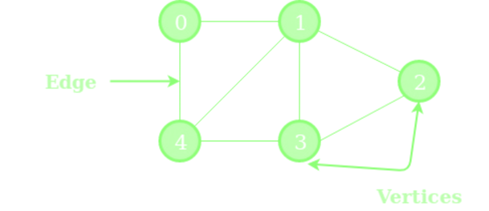

# 1.8 Graphs

## What is a Graph?
Many real-world situations are really about connections. which cities are joined by a road, which people are friends, which tasks must be finished before others can start, which web pages link to each other. A graph is the simple picture we use to describe all of these. 

A **graph** is a collection of dots joined by lines. Programmers say **vertices** (or nodes) for the **dots** and **edges** for the **lines**, and you will see both sets of words in books.



A graph is **not** a drawing. What matters is only which dots are joined to which. You could draw the same graph with the dots in different places, or with longer or shorter lines, and it would still be the same graph.

Graphs are important because they are **everywhere**, maps, friendships, computer networks, game moves, etc. Once a problem has been turned into a graph, we can use the few same recipe for graphs. And with these graphs, the amount of work can explode with a careless algorithm.

# 2. Graph Vocabulary and Modeling

Before any recipe, we need a shared vocabulary. Most of these words are everyday ideas with a precise name.

| Word | Meaning | Everyday picture |
| :--- | :--- | :--- |
| **Dot** (vertex) | One "thing" in the graph | A city, a person, a task |
| **Line** (edge) | A connection between two dots | A road, a friendship, a hyperlink |
| **Neighbours** | Two dots joined directly by a line | Two friends |
| **Undirected** | Lines work in both directions | A friendship, a two-way road |
| **Directed** | Every line is an arrow that goes only one way | "Follows" on social media, a one-way street, "must come before" |
| **Weighted** | Every line carries a number: a weight | Road length, travel time, ticket price |
| **Degree** | How many lines touch a dot (for arrows: how many go *in* and how many go *out*) | How many friends a person has |
| **Path** | A trip from one dot to another along lines. Its length is the number of lines, or the total weight in a weighted graph | A route on a map |
| **Cycle** | A path that comes back to the dot where it started | A loop you can walk around |
| **Connected** | You can get from every dot to every other dot | A country with no cut-off islands |
| **Component** | One separate "island" of a graph that is not connected | A group of friends no one else knows |
| **Tree** | A connected graph with no cycles | A family tree, a folder structure |
| **DAG** | A **d**irected graph with no cycles (acyclic graph) | Course prerequisites |
| **Bipartite** | The dots can be split into two teams so that every line joins one dot from each team | Students and the projects they could do |

## Representing Graphs
A computer cannot look at a drawing. We must store the dots and lines in memory in a way that lets our recipes ask questions quickly: Which dots are the neighbours of this one? Is there a line between these two? There are three common ways to store a graph. For example, for the graph below, we will take a look of the three representations.

### Adjacency Matrix (A Grid)
Make a table with one row and one column for every dot. Put a 1 in the cell where a line joins the row dot to the column dot, and a 0 everywhere else.
```    
  S  A  B  C  D  E  F
S  0  1  1  0  0  0  0
A  1  0  0  1  0  0  0
B  1  0  0  0  1  0  0
C  0  1  0  0  1  1  0
D  0  0  1  1  0  0  1
E  0  0  0  1  0  0  0
F  0  0  0  0  1  0  0
```

### Adjacency List (A Short List per Dot)
Give every dot its own list of neighbors.
```
S : A, B
A : S, C
B : S, D
C : A, D, E
D : B, C, F
E : C
F : D  
```

###  The Edge List (Just The Lines)
Keep one long list with a single entry per line.
```
(S,A) (S,B) (A,C) (B,D)   
(C,D) (C,E) (D,F)
```

| Situation	| Good Choice |	Why |
| :--- |	:--- |	:---|
| A sparse graph (most real graphs) |	Adjacency list | Small memory, exploring neighbours is quick |
| A dense graph, or a graph with only a few dozen dots | Adjacency matrix | Memory is no problem, and ""is there a line?"" is instant |
| Many questions of the type ""is X directly joined to Y?" | Adjacency matrix | One look per question |
| You are not sure | Adjacency list | It is the safe default for real-world data |

## Turning Real Problem into Graphs
Modeling is the most important skill in this chapter. To turn a problem into a graph, answer four questions:
* What are the **dots**?
* What are the **lines**?
* Do the lines have a **direction**?
* Do the lines carry a **number** (a weight)?

## Example
If we want to find a driving route, then the dots of the graph are the **junctions**, whilst the lines of the graph are the **road sections**. it is a **directed** graph (if there are one-way streets) and the **weights** are the travel time or length.

If we want to create a graph of **university courses**, the dots are the courses, whilst the lines are the “must be taken before” relationship. It’s a directed graph with no weights

If we want to assign students to projects, the dots are the **students and projects** whilst the lines are the *“this student could do this project“* relationship. Not a weighted graph, and it doesnt have weights (it’s bipartite)

If we want to create a graph of **water** flowing through city pipes, the dots are the **junctions**, the lines are the **pipes**. It’s a directed graph and the weights are the **capacity** of each pipe.

## Performance

### Time Complexity
For graphs there are two sizes to track, so we use two letters:
* V is the number of dots (V for vertices).
* E is the number of lines (E for edges).

| Label | Plain-English meaning | Work for 1,000 dots and 5,000 lines |
| :--- | :--- | :--- |
| `O(V + E)` | Look at every dot and every line a fixed number of times | about 6,000 |
| `O(E log V)` | Every line costs a little ""halving"" work, like searching sorted data | "about 50,000 |
| `O(V × E)` | Every dot triggers a full pass over all the lines | about 5,000,000 |
| `O(V³)` | Three nested loops over the dots | 1,000,000,000 (a billion) |

For each graph representations:

| Question or action | Adjacency matrix | Adjacency list | Edge list |
| :--- | :--- | :--- | :--- |
| Memory used | One cell per pair: V x V | One entry per dot plus one per line end: about V + 2E | One entry per line: E |
| Add a line | 1 step | 1 step | 1 step |
| Remove a line | 1 step | Search the lists | Search the list |
| Growth of the memory | `O(V^2)` | `O(V + E)` | `O(E)` |