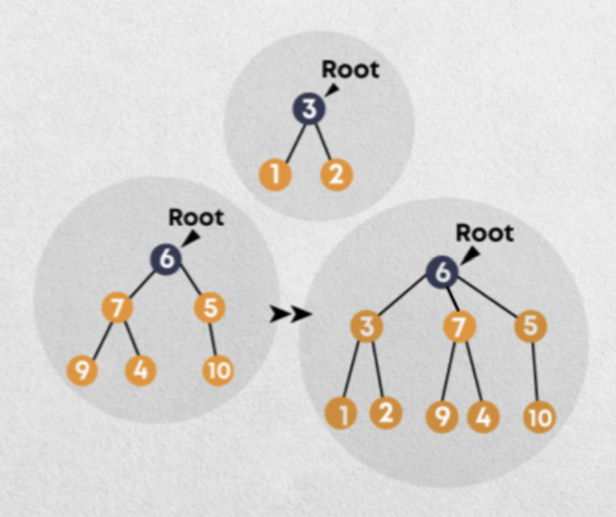
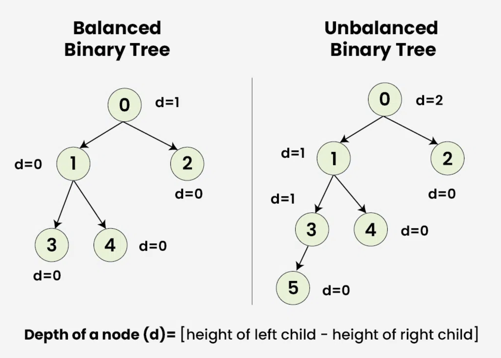
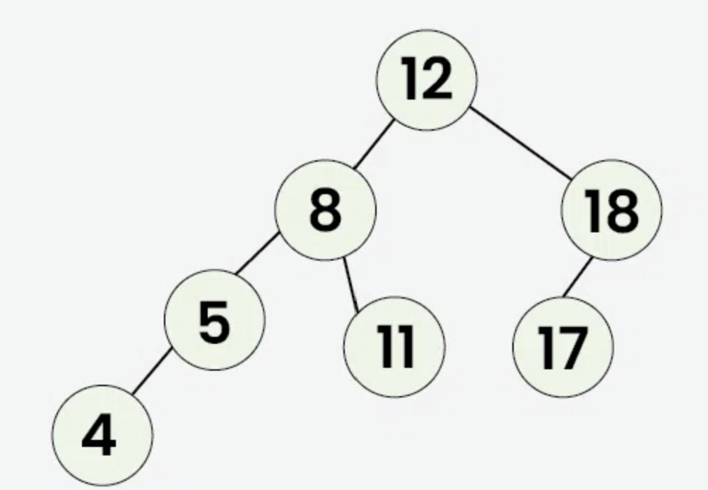
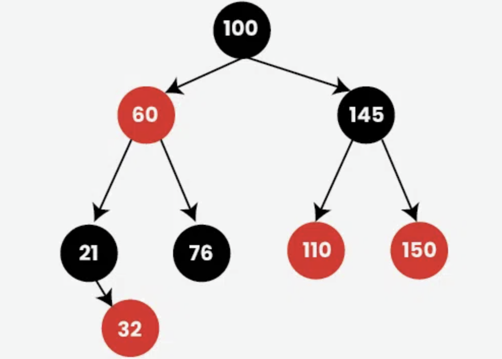

# 1.9 Specialized Data Structures

## What are Specialized Data Structures?
Regular data structures works for lots of programming cases and usage, but they aren't always the most efficient. Specialized data structures are designed to solve certain problems more efficiently than regular structures such as arrays, linked lists, stacks, queues, and others. They organize and store data according to specific requirements, making certain operations be performed faster or with less memory usage.

## Disjoint Set Union (DSU)
Disjoint Set Unions (DSUs) are used to find which elements belong to the same group. This data structure enables the merging of separate sets and addressing different inquiries concerning them, such as determining if elements a and b belong to the same set and finding out the size of the set. 

Two sets are called disjoint sets if they don't have any element in common. The disjoint set data structure is used to store such sets. DSU maintains a collection of separate sets, or groups which are represented by trees. Each group has a representative element called its root or representative.

In this example, we can see two separate Disjoint Set Union (DSU) trees being merged into a single set. At the top, one tree has root node 3 with child nodes 1 and 2. On the bottom left, another tree has root node 6, with child nodes 7 and 5, where 7 further branches into 9 and 4, and 5 branches into 10.

The arrow shows the union operation combining these two sets. In the resulting tree on the bottom right, root node 6 absorbs the entire tree rooted at 3 as its direct child, successfully merging the two disjoint sets into a single component.

## Advantages and Disadvantages

### Advantages:
* **Fast Operations:** With optimizations, operations take almost zero time `O(1)`. 
* **Great for Groups:** Perfect for tracking connected groups, like finding if two items belong to the same network. 
* **Short Code:** Simple to write in code. 

### Disadvantages:
* **Hard to Split:** Once you merge two sets, it's very hard to split them back apart or undo a union. 
* **Not for Sorting:** It can't sort items or help you search for a specific value inside a group. 

## Operations

| Operation | Description |
| :--- | :--- |
| find | Locates the representative element (root) of a disjoint set by following parent pointers. |
| union | Merges two separate disjoint sets into a single combined set. |

Optimisations can help DSU to be more efficient:
* Path compression, when finding an element's root, make the elements encountered point directly to that root. For example, D->C->B->A can be shortened to just D->A.
* Union by size or rank, When merging two groups, attach the smaller or shallower tree to the larger or taller one. This helps prevent unnecessarily long chains.

## Performance

### Space Complexity
A disjoint set union `O(N)`, as it stores each of the n elements in separate parent and rank/size arrays.

### Time Complexity

| Operation	| Best Case | Worst Case | Average |
| :--- | :--- | :--- | :--- |
| Find | `O(1)` | `O(α(N))` | `O(α(N))` |
| Union	| `O(1)` | `O(α(N))` | `O(α(N))` |

---

## Binary Search Trees (BST)
Binary Search Trees (BSTs) organizes values based on three rules:
* Values smaller than a node go to its left.
* Values larger than a node go to its right.
* Each node has at most two children.

However, BSTs aren't always well-shaped or divided properly. Unbalanced BSTs can make search times much longer than it has to be, that is why Balanced Search Trees tries to keep the tree's height small. When a tree becomes unbalanced, it rearranges its nodes while still following the BST rules.

In the image, we compare a balanced binary tree with an unbalanced binary tree. We get the depth of a node (d) by calculating the height difference between its left and right subtrees. On the right, the tree is unbalanced because a left-heavy skew causes the root 0 to have a depth of d=2, as the left branch grows significantly deeper than the right. 

There are three conditions to check if a Binary Search Tree is balanced:
* The absolute difference between heights of left and right subtrees at any node should be less than or equal to 1.
* For each node, its left subtree should be a balanced binary tree.
* For each node, its right subtree should be a balanced binary tree.

There are two well-known self-balancing BSTs:

### AVL Trees
A self-balancing binary search tree where the difference between heights of left and right subtrees cannot be more than one for all nodes.

### Red-Black Trees
A self-balancing binary search tree where each node has an additional attribute: a color, which can be either red or black. The primary objective of these trees is to maintain balance during insertions and deletions, ensuring efficient data retrieval and manipulation. Red-black trees have 5 special properties to ensure the tree is balanced:
* Every node is colored either red or black.
* The root of the tree is always black.
* Every leaf node (nodes without children) that are represented with NIl is black.
* If a node is red, then both of its children must be black.
* Every single path or branch from node x down to any of its descendant NIL leaves must contain the same number of black nodes, and you count the nodes on the path excluding the parent node x itself.

## Advantages and Disadvantages

## AVL Tree

### Advantages
* **Maximum Search Speed:** Strict balancing rules guarantee the absolute fastest lookup and search times.

### Disadvantages
* **Slower Writes:** Strict balance rules trigger frequent rotations during insertions and deletions, making write operations slower.

## Red Black Tree

## Advantages
* **Faster Inserts and Deletes:** Looser balancing requires fewer rotations, making write operations much faster.
* **Slightly Slower Lookups:** Less strict balancing can mean taking a few more steps during searches compared to AVL trees.
* **Extra Memory:** Every single node requires an extra bit of storage just to keep track of its color attribute.

## Operations
Operations are the same as normal binary search trees (BSTs).

## Performance

### Space Complexity
A binary search tree O(n), as it stores n nodes, each containing data and pointers to its child nodes.

### Time Complexity

### AVL Tree

| Operation	| Best Case	| Worst Case | Average |
| :--- | :--- | :--- | :--- |
| Access | `O(logN)` | `O(logN)` | `O(logN)` |
| Search | `O(logN)` | `O(logN)` | `O(logN)` |
| Insertion	| `O(logN)` | `O(logN)` | `O(logN)` |
| Deletion | `O(logN)` | `O(logN)` | `O(logN)` |

### Red Black Tree

| Operation	| Best Case	| Worst Case | Average |
| :--- | :--- | :--- | :--- |
| Access | `O(logN)` | `O(logN)` | `O(logN)` |
| Search | `O(logN)` | `O(logN)` | `O(logN)` |
| Insertion	| `O(logN)` | `O(logN)` | `O(logN)` |
| Deletion | `O(logN)` | `O(logN)` | `O(logN)` |

References:
- https://www.geeksforgeeks.org/dsa/introduction-to-disjoint-set-data-structure-or-union-find-algorithm/
- https://www.w3schools.com/dsa/dsa_data_binarytrees.php
- https://www.geeksforgeeks.org/dsa/balanced-binary-tree/