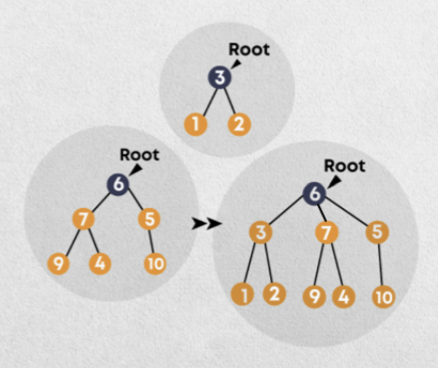
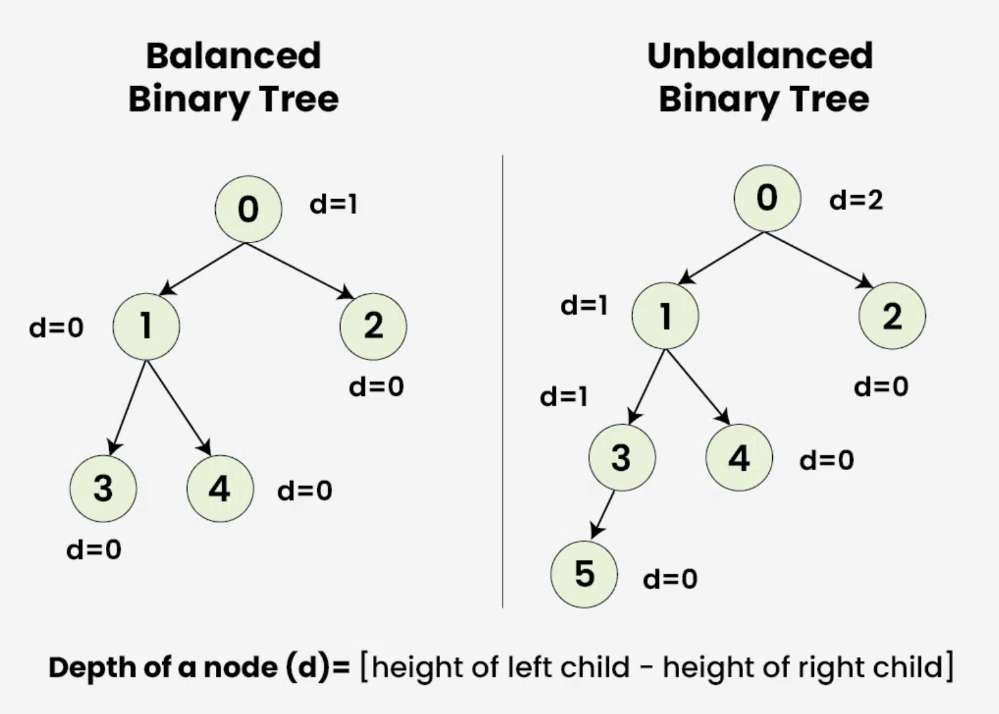
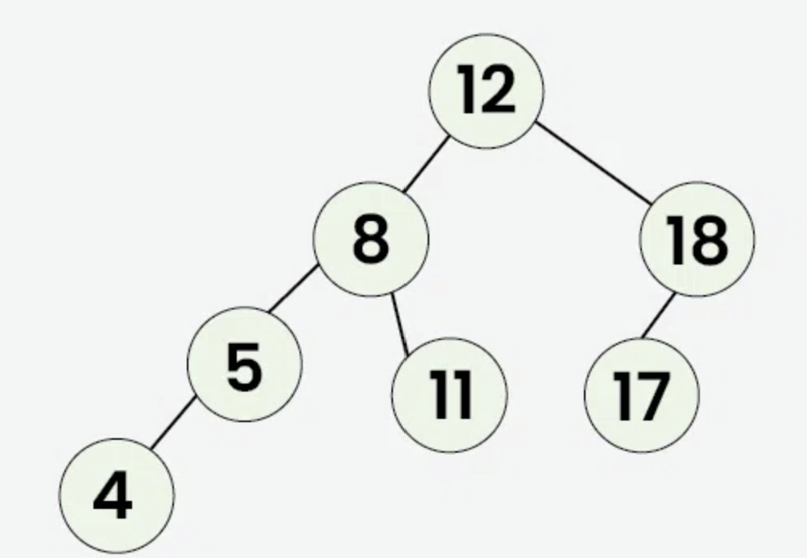
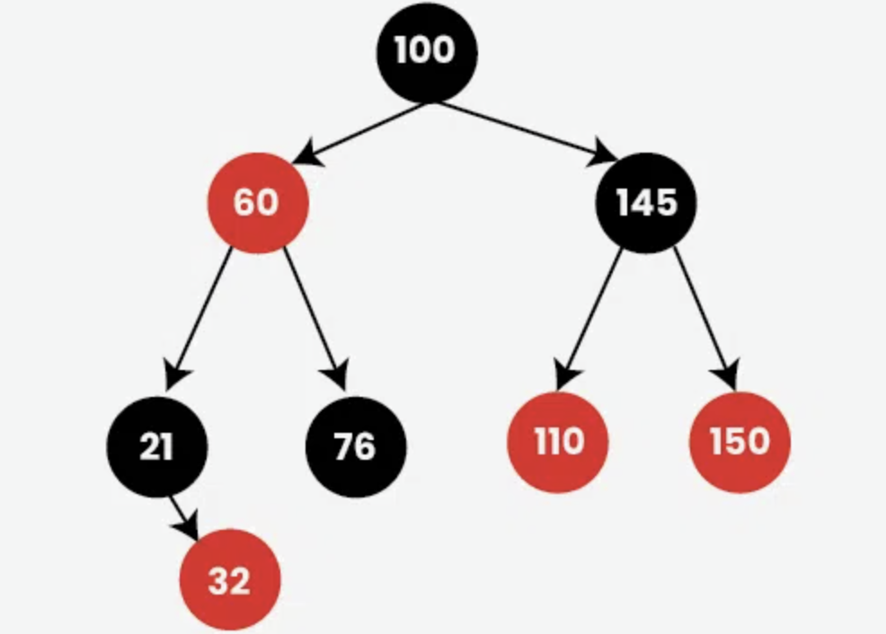

# Specialized Data Structures
Regular data structures works for lots of programming cases and usage, but they aren't always the most efficient. Specialized data structures are designed to solve certain problems more efficiently than regular structures such as arrays, linked lists, stacks, queues, and others. They organize and store data according to specific requirements, making certain operations be performed faster or with less memory usage.

## Disjoint Set Union (DSU)
Disjoint Set Unions (DSUs) are used to find which elements belong to the same group. This data structure enables the merging of separate sets and addressing different inquiries concerning them, such as determining if elements a and b belong to the same set and finding out the size of the set. 

Two sets are called disjoint sets if they don't have any element in common. The disjoint set data structure is used to store such sets. DSU maintains a collection of separate sets, or groups which are represented by trees. Each group has a representative element called its root or representative.

In DSU, two main operations can be performed:
- Find, finding representative of a disjoint set.
    For example, if we want to find the group of C, we need to follow the parent pointers to the root. Suppose we have, C points to B and B points to A. From this, we know that C belongs to the group represented by A.
- Union, merging two disjoint sets to a single set.
    For example, A and B are two different groups. B points to A, hence we perform the union operation on them. Both groups now share the representative of A. However, we need to keep in mind, the union operation merges groups, but it does not necessarily connect the exact two elements directly. It merges the sets that contain them.

Optimisations can help DSU to be more efficient:
- Path compression
    When finding an element's root, make the elements encountered point directly to that root. For example,
    D->C->B->A can be shortened to just D->A.
- Union by size or rank
    When merging two groups, attach the smaller or shallower tree to the larger or taller one. This helps prevent unnecessarily long chains.

## Balanced Search Trees (BST)
Binary Search Trees (BSTs) organizes values based on three rules:
- Values smaller than a node go to its left.
- Values larger than a node go to its right.
- Each node has at most two children.

However, BSTs aren't always well-shaped or divided properly. Unbalanced BSTs can make search times much longer than it has to be, that is why Balanced Search Trees tries to keep the tree's height small. When a tree becomes unbalanced, it rearranges its nodes while still following the BST rules.

There are three conditions to check if a Binary Search Tree is balanced:
- The absolute difference between heights of left and right subtrees at any node should be less than or equal to 1.
- For each node, its left subtree should be a balanced binary tree.
- For each node, its right subtree should be a balanced binary tree.

There are two well-known self-balancing BSTs:
- AVL Trees, where the difference between heights of left and right subtrees cannot be more than one for all nodes.

- Red-Black Tree, where each node has an additional attribute: a color, which can be either red or black. The primary objective of these trees is to maintain balance during insertions and deletions, ensuring efficient data retrieval and manipulation.

References:
- https://www.geeksforgeeks.org/dsa/introduction-to-disjoint-set-data-structure-or-union-find-algorithm/
- https://www.w3schools.com/dsa/dsa_data_binarytrees.php
- https://www.geeksforgeeks.org/dsa/balanced-binary-tree/