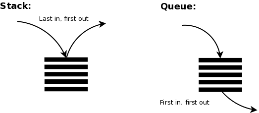

## Outline:
- Basic concept:
    - Stacks: last in, first out (LIFO)
    - Queue: first in, first out (FIFO)

## Definition:
Stacks and queues are two ways to store items. They differ in one rule: which item you take out first. A stack removes the newest item first, while a queue removes the oldest item first. Both can use an array, where markers (top for a stack, head and tail for a queue) track where to add and remove, so no items have to be moved.
- Stacks: Add (Push) & Remove (Pop)
- Queue: Add (Enqueue) & Remove (Dequeue)

## Easy Analogy:
- Stack: a pile of plates. You put a clean plate on top, and you also take a plate from the top. The last plate placed is the first one taken.
- Queue: a line at a cashier. The person who arrived first is served first, and new people join at the back.

## Key Terms
| Term | Meaning |
| ----------- | ----------- |
| Top | The end of a stack where items are added and removed. It holds the newest item. |
| Push | Add an item to the top of a stack.|
| Pop | Remove the top item of a stack and return it.|
| Front | The end of a queue where items are removed. It holds the oldest item.|
| Back | The end of a queue where items are added. It holds the newest item. |
| Enqueue | Add an item to the back of a queue. |
| Dequeue | Remove the front item of a queue and return it. |
| Marker | A number that remembers a position in an array |
| Head | The marker for the front of a queue. It points to the oldest item, the next one to be removed. |
| Tail | The marker for where the next new item will go. It points to the empty spot just after the newest item. |

## Worked Example:
- Stack example (last in, first out)

| Step | Action |  Stack (left = bottom, right = top) | Removed |
| ----------- | ----------- | ----------- | ----------- |
|1|Push 5|5||
|2|Push 3|5,3||
|3|Push 6|5,3,6||
|4|Pop|5,3|6|
|5|Push 4|5,3,4||
|6|Pop|5,3|4|
|7|Pop|5|3|

  

- Queue example (first in, first out)

| Step | Action |  Queue (left = front, right = back) | Removed |
| ----------- | ----------- | ----------- | ----------- |
|1|Enqueue 5|5||
|2|Enqueue 3|5,3||
|3|Enqueue 6|5,3,6||
|4|Dequeue|3,6|5|
|5|Enqueue 4|3,6,4||
|6|Dequeue|6,4|3|
|7|Dequeue|4|6|

## Visual:

Stack: items enter and leave at the same end. Queue: items enter at the back and leave from the front.
https://gohighbrow.com/wp-content/uploads/2018/07/Computer-science-fundamentals_6.1.png

## Question exercise & Answer:
| Step | Action |
| ------|----- |
|1|Add 5|
|2|Add 8|
|3|Remove one item|
|4|Add 2|
|5|Add 9|
|6|Remove one item|

1. Which items are removed in the stack, and what is left?
    - (8 and 9 are removed) & (5,2 remained)
2. Which items are removed in the queue, and what is left?
    - (5 and 8 are removed) & (2,9 remained)
3. Which structure would you use to model a line of people at a bank, and why?
    - Queue, because first come first served. The one who waits the longest will be served first.

## References:
1. Cormen, T. H., Leiserson, C. E., Rivest, R. L., & Stein, C. (2009). Introduction to Algorithms (3rd ed.). MIT Press. §10.1, pp. 232–236.
2. https://fahadsultan.com/csc122/data/stacks_queues.html
