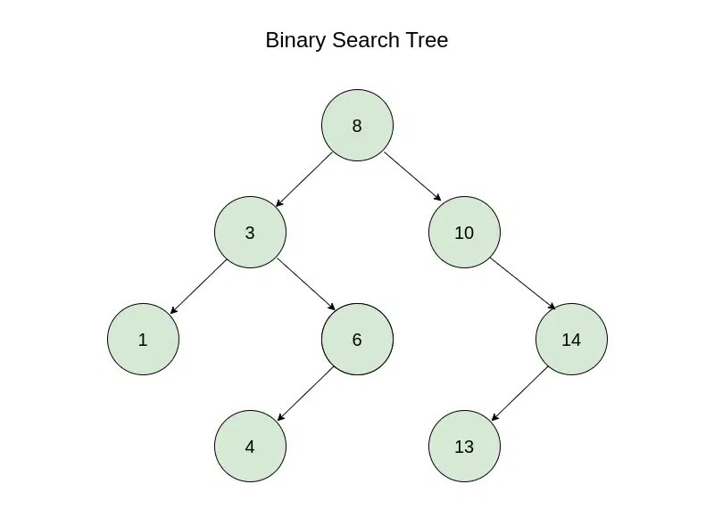

## Outline: 
A tree stores items in levels, like a company chart, with one item at the top and branches below. A binary search tree (BST) is a tree where smaller numbers go left and bigger numbers go right, so searching is fast. A trie is a tree for words, where each step down the tree is one letter.

## Definition: 
A tree is a set of items called nodes arranged in levels. The top node is the root, and a node’s children are the nodes directly below it. A node with no children is a leaf. A binary tree gives each node at most two children. A binary search tree is a binary tree where, for every node, smaller keys are in its left branch and larger keys are in its right branch. A trie is a tree where each word is stored as a path of letters from the root, and a mark shows where a word ends.

## Conditions for a Tree to be a Binary Search Tree
For a tree to be called a binary search, it should fulfill the following conditions:
- All the nodes in the left subtree of any node contain smaller values and all the nodes in the right subtree of any node contain larger values.
- Both the left and right subtrees of any node in the tree should themselves be a BST. This means that they should follow the BST rule.
- A unique path exists from the root node to every other node.

## Easy Analogy
- Tree: a company chart. The president is at the top, and the vice presidents and managers hang below.
- BST: a road with signs at every junction: “smaller numbers left, bigger numbers right”. To find 6, you follow the signs and never check the whole tree.
- Trie: phone autocomplete. When you type “c”, then “a”, the phone follows the letters one by one and suggests “car” or “cat”.

## Basics terminologies used in BST:
- Children: The successor nodes of a node are called its children.
- Parent: The predecessor node of a node is called its parent.
- Root: The "beginning" node is called the root i.e. a node that has no parent.
- leaf: A node that has no children is called a leaf.

## Basic 3 operation: search, insertion and deletion in a binary search tree.
|Operations|Description|Best Case Time Complexity|Average Case Time Complexity|Worse Case Time Complexity|
|--|--|--|--|--|
|Search|This function is used to search a given key in BST.|O(log n)|O(log n)|O(n)|
|Insertion|This function is used to insert values in a BST.|O(log n)|O(log n)|O(n)|
|Deletion|This function is used to delete the specified node from a BST.|O(log n)|O(log n)|O(n)|

## Work Example:
1. Build a BST. Insert 8, 3, 10, 1, 6 in this order. The first key becomes the root. Each next key walks down: smaller goes left, bigger goes right, until it finds an empty spot.

|Insert|Path|Result|
|--|--|--|
|8|Tree is empty|8 becomes the root|
|3|3 < 8, go left|3 is left child of 8|
|10|10 > 8, go right|10 is right child of 8|
|1|1 < 8, left; 1 < 3, left|1 is left child of 3|
|6|6 < 8, left; 6 > 3, right|6 is right child of 3|

2. Search.
    - Search 6: start at 8, 6 is smaller so go left to 3, 6 is bigger so go right to 6. Found after 3 checks.
    - Search 7: 8 → left to 3 → right to 6 → 7 is bigger, but 6 has no right child. Not in the tree.

3. Read the tree in order
    - You get 1, 3, 6, 8, 10, which is sorted.

4. A trie
    - stores the words car, cat, do, dog. Search “ca”: follow c → a. There is no end mark on “a”, so “ca” is not a word (only the start of one). Search “cab”: after c → a there is no “b” branch, so it is not in the trie.

## Visual

BST Visual. https://www.geeksforgeeks.org/cpp/cpp-binary-search-tree/

## Question exercise & Answer:
A tree has root A. A’s children are B and C. B’s children are D and E.
1. Name the leaves, the parent of D, and the sibling of B.
    - Leaves: C, D, E. Parent of D: B. Sibling of B: C.

2. Insert 5, 2, 8, 1, 4 into an empty BST, in this order. Then search for 4 and for 7.
    - 5 is the root. 2 goes left of 5. 8 goes right of 5. 1 goes left of 2. 4 goes right of 2.
    - Search 4: 5 → left to 2 → right to 4. Found after 3 checks.
    - Search 7: 5 → right to 8 → 7 is smaller, but 8 has no left child. Not in the tree.

3. List the keys of that tree in order (left branch, node, right branch).
    - 1, 2, 4, 5, 8.

5. In a trie holding “to”, “tea”, and “ten”, is “te” a word?
    - No. The path t → e exists, but no word ends at “e”. It is only the start of “tea” and “ten”.

6. What does the BST look like if you insert 1, 2, 3, 4 in that order, and why is that a problem?
    - Every new key is bigger, so it always goes right. The tree becomes one long chain, 1 → 2 → 3 → 4. Searching then takes as many steps as a plain list. Cormen p. 286 says the same: the speed depends on the tree’s height, and a chain of n nodes is the slow case.

## References
1. Cormen et al. Introduction to Algorithms, 3rd ed. Chapter 12 “Binary Search Trees”: introduction p. 286; §12.1 pp. 286-288 (BST property, inorder walk); §12.2 pp. 289-290 (search); §12.3 p. 294 (insertion).
2. Sedgewick, R. and Wayne, K. Algorithms, 4th ed. §5.2 “Tries” (for the trie part).
3. https://www.geeksforgeeks.org/cpp/cpp-binary-search-tree/