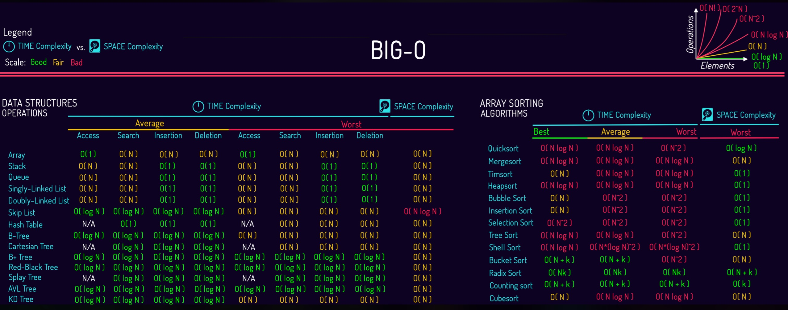

# 2.2 Correctness Complexity

## What is Algorithm Correctness?

An algorithm is correct if it produces the expected output for every valid input.  
This breaks down into two levels:
* **Partial Correctness:** If the algorithm finishes running, the output is guaranteed to be correct.
* **Total Correctness:** The algorithm is partially correct and it is mathematically guaranteed to teminate (it will nver get stuck in an infinite loop).

To prove correctness, computer scientists use structural logic:
* **Preconditions and Postconditions:** The state that must exist before the algorithm runs and the state guaranteed after it finishes must be true.
* **Loop Invariants:** A property that remains true before, during, and after every iteration of a loop. Proving an invariant usually relies on mathematical induction.
* **Variants:** A quantitative measure that strictly decreases during every loop iteration. When it reaches a baseline (like zero), the loop stops, guaranteeing termination.

## Structural Correctness in Data Structures
Think of an invariant like a strict rule a data structure must always follow to stay correct. For example, imagine a line of people ordered from shortest to tallest. If a short person cuts into the middle, the rule is temporarily broken, and you must swap them until the correct order is restored. Similarly, inserting or deleting items in a data structure disrupts its internal rules. The algorithm must always fix these violations before finishing, or else the data structure becomes corrupted and loses its efficiency guarantees.

## What is algorithm complexity?
Complexity abstracts away specific hardware speeds to measure how an algorithm's resource consumption scales as the input size $n$ grows. 
* **Time Complexity:** The number of basic operations (comparisons, assignments, arithmetic) executed.
* **Space Complexity:** The amount of auxiliary memory required beyond the input itself.

## Asymptotic Complexity Classes
Different algorithmic paradigms and structures yield vastly different growth rates:
* **Constant Time** - `O(1)`: Operations take the same time regardless of input size (e.g., accessing an array element by index, hash table lookup).
* **Logarithmic Time** - `O(logN)`: The problem size is halved at each step (e.g., Binary Search). Analogy: Finding a word in a dictionary by repeatedly opening it to the middle.
* **Linear Time** - `O(N)`: Execution time grows directly in proportion to the input size (e.g., finding the maximum element in an unsorted array via a single pass).
* **Linearithmic Time** - `O(NlogN)`: Common in efficient comparison-based sorting algorithms like Merge Sort and Quicksort, which repeatedly partition data and merge results.
* **Quadratic Time** - `O(N^2)`: Typically arises from nested loops where every element is compared against every other element (e.g., Bubble Sort, Insertion Sort, or checking all pairs in a matrix).
* **Exponential Time** - `O(2^N)`: Explodes rapidly with input size, often seen in naive recursive solutions like finding the n-th Fibonacci number without memoization.
* **Factorial Time** - `O(N!)`: The ultimate bottleneck, occurring in brute-force solutions that generate all possible permutations, such as the naive Traveling Salesperson Problem (e.g., visiting n cities in every possible order).

>$n$  is the number of elements or nodes depending on the usage.

## Asymptotic Notation (Big O, Big Omega, Big Theta)
We use Asymptotic Notation to categorize this scaling into bounds:
* **Big O** (O): The asymptotic upper bound (worst-case scenario). It guarantees that the algorithm will not exceed this growth rate.
* **Big Omega** (Ω): The asymptotic lower bound (best-case scenario). It establishes the minimum time or space required.
* **Big Theta** (Θ): A tight bound where the upper and lower bounds match, meaning the function grows at a precise predictable rate from both above and below.
* **Little o** (o) and Little omega (ω): Strict upper and lower bounds (where growth is strictly less than or greater than, without equality). 

This graph below show the best-case and worst-case based on the complexity for data structures and algorithms:

## Role of Data Structures

Algorithms and data structures are inseparable because the layout of the data directly dictates the complexity bounds.

### Complexity Trade-offs
* If you need `O(1)` constant time lookups, you might choose a Hash Table, but you sacrifice memory to get it. 
* If you need memory efficiency and strictly ordered data, you might use a Binary Search Tree, which slows lookups to `O(log N)`.