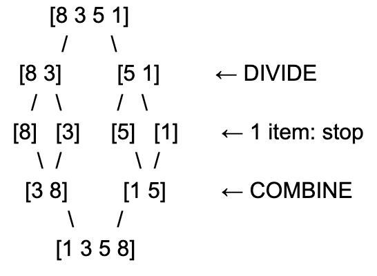

# 2.4 Recursion and Divide-and-Conquer

## What is Recursion?
Imagine we are playing the “higher or lower” guessing game. Your friend thinks of a number from 1 to 100. You guess 50. Your friend says “higher”. Now you only need to look at 51–100, so you guess 75. Each guess cuts the possibilities in half, and you repeat the same idea each time.

**Recursion** means solving a task by repeating the same steps on a smaller version of the same task, until the task is small enough to answer directly. In other words, it is a procedure that refers to itself to solve a smaller version of the problem.

**Recursion vs Loops**
A loop finishes a set of steps and then repeats it. Recursion repeats the steps as a subtask of itself. The situation that is small enough to answer directly, so the repeating stops. For example, a list with no items, or a list with only one item.

## What is Divide-and-Conquer
Imagine we are sorting a pile of exam papers: We would want to split the pile into two smaller piles. Ask two friends to sort one pile each. Join the two sorted piles into one: look at the top paper of each pile, take the one that comes first, and repeat. This is exactly how divide-and-conquer works.

**Divide-and-Conquer** is a way to solve a big problem by splitting it into smaller problems of the same kind, solving each small one, and then joining the answers.
* **Divide:** split the problem into smaller parts that look like the original.
* **Conquer:** solve each part by using the same method again (recursion). If a part is small enough, just solve it directly.
* **Combine:** put the small answers together into the answer to the big problem.

## Example

### Recursion
We want to find `27` in this sorted list: `3, 8, 12, 15, 21, 27, 34, 40`.
* If the list is empty → the number is not here. Stop.
* Otherwise, look at the middle number. (If the list has an even number of entries, the middle is the first entry of the second half.)
  * If it matches → found it. Stop.
  * If your number is smaller → search the first half, using these same steps.
  * If your number is bigger → search the second half, using these same steps.

| Step | List | Middle | What Happens |
| :--- | :--- | :--- | :--- |
| 1 | 3,8,12,15,21,27,34,40 | 21 | 27 is bigger, so keep the right half |
| 2 | 27,34,40 | 34 | 27 is smaller, so keep the left half |
| 3 | 27 | 27 | Found it! |

### Divide-and-Conquer
Imagine we want to sort `8, 5, 3, 1` using divide-and-conquer.

| Step | What Happens | Result |
| :--- | :--- | :---|
| Divide | Split the list in half | [8, 3] and [5, 1] |
| Divide | Split again until each part has 1 item | [8], [3], [5], [1] |
| Conquer | One item is already sorted, so stop splitting | |
| Combine | Merge [8] and [3] | [3, 8] |
| Combine | Merge [5] and [1] | [1, 5] |
| Combine | Merge [3, 8] and [1, 5] | [1, 3, 5, 8] |

* Compare 3 and 1. Take 1.
* Compare 3 and 5. Take 3.
* Compare 8 and 5. Take 5.
* Only 8 are left. Take 8.

## Performance
Merging:
* **Best-case time complexity:** `O(NlogN)` (guaranteed splitting and merging)
* **Worst-case time complexity:** `O(NlogN)` (consistent performance regardless of initial order)
* **Average-case time complexity:** `Θ(NlogN)`
* **Space complexity:** `O(N)` (requires auxiliary memory for merging)

Sorting:
* **Best-case time complexity:** `O(NlogN)` (balanced partitions)
* **Worst-case time complexity:** `O(N^2)` (unbalanced partitions from poor pivot selection)
* **Average-case time complexity:** `Θ(NlogN)`
* **Space complexity:** `O(logN)` (recursion call stack)

## Strengths and Limits
* **Merging:** Guaranteed `O(NlogN)` performance and stability, making it ideal for linked lists and external sorting, though it requires `O(N)` extra auxiliary memory for the merging process.
* **Sorting:** Fast average speed with minimal in-place space overhead (`O(logN)` stack space), but it is unstable and can degrade to `O(N^2)` time if poor pivot selections occur.