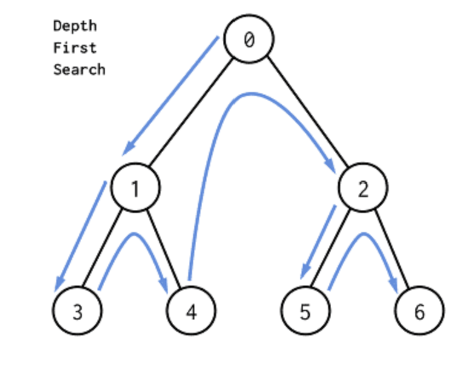
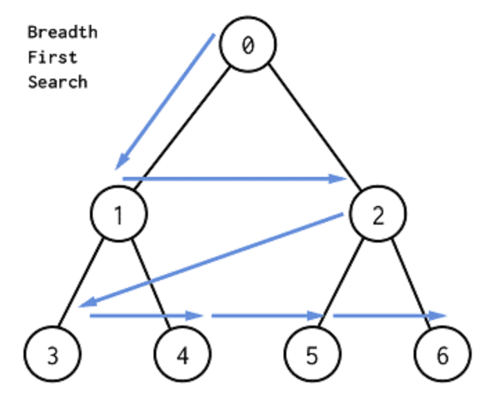
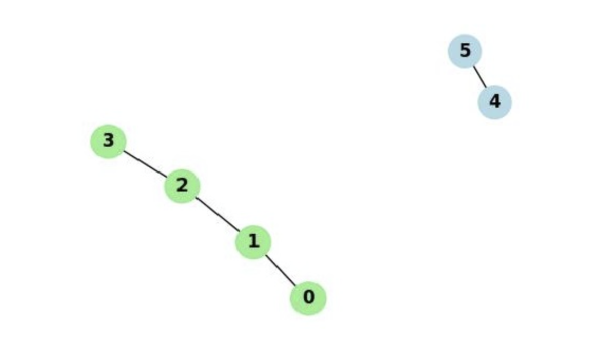
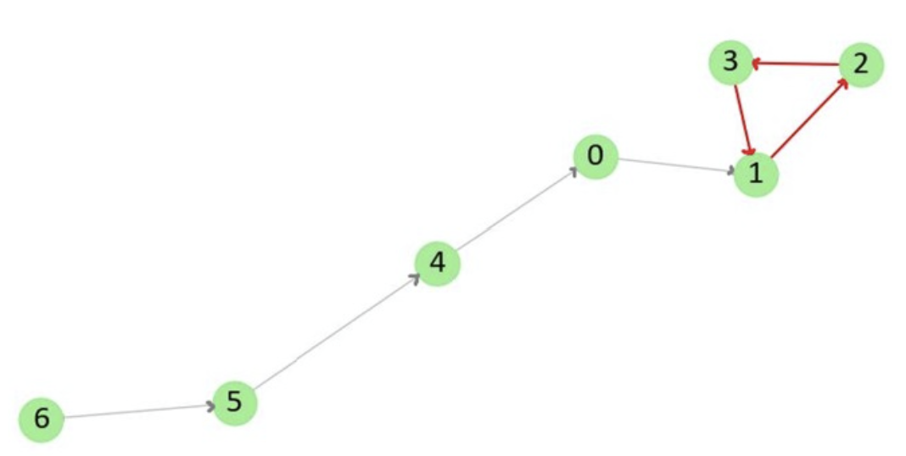
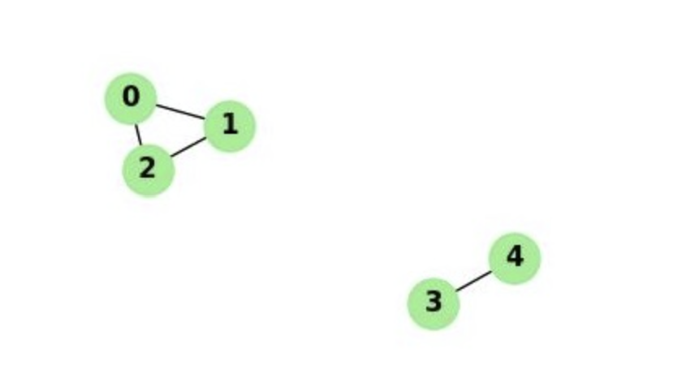
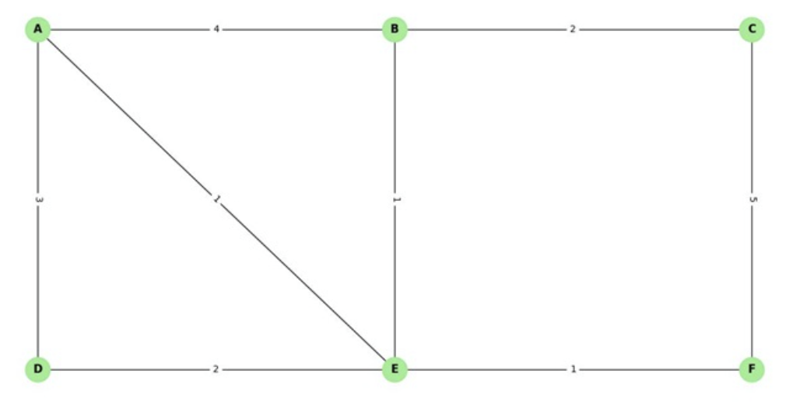
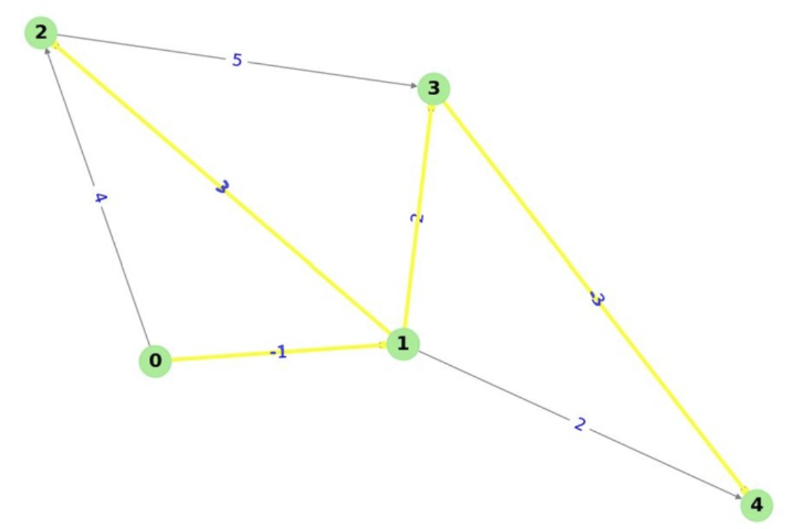
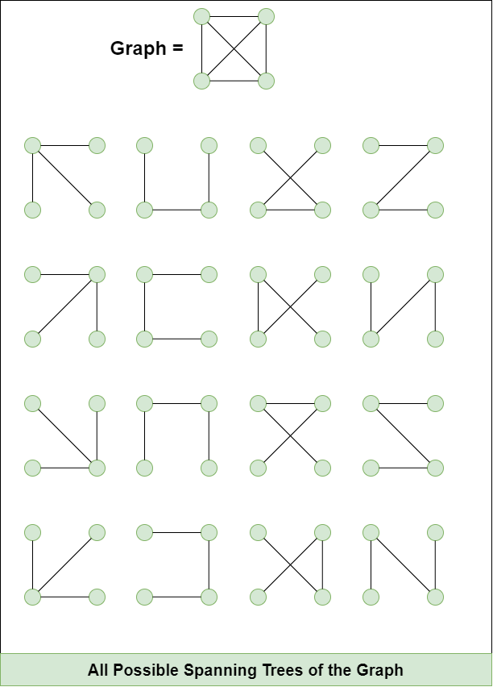
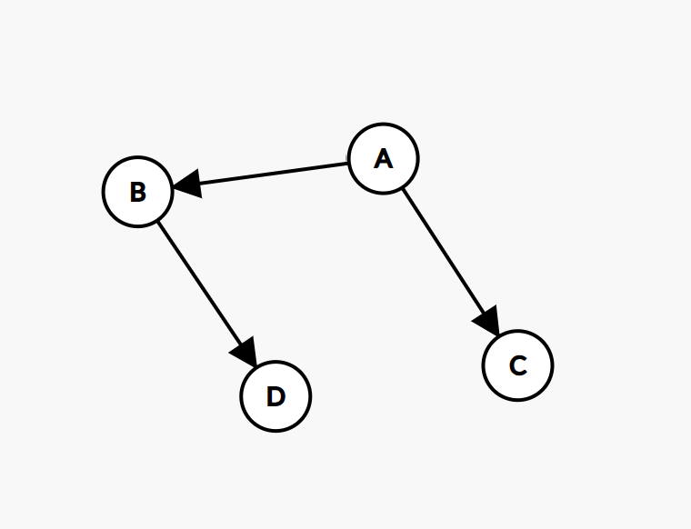

# Graph Algorithms 
Graph algorithms are procedures used to solve problems involving relationships between objects or by representing object as nodes (vertices) and relationships as edges. Graph algorithms use these relationships or connections to answer questions such as whether two nodes (vertices) are connected, what the shortest route between them is, and how a network can be connected at minimum cost.

Major Types of Graph Algorithms:
## Graph Traversal
Graph traversal is the process of visiting all the vertices or edges in a graph. There are two primary methods for graph traversal: 

### Depth-First Search (DFS)
Depth-First Search (DFS) starts at a source vertex and explores until it hits a dead end before backtracking. DFS prioritizes exploring deeper into the graph instead of fully exploring each level. It can be implemented using recursion or an explicit stack. DFS is used for tasks like cycle detection and topological sorting.

How DFS works:
1. Start at a vertex and mark it as visited.
2. Process the vertex.
3. Visit an unvisited neighbor, repeating the same procedure.
4. When no unvisited neighbors remain, backtrack to the previous vertex.
5. Continue until all reachable vertices have been explored.

In this illustration, traversal starts at 0, moves to its neighbour 1, then goes as deep as possible to 3. After reaching a dead end, it backtracks to 1 and explores 4. Then, it backtracks all the way up, exploring 2 and repeating the same process for 5 and 6. In this example, the traversal follows the sequence of: 0->1->3->4->2->5->6. 

This sequence can be visualized with the following table.
| **Step** | **Visited** | **Stack** |
| :---     | :----:   | ---:     |
| 0 | - | {0} |
| 1 | 0 | {1, 2} |
| 2 | 1 | {3, 4, 2} |
| 3 | 3 | {4, 2} |
| 4 | 4 | {2} |
| 5 | 2 | {5, 6} |
| 6 | 5 | {6} |
| 7 | 6 | {} |

With an adjacency list, DFS has a time complexity of $O(V + E)$, where this means the time it takes to finish DFS depends on how many vertices ($V$) and edges ($E$) are in the graph. DFS also has an auxiliary (supplementary) space complexity of O(V), meaning the extra memory DFS uses to track where it has visited. The space is used by the visited information and the recursion stack or explicit stack.

For very deep graphs, recursive DFS may exceed a programming language's recursion limit. An explicit stack can be used instead.

### Breadth-First Search (BFS)
Breadth-First Search (BFS) starts at a source vertex and explores all vertices at its level before moving on to the next level. BFS uses a queue, which follows the First In, First Out (FIFO) principle. The first vertex added to the queue is the first one processed. BFS can be used for finding the shortest path in unweighted graphs.

How BFS works:
1. Mark the starting vertex as visited and add it to the queue.
2. Remove the front vertex from the queue and process it.
3. Examine its neighbors. For each unvisited neighbor, mark it as visited and add it to the queue.
4. Repeat until the queue is empty.

In this illustration, traversal starts at 0, moves to its neighbour 1, then explores the adjacent vertex of 2. After exploring every vertex at its level, it starts exploring the next level, starting with 3. It repeats the process for 4, 5, and 6 until all vertices have been visited. In this example, the traversal follows the sequence of: 0->1->2->3->4->5->6.

This sequence can be visualized with the following table.
| **Step** | **Visited** | **Queue** |
| :---     | :----:   | ---:     |
| 0 | - | {0} |
| 1 | 0 | {1, 2} |
| 2 | 1 | {2, 3} |
| 3 | 2 | {3, 4} |
| 4 | 3 | {4, 5} |
| 5 | 4 | {5, 6} |
| 6 | 5 | {6} |
| 7 | 6 | {} |

With an adjacency list, BFS has a time complexity of O(V + E), where V is the number of vertices and E is the number of edges. Each vertex and edge is examined a bounded number of times.

Its auxiliary space complexity is O(V) because the visited information and queue may store up to a number of entries proportional to the vertices.

## Connectivity and Cycle Detection
### Connectivity
Connectivity describes whether vertices can reach one another through paths. In an undirected graph, a graph is connected if every vertex can be reached from every other vertex. If this is not true, the graph consists of multiple connected components. A connected component is a group of vertices in which every pair of vertices is connected by a path. To find connected components, the two algorithms that are used are BFS and DFS.

How does this work:
1. Mark every vertex as unvisited.
2. Choose an unvisited vertex and do BFS or DFS from it.
3. Assign all vertices reached during that traversal to the same component.
4. Repeat with another unvisited vertex until every vertex has been visited.

With an adjacency list, this process takes O(V + E) time.

In directed graphs, connectivity has additional rules because edges can only be followed in their specified directions. This divides the level of connectivity into two, strongly connected and weakly connected. A strongly connected component (SCC) is a group of vertices in which every vertex can reach every other vertex by following directed edges. A weakly connected component is a group of vertices that is connected when edge directions are ignored. Connectivity in directed graphs uses different algorithms that won't be further discussed such as Kosaraju's and Tarjan's can identify strongly connected components.

In the illustration, DFS identifies two connected components: {0, 1, 2, 3} and {4, 5}.

### Cycle Detection
Cycle detection is the process of finding cycles (if any) in a graph. It is important in tasks such as checking dependencies in directed graphs and detecting infinite loops. The two major methods for cycle detection are:

1. DFS-Based Cycle Detection
This method uses DFS to explore the graph and keep track of the visited vertices. If a vertex is encountered that is already in the recursion stack, a cycle is detected.

- In an undirected graph, DFS can detect a cycle by finding a visited neighbor that is not the current vertex's parent until it meets the edge of the vertex's parent.
- In a directed graph, DFS can detect a cycle by finding an edge to a vertex that is currently on the active recursion path. A common implementation tracks three states:
    - Unvisited: the vertex has not been explored.
    - Visiting: the vertex is currently being explored.
    - Visited: the vertex and its outgoing edges have been fully explored.
An edge to a vertex in the visiting state indicates a directed cycle.

In this graph, a cycle is detected involving vertices 1, 2, and 3.

2. Union-Find Cycle Detection 
This method uses a union-find data structure to keep track of connected components and detect cycles in an undirected graph. If adding an edge connects two vertices that are already in the same component, a cycle is detected.

In this graph, a cycle is detected with vertices 0, 1, and 2.

## Shortest Path Algorithms
A shortest-path algorithm finds a path between vertices that minimizes the total path cost. Depending on the graph, the cost may be the number of edges or the sum of edge weights. The appropriate algorithm depends on whether edges have weights, whether those weights can be negative, and whether a single source or all pairs of vertices must be considered.

Three major algorithms to find the shortest paths:
### 1. BFS
BFS finds shortest paths in an unweighted graph or when every edge represents the same cost because it explores vertices in increasing order of their distance, measured in edges, from the source. During traversal, the algorithm records the distance of each newly discovered vertex as one more than the distance of the vertex from which it was reached. 

Its time complexity is $O(V + E)$ with an adjacency list.

### 2. Dijkstra's Algorithm
Dijkstra's algorithm finds the shortest paths from one source vertex to all reachable vertices in a weighted graph when all edge weights are non-negative. Dijkstra's Algorithm uses a priority queue to select the vertex with the minimum distance at each step.

How does this work:
1. Label all other vertices estimated to be infinity ($\infty$), except the source vertex which we know is 0 cost.
2. Explore neighbours with the least estimated cost following a priority queue.
3. Evaluate all adjacent unvisited neighbours to calculate costs. If the newly calculated path is shorter than the previous one, update the vertex's cost. This improvement step is called relaxation.
4. Move to the next lowest cost estimate vertex, while keeping track of the shortest paths taken.
5. Repeat step 2 through 4 until the priority queue is empty or the designated end point has been reached.
6. Organize the lowest cost path based on found estimates.

Relaxation can be modelled where for an edge from u to v with weight w, it checks:
$distance[u] + w < distance[v]$

Its time complexity is $O((V + E) log V)$.

The shortest path from A to F using Dijkstra's algorithm is A - E - F with a total weight of 2.

### 3. Bellman–Ford Algorithm
Bellman–Ford Algorithm also finds shortest paths from a single source, but it supports negative edge weights. However, this algorithm does not work with negative cycles likewise with Dijkstra's Algorithm.

How does this work:
1. Label all other vertices estimated to be infinity ($\infty$), except the source vertex which we know is 0 cost.
2. Relax every edge $(u, v)$ with the cost $w$, evaluate if the path to $v$ through $u$ is shorter than the previously calculated cost for $v$. If it is, update the vertex's cost and record $u$ as its predecessor.
3. Repeat step 2 for a total of $V - 1$ iterations or times (where $V$ is the number of vertices). In a graph without negative cycles, a shortest path contains at most $V - 1$ edges. Optimal or shortest paths can be found sooner than $V - 1$, but $V - 1$ iterations will guarantee shortest paths.
4. If the graph keeps relaxing after $V - 1$ iterations, that means the graph has a negative cycle.
5. Organize the lowest cost path based on predecessors.

Its time complexity is $O(V \cdot E)$.

- Vertex 0: The distance to itself is 0, as no travel is needed.
- Vertex 1: The shortest distance is -1, achieved via the edge from vertex 0 to vertex 1 with a weight of -1.
- Vertex 2: The shortest distance is 2, found by traveling from vertex 0 to vertex 1 (distance -1), and then from vertex 1 to vertex 2 (distance 3), resulting in a total distance of -1 + 3 = 2.
- Vertex 3: The shortest distance is 1, obtained by traveling from vertex 0 to vertex 1 (distance -1), and then from vertex 1 to vertex 3 (distance 2), resulting in a total distance of -1 + 2 = 1.
- Vertex 4: The shortest distance is -2, found by traveling from vertex 0 to vertex 1 (distance -1), from vertex 1 to vertex 4 (distance 2), and then from vertex 3 to vertex 4 (distance -3), resulting in a total distance of -1 + 2 - 3 = -2.

Hence, shortest distances from vertex 0: {0: 0, 1: -1, 2: 2, 3: 1, 4: -2}.

## Minimum Spanning Tree (MST)
A Minimum Spanning Tree (MST) is a subgraph of an undirected, weighted graph that connects all the vertices together with the minimum total edge weight, without any cycles. 

There are two commonly used algorithms to find an MST:
### Kruskal's Algorithm
Kruskal's algorithm is a greedy algorithm used to find the MST of a graph using an edge-based approach. It works by sorting the edges by weight and adding edges to the MST in increasing order of weight, ensuring no cycles are formed.

How it works:
1. Sort all edges from lowest to highest weight.
2. Start with an empty spanning tree by choosing the lowest-weight edge.
3. Examine the next lowest-weight edge and connect it if it does not create a cycle.
4. Repeat until MST contains V-1 edges.

Its time complexity is $O(E log E)$.

### Prim's Algorithm
Prim's algorithm is also a greedy algorithm used to find the MST of a graph using a vertex-based approach. It starts with any vertex and grows the minimum spanning tree (MST) by adding one vertex at a time. It always adds the smallest edge that connects a vertex already in the tree to a vertex not yet in the tree. A priority queue is used to select the smallest edge at each step.

How it works:
1. Choose any starting vertex.
2. Examine the edges connecting the current tree to vertices outside it.
3. Select the lowest-weight edge that connects the tree to a new vertex.
4. Add that edge and vertex to the tree.
5. Repeat until all vertices have been included.

Its time complexity is $O((V + E) log V)$.

## Topological Sorting
Topological sorting arranges each vertice in order so vertices with no dependencies are ordered first. A topological sorting is not unique, meaning as long as the order is valid, the topological sorting is also valid. This type of sorting is also only possible for a directed acyclic graph (DAG). 

There are two methods to do topological sorting:
### DFS
Topological sorting uses DFS by placing each vertex into a list after all its reachable unvisited neighbors have been processed.

How it works:
1. Mark every vertex as unvisited.
2. Start DFS from an unvisited vertex.
3. Explore unvisited neighbours deeper until hitting a dead end.
4. Add the vertex to the list and backtrack to check other paths.
5. Repeat for any remaining unvisited vertices.
6. Reverse the result list to obtain the topological ordering.

Using the DFS, we get the order of D->B->C->A. We reverse the list to get the topological order, which is A->C->B->D.

### BFS using Kahn's Algorithm
Kahn's algorithm uses in-degree, which is the number of incoming edges or dependencies a vertex has. As long as the vertex has no remaining dependencies, it can be placed in the queue.

How it works:
1. Calculate the in-degree of every vertex.
2. Add every vertex with in-degree zero to a queue.
3. Remove a vertex from the queue and add it to the ordering list.
4. Reduce each vertex's in-degree by one.
5. Whenever a neighbour's in-degree becomes zero, add it to the queue.
6. Continue until the queue is empty.
7. If the ordering doesn't include all vertices, the graph contains a cycle.

| Vertex | In-degree |
| ---- | ---- |
| A	| 0 |
| B	| 1 |
| C	| 1 |
| D | 2 |
Sorting using Kahn's Algorithm, we get the topological order of A->B->C->D.

References:
- https://aiknowledgehub.in/solving-a-maze-using-bfs-and-dfs/
- https://www.tutorialspoint.com/graph_theory/graph_theory_graph_algorithms.htm
- https://neo4j.com/blog/graph-data-science/graph-algorithms/#h-graph-traversal
- https://www.puppygraph.com/blog/graph-algorithms
- https://www.w3schools.com/dsa/dsa_algo_graphs_traversal.php
- https://www.geeksforgeeks.org/dsa/graph-data-structure-and-algorithms/
- https://www.youtube.com/watch?v=EFg3u_E6eHU&t=467
- https://youtu.be/j0OUwduDOS0?si=fC5Z0ACYLtzva-Rw
- https://youtu.be/TtQi1LVVOUI?si=Aw0sQw2AldHw4fxR
- https://youtu.be/9PHkk0UavIM?si=1SaYD_QVCmuN2K5f
- https://www.geeksforgeeks.org/dsa/spanning-tree/