# 3.1 Foundation of Connectionist AI

## What is Artificial Intelligence (AI)?
Artificial Intelligence (AI) is a field of computer science focused on enabling computers and machines to do tasks that are commonly associated with intelligent beings. This includes, but not limited to, processing thoughts, decision-making, and creativity. In the 21st century, AI has become increasingly integrated into everyday life. Examples include AI-generated images, enemy behavior in video games, recommendation systems, and Large Language Models (LLMs) such as ChatGPT and Claude.

When you boot up a game in Pokemon, AI is used to determine what actions they will take against you. 

When you mistype, AI predicts your next words and fixes typos based on your typing habits.

These examples show how AI can be used across entertainment, communication, and many other fields.

We often confuse the terms Artificial Intelligence (AI), Machine Learning (ML) and Deep Learning (DL), assuming they all mean the same thing. But in reality, they represent different levels of intelligent computing. AI is the broadest field, ML is a subset of AI and DL is a further subset of ML. 

Their relationship can be represented by the graph below.

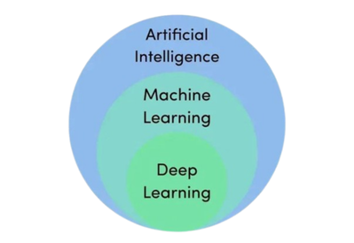

### Machine Learning
Machine Learning is a subset of AI that focuses on making machines or algorithms "learn" patterns from training data and use them to make predictions or decisions. This "training" enables machine learning models to make decisions or predictions without explicit, hard-coded instructions. The core idea behind machine learning is that if you optimize a model's performance on a dataset of tasks that resemble the real-world problems it will be used for, through a process called model training, the model can make accurate predictions on the new data it is used for.

Examples:
* Taobao Recommendations: Recommendation systems analyze, user behavior, inputs like browsing history, and other interactions to suggest products users might be interested in.
* Spam Detection: Machine learning models learn patterns from examples of spam and legitimate emails to filter incoming messages.

Main types of machine learning algorithms:  
**Supervised Learning**  
Supervised Learning is when a model is trained on "Labelled Datasets" or in simpler terms, datasets that are categorized. The raw data that these algorithms use already have a predetermined label attached to them. For example, a model trained on labeled images of cats and dogs can learn patterns that help it classify a previously unknown image.

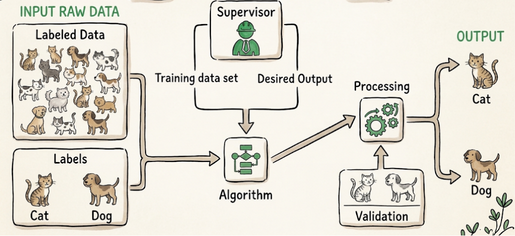

Supervised learning has two main categories:
* **Classification**, predicts categorical outputs, meaning it assigns data into predefined classes like spam/non-spam emails or disease risk categories. These algorithms learn to map input features to discrete labels. 
* **Regression**, predicts continuous values, such as house prices or product sales. It learns the relationship between input features and a numerical target variable.

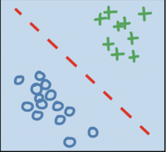 

When illustrated, supervised learning uses labeled examples to adjust the classification boundary to separate classes so that new, unseen inputs can be classified based on which side of the line they fall on.

**Unsupervised Learning**  
Unsupervised learning is when a model is trained on unlabelled data. The algorithm has to find any hidden patterns, groups or relationships within the data on its own. It's mainly used for clustering, dimensionality reduction and data visualization. For example, a model analyzing customer purchasing behavior may identify groups of customers with similar shopping habits without being given predetermined customer categories.

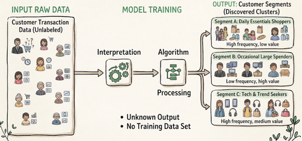

Unsupervised learning has three main categories :
* **Clustering**, groups data points into clusters based on their similarity. This technique is useful for identifying patterns and relationships in data without the need for labeled examples.
* **Dimensionality Reduction Techniques**, reduces the number of features while preserving important information.
* **Association Rule Learning**, technique for discovering relationships between items in a dataset. It identifies rules that indicate the presence of one item implies the presence of another item with a specific probability.

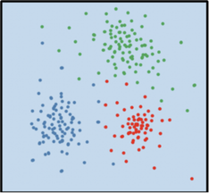

When illustrated, unsupervised learning groups the data into clusters. Rather than predicting a predefined label, it organizes data into coherent groups or clusters on its own based on similarity.   

**Reinforcement Learning**  
Reinforcement learning is when a model is trained to make a sequence of decisions through trial and error. The system or we call the agent, interacts with the environment, receives feedback in the form of rewards or penalties and learns optimal actions over time. For example, an AI agent learning to play chess gets positive feedback for good moves and negative for poor ones. Over time, it improves its strategies through repeated games.

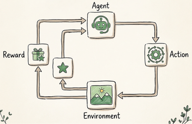 

Types of Reinforcement Learning :
* Positive Reinforcement, rewarding desired behavior (e.g., giving points for correct answers).
* Negative Reinforcement, removing negative outcomes to encourage good actions (e.g., turning off a buzzer after the right move).

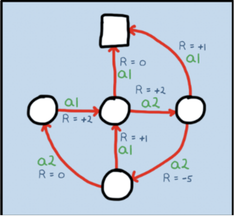

When illustrated, reinforcement learning uses the feedback from the environment that evaluates how desirable a transition or action is. Instead of learning from static labeled datasets, an agent learns by choosing favorable actions.

### Deep Learning
Deep learning is a subset of machine learning that builds multilayered neural networks, called deep neural networks, that more closely simulate the complex decision-making power of the human brain.

Neural networks consist of interconnected artificial neurons organized into layers. In a deep neural network, information passes through multiple layers, where mathematical transformations allow the model to learn increasingly complex patterns.

The deep learning process consists of three layers, the input layer receives data, the hidden layers transform the information, and the output layer generates a prediction or other result. Through training, the network adjusts itself to improve its performance.

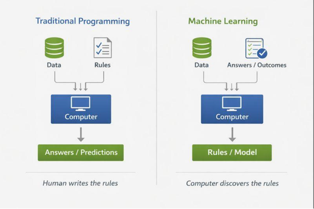

Deep learning is particularly useful for tasks involving complex or unstructured data, such as recognizing objects in images, understanding spoken language, translating text, and generating content.

Deep learning is closely related to Connectionist AI, an approach that explains how intelligent behavior can emerge from networks of interconnected processing units. This connection provides the foundation for understanding how deep learning systems learn and process information.

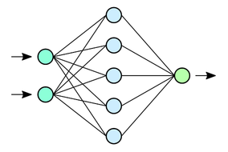

The main idea behind connectionist AI is that many simple processing units can work together to perform complex tasks. This approach is the foundation of neural networks and deep learning.

## What is Connectionist AI?
Connectionist AI is an approach to artificial intelligence that models human behavior through networks of interconnected artificial neurons or processing units we call nodes. Unlike traditional AI systems that follow predefined rules, connectionist AI learns by identifying patterns in examples. It does this by adjusting the strengths of connections between its nodes, called weights. These weights influence how information passes through the network and help the system improve its results over time.

### Symbolic vs Connectionist AI
Symbolic AI and Connectionist AI are two approaches to developing artificial intelligence. They differ mainly in how they represent information and solve problems. Symbolic AI uses rules and logical structures to solve problems based on the principle of warrantable knowledge. Connectionist, or neural network AI  is based on the structure of the human brain, processes data and adapts easily to new data as it relies on patterns. 

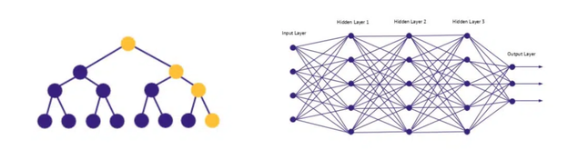

In the illustration, we see how connectionist AI (right) is formed by a network of nodes, while symbolic AI (left) is much simpler.

For example, when trying to recognize a cat using symbolic AI, hard-coded rules will be used to give categorisations or characteristics to a cat, like a cat has four legs, two ears, or other feline characteristics. If these conditions are fulfilled, the AI will recognise it as a cat. In contrast, connectionist AI can only recognize a cat once it has been trained sufficiently to distinguish what is a cat. It has to be trained on labeled cat and non-cat images, learning patterns in the data that help it distinguish cats from other objects. This is just one among the many differences between these two.

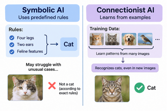

Both approaches have their strengths. Symbolic AI is useful for tasks that require clear rules and logical reasoning, while connectionist AI is effective at recognizing patterns in complex data, such as images and speech.

In present day, hybrid forms of these AI have been created, called Neuro-Symbolic AI. This combines neural networks with symbolic reasoning to tackle tasks like visual question answering, where understanding complex scenes and answering questions requires both pattern recognition and logical reasoning.

To get a clearer understanding of the differences, we can refer to tthe table below.

| **Aspect** | **Symbolic AI** | **Connectionist AI** |
| :--- | :--- | :--- |
| Knowledge Representation | Uses explicit symbols and rules | Uses connections and weights in networks |
| Transparency | High, interpretable and traceable | Low, hard to interpret |
| Reasoning Ability | Excels in logical reasoning and problem-solving | Excels in pattern recognition and prediction |
| Scalability | Struggles with large, complex datasets | Scales well with large datasets |
| Flexibility | Less flexible and adaptable | Highly adaptable through training |
| Resource Requirements | Less resource-intensive | Requires significant computational resources |
| Risk of Overfitting | Lower risk | Higher risk |

>Overfitting = Cases when an AI model fits training data too closely, instead of learning the underlying patterns behind the data.

References:
- https://www.ibm.com/think/topics/artificial-intelligence
- https://www.geeksforgeeks.org/machine-learning/types-of-machine-learning/
- https://www.geeksforgeeks.org/deep-learning/introduction-deep-learning/
- https://www.geeksforgeeks.org/deep-learning/neural-networks-a-beginners-guide/
- https://www.geeksforgeeks.org/artificial-intelligence/difference-between-symbolic-and-connectionist-ai/

