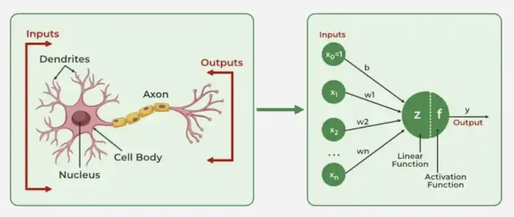

# 3.2 The Artificial Neuron

## What is Artifical Neuron?
Artificial neurons serve as the fundamental building blocks of connectionist AI. When linked together, they form Artificial Neural Networks (ANNs) that are the foundation of modern deep learning. Structurally, an ANN consists of these interconnected neurons organized into distinct layers. Each neuron receives inputs, combines them using weights and a bias, and applies an activation function to produce an output.

The idea behind neural networks themselves comes from human biology and is inspired by the brain. This structure can be compared to biological neurons, with dendrites receiving signals as inputs, the cell body processing them, and the axon transmitting signals to other neurons. Similarly, artificial neurons receive inputs, process them, and pass their outputs to other neurons. However, artificial neural networks are only simplified mathematical models and do not reproduce the full complexity of biological neurons.

## How does It Work?
We can think of an artificial neuron as a small decision-maker. It receives information, processes it, and produces an output. For example, when identifying an image, a neuron might respond more strongly to certain patterns in the image.

Each neuron receives inputs, such as numbers or pixel values, from the input data or other neurons. Each input has a weight, which determines how strongly it influences the neuron's result. The neuron combines these weighted inputs with a value called a bias, then applies an activation function to determine its output.

When this concept is translated into a mathematical model it becomes:

$$z = \sum_{i=1}^{n} w_i x_i + b \quad \text{and} \quad a = \sigma(z)$$

Where:  
$x_i$ = input values,  
$w_i$ = weights of each input,  
$b$ = bias,  
$z$ = weighted sum,  
$\sigma$ or $f$ = activation function,  
$a$ or $y$ = output,  

In simpler terms, this basically means the neuron calculates the weighted sum before activation by multiplying each input with their weights and adds them together. Then a bias is added and the value is passed through the activation function.

## Example
Imagine we are supposed to calculate weighted sum and the output. We are given:
* $x_1$ = 0.8
* $x_2$ = 0.5
* $w_1$ = 2.0
* $w_2$ = -1.0
* $b$ = -0.5

Calculating weighted sum:
| Step | Result |
| :--- | :--- |
| 1 | $z = (w_1 x_1 + w_2 x_2) + b$ |
| 2 | $z = (2.0 \times 0.8) + (-1.0 \times 0.5) + (-0.5)$ |
| 3 | $z = 1.6-0.5-0.5$ |
| 4 | $z = 0.6$ |

Calculating output using ReLu:
| Step | Result |
| :--- | :--- |
| 1 | $f(z) = max(0,z)$ |
| 2 | $f(0.6) = max(0,0.6)$ |
| 3 | $y = 0.6$ |

Using the ReLu (Rectified Linear Unit) function as the activation function, we get that the final output is 0.6. The ReLu function outputs zero for negative inputs and retains positive inputs. We will learn more about these concepts in the next chapter.

References:
- https://www.ibm.com/think/topics/artificial-intelligence
- https://www.geeksforgeeks.org/machine-learning/types-of-machine-learning/
- https://www.geeksforgeeks.org/deep-learning/introduction-deep-learning/
- https://www.geeksforgeeks.org/deep-learning/neural-networks-a-beginners-guide/
- https://www.geeksforgeeks.org/artificial-intelligence/difference-between-symbolic-and-connectionist-ai/
- https://towardsdatascience.com/explain-like-im-five-artificial-neurons-b7c475b56189/
