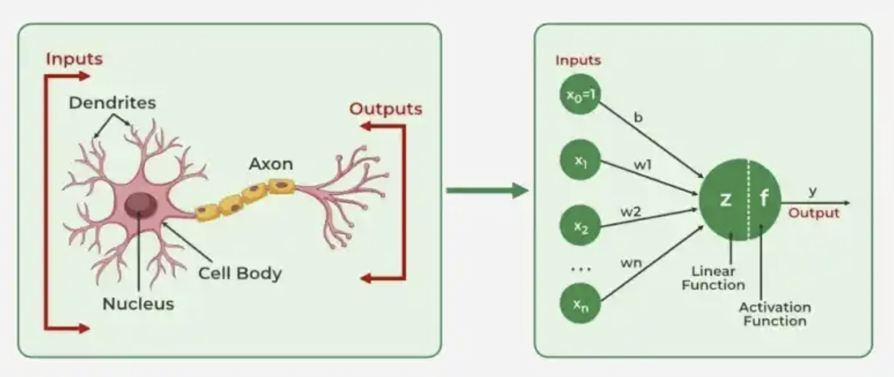
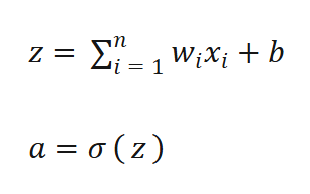

# Artificial Neural Network (ANN)
Artificial Neural Networks (ANNs) are the fundamental building blocks of deep learning systems and connectionist AI. It consists of interconnected artificial neurons organized into layers. Each neuron receives inputs, combines them using weights and a bias, and applies an activation function to produce an output.

The idea behind neural networks themselves comes from human biology and is inspired by the brain. This structure can be compared to biological neurons, with dendrites receiving signals as inputs, the cell body processing them, and the axon transmitting signals to other neurons. Similarly, artificial neurons receive inputs, process them, and pass their outputs to other neurons. However, artificial neural networks are only simplified mathematical models and do not reproduce the full complexity of biological neurons.

## How does an Artificial Neuron Work?
We can think of an artificial neuron as a small decision-maker. It receives information, processes it, and produces an output. For example, when identifying an image, a neuron might respond more strongly to certain patterns in the image.

Each neuron receives inputs, such as numbers or pixel values, from the input data or other neurons. Each input has a **weight**, which determines how strongly it influences the neuron's result. The neuron combines these weighted inputs with a value called a **bias**, then applies an **activation function** to determine its output.

When this concept is translated into a mathematical model it becomes:

Where:
$x_i$ = input values,
$w_i$ = weights of each input,
$b$ = bias,
$z$ = weighted sum,
$\sigma$ or $f$ = activation function,
$a$ or $y$ = output,

In simpler terms, this basically means the neuron calculates the weighted sum before activation by multiplying each input with their weights and adds them together. Then a bias is added and the value is passed through the activation function.

### Worked Example
- Imagine we are supposed to calculate weighted sum and the output. We are given:
    - $x_1$ = 0.8
    - $x_2$ = 0.5
    - $w_1$ = 2.0
    - $w_2$ = -1.0
    - $b$ = -0.5

Calculating weighted sum:
|Step|Result|
|---|---|
|1|$z = (w_1 x_1 + w_2 x_2) + b$|
|2|$z = (2.0 \times 0.8) + (-1.0 \times 0.5) + (-0.5)$|
|3|$z = 1.6-0.5-0.5$|
|4|$z = 0.6$|

Calculating output using ReLu:
|Step|Result|
|---|---|
|1|$f(z) = max(0,z)$|
|2|$f(0.6) = max(0,0.6)$|
|3|$y = 0.6$|

Using the ReLu (Rectified Linear Unit) function as the activation function, we get that the final output is 0.6. The ReLu function outputs zero for negative inputs and retains positive inputs. This creates a non-linear relationship, allowing layers to represent more complex patterns when combined or in other words it makes the relationship less predictable since it cannot simply be represented by a straight line. We will learn more about these concepts in the next chapter.

Neurons are organized into layers, each with a different role:
- Input Layer: Receives the original data, such as the pixel values of an image.
- Hidden Layers: Process the information and learn patterns, such as edges, shapes, or other features in an image.
- Output Layer: Produces the final result, such as predicting whether an image contains a cat or a dog.

Information passes from one layer to the next, with each layer transforming the information it receives. You can think of this process as gradually assembling puzzle pieces. Early layers may identify simple patterns, while later layers combine them into more complex features. Through training, the network adjusts its weights and biases to improve its predictions.

References:
- https://www.ibm.com/think/topics/artificial-intelligence
- https://www.geeksforgeeks.org/machine-learning/types-of-machine-learning/
- https://www.geeksforgeeks.org/deep-learning/introduction-deep-learning/
- https://www.geeksforgeeks.org/deep-learning/neural-networks-a-beginners-guide/
- https://www.geeksforgeeks.org/artificial-intelligence/difference-between-symbolic-and-connectionist-ai/
- https://towardsdatascience.com/explain-like-im-five-artificial-neurons-b7c475b56189/
