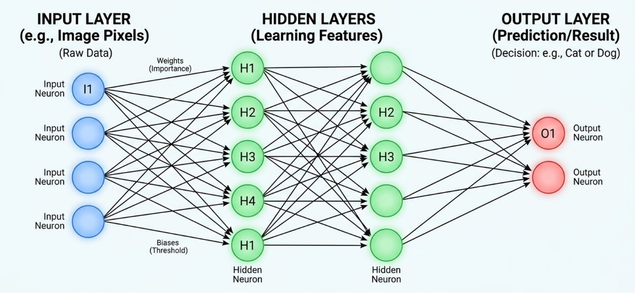

# 3.3 Neural Network Architecture
A neural network takes input data and passes it through layers of connected nodes to make a prediction.

Neurons are organized into layers, each with a different role:
* **Input Layer:** Receives the original data.
* **Hidden Layers:** Process the information and learn patterns.
* **Output Layer:** Produces the final result.

Information passes from one layer to the next, with each layer transforming the information it receives. You can think of this process as gradually assembling puzzle pieces. Early layers may identify simple patterns, while later layers combine them into more complex features. Through training, the network adjusts its weights and biases to improve its predictions.

## Input Layer
The input layer is where data enters the network. It receives raw feature values from a dataset. For example, to predict house prices using three features: House size in square feet Number of bedrooms Age of the house in years

## Hidden Layer
Hidden layers sit between the input and output layers. They perform math steps to find patterns between features. Instead of looking at size and age separately, a hidden node can combine them to measure something deeper, like overall wear and tear or space efficiency, before making a final prediction.

## Output Layer
The output layer gives the final calculated result. The type of result depends on the task: Regression Tasks: Predicts a continuous number (estimating a house price of $250,000). Classification Tasks: Predicts a category probability (a 90% chance of being a cat and a 10% chance of being a dog).

The following is a simple illustration on neural network architecture can be visualised.

In this example, the input layer receives the data of the image pixels. The hidden layer then processes the information to learn the patterns from the data. This can include learning patterns of cat or dog features, such as having two ears, their teeth, and other characteristics. Finally, the output layer predicts that based on the input data, the result is a cat or a dog.

Other Components of the Neural Network:

## Weights and Bias
**Weights** are a number that multiplies an input to show its importance. A higher weight gives an input a bigger impact on the final answer. 

**Bias** is an extra value added to the calculation that helps shift the output so the network can fit the data better. 

Imagine deciding whether to buy a jacket. Weights represent how much importance you give to each factor. For instance, cold weather gets a high weight (very important), while matching your shoes gets a low weight. Bias is your baseline tendency, if you get cold easily, you have a high positive bias, making you much more inclined to buy the jacket regardless of other factors.

## Activation Functions
**Activation function** are like decision-makers sitting inside a neuron. After the network multiplies the inputs by the weights and adds the bias, the activation function decides whether that neuron should "fire" (pass the message forward) and how strong that signal should be. This matters because without activation functions, a neural network could only do basic straight-line math, no matter how many layers it has. Activation functions add non-linearity (curves and bends) to the math, allowing the network to learn complex patterns like recognizing a face, understanding human speech, or driving a car. 

Think of it like a light switch with a dimmer: If the incoming signal is too weak, the switch stays completely off (output is 0). If the signal passes a certain threshold, the switch turns on, and the activation function decides how bright the light should shine. Common examples include ReLU (which simply blocks negative signals and lets positive ones pass through) and Sigmoid (which squashes values between 0 and 1, often used for yes/no probabilities).

Two common activation Functions:
* **ReLU** is like a thermometer that can't read below freezing. If the temperature drops below 0, it just says 0. If it's warmer than 0, it shows the actual number (like 5, 15, or 30). the function returns zero when the input is negative and returns the input itself when it is positive.
$$ReLU(z) = max(0,z)$$

* **Sigmoid** is like a sliding scale from 0 to 1 (or 0% to 100%). It is used for yes/no questions, like "Is this a picture of a cat?". It takes any score and turns it into a clear probability—like 0.9 (90% sure it's a cat) or 0.1 (10% sure it's a cat). The sigmoid function converts any real-valued input into a value strictly between 0 and 1.
$$\sigma(z) = \frac{1}{1 + e^{-z}}$$