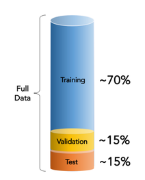
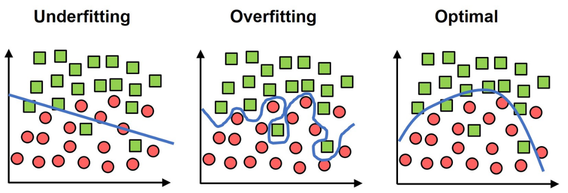
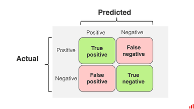
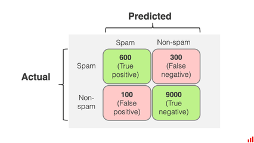

# 3.5 Evaluating Learning
After training, you want test how well the network works on new, unseen data. This ensures the model is truly correct and learns actual patterns from the data. This whole process prevents the model from accidentally picking up too many worthless patterns and matching too closely with the training data (overfitting).

## Dataset Splitting
To keep testing honest, the dataset is split into three separate parts: 
* **Training Set (~70%):** Used directly to train weights and biases.
* **Validation Set (~15%):** Used during training to tweak settings and prevent the model from memorizing.
* **Test Set (~15%):** Saved for the very end to check real-world accuracy.

These are used together to make sure the model is trained for all cases of its usage.

## Common Training Mistakes
While training, there are two very common mistakes that happen, if testing is not done properly.
* **Overfitting:** The model gets high accuracy on training data, but low accuracy on test data because it memorized noise instead of learning main trends.
* **Underfitting:** The model gets poor accuracy on both training and test data because it is too simple to learn anything useful.

The goal is to find a balance where the model learns the important patterns without simply memorizing its training examples.

Based on the diagrams, we can see what happens in each outcome. An underfitted model fails to learn enough patterns, while an overfitted model learns the training data too closely and struggles with unseen examples. A well-fitted model finds a balance between the two.

## Classification Metrics
When a neural network predicts categories, such as identifying whether an email is spam or not, we need ways to measure how well its predictions match the actual answers.

 

A confusion matrix organizes a model's predictions by comparing them with the actual answers. It shows four possible outcomes: true positives, true negatives, false positives, and false negatives. These values are used to calculate the four common metrics for classification, accuracy, precision, recall, and the F1-score. But what do these mean?
* **Accuracy:** The percentage of total correct predictions.
* **Precision:** Out of all positive predictions, how many were actually correct.
* **Recall:** Out of all real positive items, how many did the model find.
* **F1-Score:** The balance between precision and recall, best used when data classes are uneven (detecting rare fraud cases).

For example, when detecting fraudulent transactions, recall helps measure how many actual fraud cases the model catches, while precision measures how many transactions flagged as fraud really are fraudulent. The F1-score combines both measures into one score.

How do we calculate these:

$$\text{Accuracy} = \frac{\sum \text{TP} + \sum \text{TN}}{\sum \text{total population}}$$

$$\text{Precision} = \frac{\sum \text{TP}}{\sum \text{prediction positive}}$$

$$\text{Recall (Sensitivity)} = \frac{\sum \text{TP}}{\sum \text{condition positive}}$$

$$\text{F}_1 \text{ Score} = \frac{2}{\frac{1}{\text{Recall}} + \frac{1}{\text{Precision}}}$$

## Example
We are given the confusion matrix as below.

We have to calculate the four commin classification metrics:
* Accuracy
* Precision
* Recall
* F1-Score

| Metric | Result |
| :--- | :--- |
| Accuracy | 0.96 (96%) |
| Precision | 0.8571 (85.71%) |
| Recall | 0.6667 (66.67%) |
| F1-Score | 0.75 (75%) |