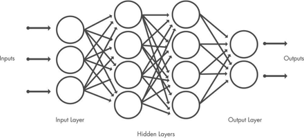
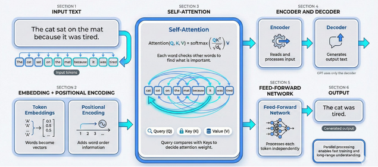
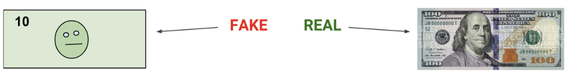
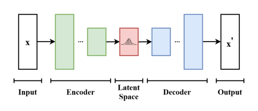
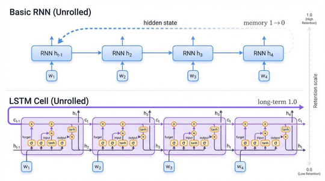
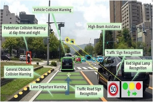

# 3.6 Major Neural Network Types
Connectionist AI relies on Artificial Neural Networks (ANNs), which model cognition using layers of interconnected rocessing units (artificial neurons) that adjust weighted connections through data. Within these, there are also many different types of the neural networks.

## Feed Forward Networks (FNNs)
Think of a feedforward network as an assembly line. Information enters through the input layer, passes through one or more hidden layers, and reaches the output layer. Unlike networks with recurrent connections, information does not loop backward or revisit earlier layers during this process. Information travels in one direction, from the input layer through the hidden layers to the output layer. Each layer processes the information before passing it to the next.

Feedforward Neural Network are best for: Simple tasks like identifying if an email is spam or predicting a price based on a spreadsheet of basic data.

## Convolutional Neural Networks (CNNs)
Convolutional Neural Networks is like scanning a picture with a magnifying glass. CNNs are designed specifically to look at grids of data, like images by scanning small chunks of the image piece by piece. It looks for basic edges and shapes first, then pieces them together.

Convulutional Neural Networks are best for: Facial recognition, identifying diseases in medical x-ray, and computer vision for self driving cars.

## Recurrent Neural Networks (RNNs)
Recurrent Neural Networks is like reading a book and remembering the last sentence you read. Standard networks forget everything they just did the moment they started a new job ask. RNN solves this problem problem by using a built in "memory" loop that lets them remember previous inputs, so they can understand context in a sequence of data over time. Recurrent Neural Networks are best for: Speech recognition (like alexa, siri, or google), translating sentences between languages, and predicting the weather.

## Transformers
Think of a transformer as reading an entire paragraph while paying attention to how different words relate to one another. Transformers use a mechanism called attention to determine which parts of the input are most relevant when processing each part of a sequence.

Unlike traditional RNNs, Transformers can process many parts of an input sequence in parallel during training. This makes them effective at handling large amounts of language data and learning relationships between words, even when they are far apart.

  

Transformers are the foundation of many modern language models, including ChatGPT and Gemini, and are also used in image processing and other AI applications.

Attention allows the network to consider relationships between different parts of the input. For example, when processing a sentence, it can focus on words that provide important context for understanding another word.

## Generative Adversarial Networks (GANs)
Think of a GAN as an art forger competing against a detective. A GAN consists of two neural networks working against each other:
* **Generator:** Creates artificial data, such as realistic-looking images. 
* **Discriminator:** Tries to determine whether the data is real or generated by the other network.

The generator tries to create increasingly convincing results, while the discriminator improves at spotting generated data. Through this, both networks improve, allowing the generator to produce increasingly realistic outputs. This network is used to generate realistic images, create video game assets, and improve the quality or resolution of images.

When training begins, the generator produces obviously fake data, and the discriminator quickly learns to tell that it's fake:

$$\Downarrow$$

As training progresses, the generator gets closer to producing output that can fool the discriminator:

$$\Downarrow$$

Finally, if generator training goes well, the discriminator gets worse at telling the difference between real and fake. It starts to classify fake data as real, and its accuracy decreases.

The whole system can be illustrated as below.

## Autoencoders
Think of an autoencoder as packing and unpacking a suitcase. It first compresses information into a smaller representation, keeping the features needed to reconstruct the original data. It then uses that compressed representation to rebuild the input as closely as possible. An autoencoder has two main parts:
* **Encoder:** Compresses the input into a smaller representation.
* **Decoder:** Uses that representation to reconstruct the original input.

The encoder reduces the input into a compressed representation, while the decoder attempts to reconstruct the original data from it.

Autoencoders are useful for tasks such as reducing noise in images or audio, compressing data, and detecting unusual patterns that may indicate fraud or equipment problems.

## Long Short-Term Memory Networks (LSTMs)
Long Short-Term Memory networks are a specialized type of RNN designed to remember important information over longer sequences. They use internal mechanisms called gates to control what information should be kept, updated, or forgotten. This helps address the difficulty standard RNNs can have when trying to learn relationships between inputs that are far apart in a sequence. When an RNN passes information from one step to the next, allowing earlier inputs to influence later outputs. LSTMs extend this approach with gates that help control which information is retained or forgotten over longer sequences.

Long Short-Term Memory Network are best for: Complex language translation, generating text, and analyzing time sensitive data like stock market trends.

## Self-Organizing Maps (SOMs)
Think of a Self-Organizing Map as sorting a messy pile of items into groups based on their similarities. SOMs are a type of unsupervised neural network, meaning they can learn from data without being given labeled answers. They organize similar data points close to one another on a usually two-dimensional map. This makes it easier to explore patterns and relationships in large datasets.

One of the examples where SOMs can be used can be seen above, where it classifies world poverty that maps countries based on 39 "quality-of-life factors" including health, nutrition, education, etc.

Besides that, SOMs can also be used for customer segmentation, identifying patterns in weather data, and visualizing complex datasets.

## Spiking Neural Networks (SNNs)
Think of a Spiking Neural Network as communicating through flashes of light. Instead of continuously passing numerical signals like many traditional neural networks, SNNs communicate using brief electrical-like signals called spikes. A neuron sends a spike when its internal activity reaches a certain threshold. This approach is inspired by how biological neurons communicate and can be useful in systems that need to process information efficiently over time.

SNNs are being explored for low-power AI hardware, robotics, and brain-computer interface research.

## Modular Neural Networks
Think of a Modular Neural Network as a company with different specialized departments. Instead of relying on one large network to handle everything, a modular network divides a task among smaller networks, each responsible for a particular part of the problem. Their outputs are then combined to produce a final result.

For example, a self-driving car system could use separate modules to detect pedestrians, recognize traffic signs, and estimate the vehicle's position. Combining their outputs helps the system make decisions.

