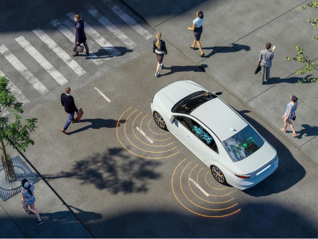

# 3.7 Practical Implementation
Connectionist AI is used in many technologies we interact with every day. Instead of relying only on fixed, pre-programmed rules, neural networks learn patterns from data and use what they have learned to make predictions, recognize information, or generate responses. Here are some examples of how connectionist AI is applied in different fields.

## Computer vision & image processing
Computer vision allows computers to interpret and understand visual information, such as images and videos. Convolutional Neural Networks (CNNs) are commonly used for this because they can identify visual patterns and features.

For examples:
* **Self-Driving Cars:** Neural Networks processes the live video feed from the car's camera to make split second driving decisions. Like when there's a pedestrian crossing the roads, the car's camera "see" there's someone/something infront of the cars so its makes a split-second decision to stop the car smoothly.
* **Facial Recognition & Photo Apps:** Usually we unlock our phones using face ID, because its more convenient then inputting your password everytime you want to unlock your phones, or when a photo app automatically groups a pictures of you god together. Those activity are made possible with Connectionist AI by identifying the unique visual patterns of a face or an object.
* **Medical Imaging:** Connectionist AI are also very usefull in healthcare. Neural networks are trained on thousands of x-ray and MRI scans. They can now analyze new scans to spot early signs of diseases or tumors much faster than human doctors.

<table align="center" border="0" cellspacing="12">
  <tr>
    <td></td>
    <td></td>
    <td></td>
  </tr>
</table>

## Natural Language Processing (NLP) & Speech
Natural Language Processing allows computers to work with human language, including spoken words and written text. Neural networks help recognize speech, interpret context, translate languages, and generate responses.

For examples:
* **Digital Assistants:** When you speak to Siri, Alexa, and other voice assistants, neural networks are doing 2 different things: first, they transcribe your spoken audio into text, and second, they figure out what you actually mean so they can respond accurately.
* **Live Translation:** When you point your smartphone at a menu trying to translate the content into your native language to make it easier to understand, google translate changes the text in real time. What you're seeing are neural networks processes both image and the language simultaneously.
* **Large Language Models (LLMs):** Chat GPT, Gemini, and other similiar LLMs uses transformers networks to understand the contect of entire paragraphs at once, allowing them to write essays, answer questions, write computer codes, etc.

  
  
  

## Predictive Analytics & Recommendation Engines
Neural networks can analyze large amounts of historical data to identify patterns and make predictions. This is useful when systems need to estimate what a user might prefer or identify unusual activity.

For example:
* **Content Recommendations:** Netflix, Youtube, Spotify and other similars apps uses neural networks to analyze your past viewing or listening habits, like what you like to watch or listen. Then, compare them to millions of other users, and accurately predict what movie or music you'll like.
* **Fraud Detection:** Banks and credit card companies uses neural networks like Autoencoders to monitor your spending habits. If your cards is suddenly used to buy expensive items in another country, the network will recognize that this patter doesnt match your usual spending habit and will immediately flags the transaction as fraud.
* **Stock Market & Finance:** Financial institution uses complex networks like LSTMs to analyze years of stock market trends, news headlines, and economic data to predict whether a stock's price will go up or down.

<table align="center" border="0" cellspacing="12">
  <tr>
    <td></td>
    <td></td>
    <td></td>
  </tr>
</table>